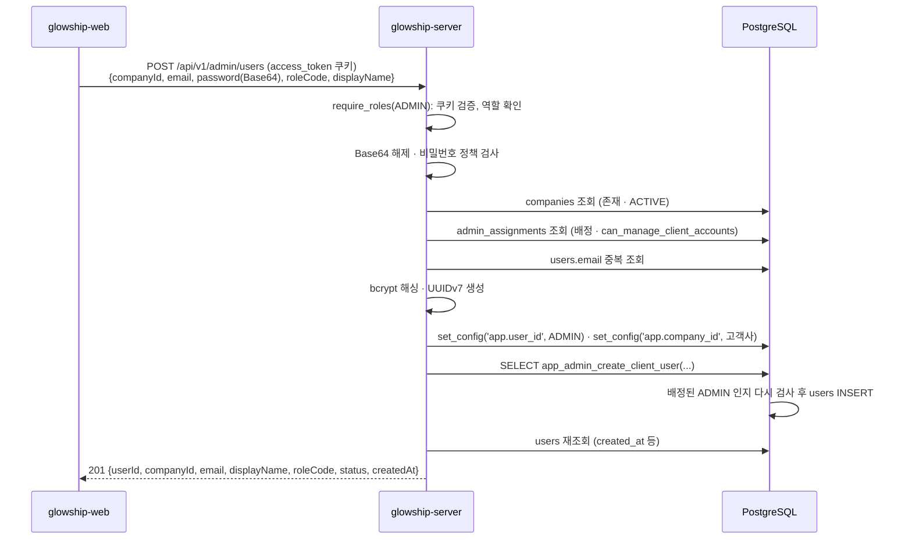

# 고객사 계정 생성 (Admin)

Glowship 내부 관리자(ADMIN)가 담당 고객사에 Client 계정을 만드는 API가 **현재 어떻게 동작하는지** 설명합니다.
계정 수정·비활성화와 OWNER의 계정 생성은 아직 구현되지 않았으며, 이 문서는 그 자리를 어떻게 비워 두었는지까지만 다룹니다(7절).

고객사 계정은 공개 회원가입으로 만들지 않습니다(API 명세 D5). 내부 관리자가 이 API로 만들고, 초기 비밀번호는 관리자가 정해 고객사 직원에게 따로 전달합니다.

## 1. 전체 흐름



- 권한 검사는 **두 번** 일어납니다. 서버(서비스)가 먼저 검사해 구분된 오류 코드를 주고, DB 함수가 같은 규칙으로 다시 검사해 최종 강제합니다(4절).
- 다른 API와 달리 고객사 범위를 토큰이 아니라 요청 본문(`companyId`)으로 받습니다. ADMIN은 소속 고객사가 없기 때문이며, 내부 관리자 API만의 예외입니다.

## 2. 계정 생성 API

`POST /api/v1/admin/users` — `app/modules/user/presentation/client_account_api_router.py`

### 권한

`access_token` 쿠키의 역할이 `ADMIN`이어야 합니다(`require_roles(UserRoleCode.ADMIN)`). 그리고 요청한 ADMIN이 대상 고객사에 `admin_assignments`로 배정되어 있고 `can_manage_client_accounts`가 참이어야 합니다(3절).

### 요청

```json
{
  "companyId": "0199c2a8-7d4e-7b3c-9f1a-2e5d6c7b8a90",
  "email": "lead@client.com",
  "password": "cGFzc3dvcmQxMjM=",
  "roleCode": "CLIENT_LEAD",
  "displayName": "홍길동"
}
```

| 필드 | 필수 | 규칙 |
| --- | --- | --- |
| `companyId` | ✓ | 계정을 만들 고객사 UUID |
| `email` | ✓ | 50자 이하, 이메일 패턴. 공백 불허(422). 소문자로 정규화. 로그인 요청과 같은 규칙 |
| `password` | ✓ | 프론트가 `btoa()`로 Base64 인코딩한 초기 비밀번호. 디코딩 결과는 영문·숫자 6~16자(회원가입과 같은 정책) |
| `roleCode` | ✓ | `CLIENT_MEMBER` 또는 `CLIENT_LEAD`. `OWNER`·`ADMIN`은 스키마 단계에서 422 |
| `displayName` | – | 1~30자. 생략하면 이메일을 사용 |

JSON 필드는 camelCase 입니다(5절).

### 성공 응답

```http
HTTP/1.1 201 Created
```

```json
{
  "userId": "01a18a64-97e5-77ce-b6d1-6bd3dbf58d48",
  "companyId": "0199c2a8-7d4e-7b3c-9f1a-2e5d6c7b8a90",
  "email": "lead@client.com",
  "displayName": "홍길동",
  "roleCode": "CLIENT_LEAD",
  "status": "ACTIVE",
  "createdAt": "2026-10-30T01:20:10.531273Z"
}
```

생성된 계정은 항상 `ACTIVE`입니다. 비밀번호 관련 값은 응답에 넣지 않습니다.

### 실패 응답

모든 실패는 공통 에러 형식 `{"code", "message", "request_id"}`로 응답합니다.

| 상태 | code | 상황 |
| --- | --- | --- |
| 400 | `INVALID_PASSWORD_FORMAT` | `password`가 Base64가 아니거나 정책(영문·숫자 6~16자) 위반 |
| 401 | `UNAUTHENTICATED` | 쿠키 없음·만료·위조 |
| 403 | `FORBIDDEN` | 역할이 ADMIN이 아님, 대상 고객사에 배정되지 않음, `can_manage_client_accounts`가 거짓 |
| 403 | `INVALID_ORIGIN` | 허용되지 않은 `Origin`의 요청(출처 검사, `docs/auth/login.md` 3-1절) |
| 404 | `COMPANY_NOT_FOUND` | `companyId`에 해당하는 고객사 없음 |
| 409 | `COMPANY_INACTIVE` | 고객사 `status`가 `INACTIVE` |
| 409 | `EMAIL_DUPLICATED` | 이미 있는 이메일 |
| 422 | `VALIDATION_ERROR` | 필수 필드 누락, 이메일 패턴 불일치, Client 역할이 아닌 `roleCode` |

### 서비스 로직 (`ClientAccountService.create_client_user`)

```
Base64 해제 → 비밀번호 정책 → companies 조회(404 · 409) → admin_assignments 조회(403) → email 중복(409)
→ bcrypt 해싱 · uuid7 → Repository.create_client_user (RLS 컨텍스트 + DB 함수) → 생성 사용자 반환
```

- DB에 접근하지 않는 검사(비밀번호)를 먼저 수행합니다. 회원가입과 같은 원칙입니다.
- DB 오류 변환: 유니크 위반(`IntegrityError`) → `EMAIL_DUPLICATED`, DB 함수의 권한 오류(SQLSTATE `42501`) → `FORBIDDEN`. 그 밖의 DB 오류는 그대로 전파되어 500이 됩니다.
- RLS가 적용되는 운영 환경에서는 다른 고객사의 사용자가 조회되지 않아 이메일 중복 사전 검사를 통과할 수 있습니다. 그 경우 INSERT의 유니크 위반이 같은 `EMAIL_DUPLICATED`로 응답하므로 결과는 같습니다.

## 3. 권한 규칙

| 요청자 | 결과 |
| --- | --- |
| ADMIN, 대상 고객사에 배정, `can_manage_client_accounts = true`, 고객사 ACTIVE | 생성 가능 |
| ADMIN, 배정은 있으나 `can_manage_client_accounts = false` | 403 `FORBIDDEN` |
| ADMIN, 대상 고객사에 배정 없음 | 403 `FORBIDDEN` |
| OWNER | 403 `FORBIDDEN` (7절) |
| CLIENT_MEMBER · CLIENT_LEAD | 403 `FORBIDDEN` |

- 배정은 `admin_assignments(admin_user_id, company_id)`로 조회하며, 유니크 제약(`admin_assignments_uk2`)으로 최대 1건입니다.
- 생성할 수 있는 역할은 `CLIENT_MEMBER`·`CLIENT_LEAD`뿐입니다. `users` 테이블의 CHECK 제약(`users_ck2`)이 Client 역할에만 `company_id`를 허용하고, DB 함수도 같은 범위만 받습니다.
- `require_roles`는 토큰의 역할만 보고 DB를 조회하지 않습니다. 요청한 ADMIN 계정이 비활성화되었더라도 토큰이 만료될 때까지 1차 검사는 통과하지만, DB 함수가 `users.status = 'ACTIVE'`를 다시 확인해 거절합니다.

## 4. DB 함수와 RLS 컨텍스트

초기 마이그레이션(`migrations/versions/0001_*.py`의 `_create_rls()`)이 다음을 만들어 둡니다.

| 항목 | 내용 |
| --- | --- |
| 앱 DB 역할 권한 | `users`는 SELECT와 `display_name` UPDATE만 가능. **INSERT 권한 없음** |
| `app_admin_context_ok()` | `app.user_id`가 ACTIVE ADMIN이고, `app.company_id`에 배정되어 있으며 `can_manage_client_accounts`가 참이고, 고객사가 ACTIVE인지 검사 |
| `app_admin_create_client_user(user_id, email, password_hash, display_name, role_code)` | 위 검사를 통과하면 `users`에 INSERT (SECURITY DEFINER). 역할은 Client 역할만, 해시는 bcrypt 형식만 허용 |

따라서 고객사 계정 생성은 ORM INSERT가 아니라 이 함수를 호출합니다(`UserRepository.create_client_user`).

### 컨텍스트 설정

함수는 인자가 아니라 세션 설정값에서 요청자와 고객사를 읽으므로, 같은 트랜잭션 안에서 먼저 설정해야 합니다.

```python
# app/core/rls_context.py
await set_rls_context(db, user_id=actor.user_id, company_id=company_id)
# → SELECT set_config('app.user_id', '<uuid>', true), set_config('app.company_id', '<uuid>', true)
```

- `set_config(..., true)`는 `SET LOCAL`과 같이 **현재 트랜잭션에서만** 유효합니다. 요청 단위 세션(`get_db`)이 commit/rollback 되면 사라지며, 커넥션 풀을 통해 다른 요청으로 새지 않습니다.
- 같은 값을 고객사 범위 테이블 23개의 RLS 정책도 읽습니다. 앞으로 주문·선적·재고 API를 만들 때 이 헬퍼를 요청마다 호출해야 운영 환경에서 데이터가 보입니다(7절).

### 로컬 환경

로컬은 superuser로 접속하므로 RLS 정책은 우회되고 ORM INSERT도 가능합니다. 하지만 SECURITY DEFINER 함수 안의 검사는 **그대로 실행**되므로, 로컬에서도 컨텍스트를 설정하고 함수를 불러야 합니다. 덕분에 로컬 확인이 운영과 같은 경로를 검증합니다.

- 합성데이터 v5에는 `admin_assignments` 행이 없습니다. Swagger로 확인하려면 배정 행(`can_manage_client_accounts = true`)을 로컬 DB에 직접 넣어야 합니다.

## 5. 요청·응답 스키마 (camelCase)

API 명세(D2)에 따라 JSON 필드는 camelCase입니다. `app/core/schemas.py`의 `CamelModel`을 상속하면 파이썬 필드는 snake_case로 두고 JSON만 camelCase로 주고받습니다.

```python
class ClientUserCreateRequest(CamelModel):
    company_id: uuid.UUID      # JSON: companyId
    display_name: str | None   # JSON: displayName
```

| 설정 | 효과 |
| --- | --- |
| `alias_generator=to_camel` | `company_id` → `companyId` 별칭 생성 |
| `validate_by_alias` / `validate_by_name` | 요청은 camelCase로 받고, 파이썬 코드에서는 snake_case로도 객체 생성 가능 |
| `serialize_by_alias` | 응답을 camelCase로 직렬화 |
| `from_attributes` | ORM 객체를 `model_validate(user)`로 바로 응답에 담음 |

기존 로그인 스키마와 오류 응답(`request_id`)은 아직 snake_case입니다. 전환은 공통 작업으로 별도 진행합니다.

## 6. 테스트

`tests/modules/user/` — DB 없이 실행됩니다.

| 파일 | 내용 |
| --- | --- |
| `test_client_account_service.py` | 가짜 Repository로 서비스 로직 검증. 성공, 표시 이름 기본값, 비밀번호 정책, 고객사 없음·비활성, 배정 없음·권한 없음, 이메일 중복, DB 오류 변환(23505 → 409, 42501 → 403, 그 외 전파). bcrypt는 `monkeypatch`로 대체 |
| `test_client_account_api.py` | 라우터 검증. 쿠키 없음 401, ADMIN 아님 403, `roleCode` 범위 밖 422, 필수 필드 누락 422, 성공 201과 camelCase 응답. 서비스는 `dependency_overrides`로 대체, 쿠키는 `create_access_token`으로 발급 |

DB 함수 경로는 로컬 DB에서 트랜잭션 안에 임시 고객사·ADMIN·배정을 만들어 호출한 뒤 롤백하는 방식으로 확인했습니다(자동화되어 있지 않음).

## 7. 아직 없는 것

| 기능 | 비워 둔 자리 |
| --- | --- |
| 계정 수정·비활성화 | DB 함수 `app_admin_update_client_user(user_id, role_code, status)`가 이미 있음. 같은 서비스에 메서드를 추가하고 `PATCH /api/v1/admin/users/{userId}` 등으로 노출 |
| OWNER의 계정 생성 | DB 함수가 `role_code = 'ADMIN'`과 배정 여부를 검사하므로 OWNER는 허용되지 않음. 열려면 함수를 바꾸는 마이그레이션 필요 |
| Admin 여러 고객사 배정 선택 | 명세 D7은 `X-Company-Id` 헤더를 예정. 이 API는 본문 `companyId`로 이미 고객사를 지정하므로 영향 없음 |
| Client API용 컨텍스트 의존성 | 토큰의 `company_id`로 `set_rls_context`를 자동 호출하는 FastAPI 의존성. 주문·선적 조회 API를 만들 때 추가 |
| 초기 비밀번호 변경 강제 | 비밀번호 재설정 API가 없으므로(명세 D19) 운영으로 보완 |

## 8. 관련 파일

| 파일 | 역할 |
| --- | --- |
| `app/modules/user/presentation/client_account_api_router.py` | `POST /api/v1/admin/users` 엔드포인트 |
| `app/modules/user/presentation/client_account_schemas.py` | 요청·응답 스키마 (camelCase) |
| `app/modules/user/application/client_account_service.py` | 검사 순서, DB 오류 변환 |
| `app/modules/user/infrastructure/repository/user_repository.py` | `create_client_user`(DB 함수 호출), `find_by_id` |
| `app/modules/user/dependencies.py` | `get_client_account_service` 조립 |
| `app/modules/company/infrastructure/repository/company_repository.py` | 고객사 조회 |
| `app/modules/company/infrastructure/repository/admin_assignment_repository.py` | ADMIN 배정 조회 |
| `app/modules/company/application/exception/company_exceptions.py` | `COMPANY_NOT_FOUND`, `COMPANY_INACTIVE` |
| `app/modules/company/infrastructure/company_enums.py` | `CompanyStatus` |
| `app/core/rls_context.py` | `set_rls_context` |
| `app/core/schemas.py` | `CamelModel` |
| `migrations/versions/0001_*.py` `_create_rls()` | 앱 역할 권한, `app_admin_context_ok`, `app_admin_create_client_user` |
