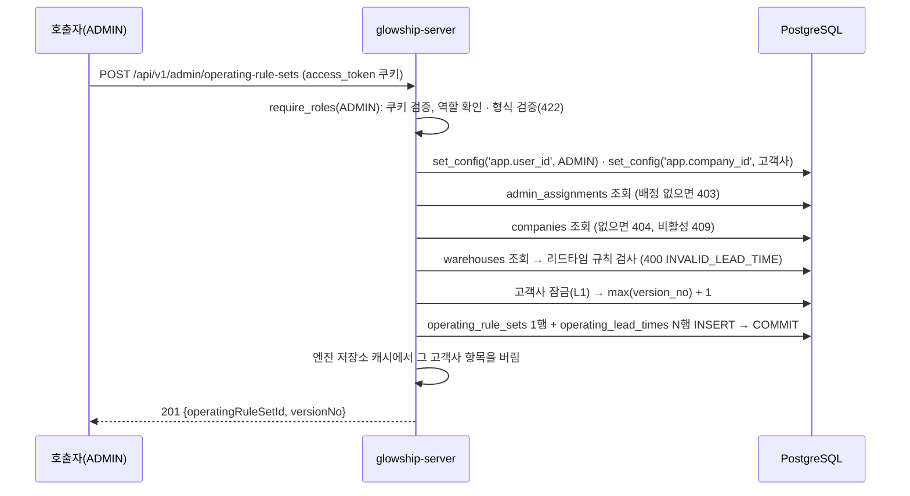

# 운영 기준 조회·새 버전 저장 (Admin)

Glowship 내부 관리자(ADMIN)가 담당 고객사의 운영 기준을 조회하고 새 버전으로 저장하는 API가 **현재 어떻게 동작하는지** 설명합니다(API 명세 v6.2 4.2절 API 4·5, FR-004, GLOW-153).
Admin용 화면은 아직 없습니다. 이 문서는 서버 API까지만 다룹니다(8절).

운영 기준은 고객사의 물류 조건입니다: 안전재고 일수, 판매 기준 일수, 부분 출고 허용 여부, 창고별 리드타임(고객 배송·항공 운송·입고 처리·출고 처리). 분석은 이 값으로 대응안의 실행 가능 여부와 회복 주문을 계산하고, 팀장의 최종 선택도 같은 값으로 시간을 다시 확인합니다.

## 1. 전체 흐름



- 기존 버전은 수정·삭제하지 않습니다. 저장은 항상 새 버전입니다.
- 분석과 최종 선택은 **적용 시작일(`effective_from`)이 지난 것 중 버전이 가장 큰 것**을 씁니다(분석 실행 생성, 재고 현황, 최종 선택 재확인이 같은 규칙). 그래서 적용 시작일이 미래인 버전은 저장해도 그날이 되기 전까지 쓰이지 않습니다.

## 2. 권한 (NFR-005)

| 요청자 | 결과 |
| --- | --- |
| 쿠키 없음·만료 | 401 `UNAUTHENTICATED` |
| Client 팀원·팀장, OWNER | 403 `FORBIDDEN` (`require_roles(ADMIN)`) |
| 그 고객사에 배정되지 않은 ADMIN | 403 `FORBIDDEN` |
| 그 고객사에 배정된 ADMIN | 허용 |

- 고객사 범위는 토큰이 아니라 요청의 `companyId`입니다(ADMIN은 소속 고객사가 없음). 계정 생성 API(`/admin/users`)와 같은 방식입니다.
- **계정 관리 권한(`can_manage_client_accounts`)은 보지 않습니다.** 명세 6절에서 그 권한은 Client 계정 생성에만 해당합니다. 배정만 있으면 운영 기준을 조회·저장할 수 있습니다.
- **배정을 고객사보다 먼저 확인합니다.** 운영 앱 DB 역할에서는 배정되지 않은 ADMIN에게 `companies` 행이 보이지 않아(RLS), 고객사를 먼저 보면 403이 아니라 404가 됩니다. 계정 생성 API는 고객사를 먼저 보므로 이 경우 404입니다(그 API는 바꾸지 않았습니다).
- DB가 한 번 더 막습니다. 두 표의 RLS 정책(`app_context_allowed`)은 `app.user_id`가 `app.company_id` 고객사에 배정된 ACTIVE ADMIN일 때만 행을 보여 주고 INSERT를 허용합니다(마이그레이션 0001). 새 마이그레이션은 없습니다.

## 3. 조회 `GET /api/v1/admin/operating-rule-sets?companyId=…`

버전 내림차순으로 전체를 돌려줍니다(버전 수가 적어 페이지를 나누지 않음).

```json
{
  "items": [
    {
      "operatingRuleSetId": "c990cbe4-e9d7-52ab-a235-68a7129bb86d",
      "versionNo": 1,
      "effectiveDate": "2025-01-01",
      "safetyStockDays": 14,
      "salesBasisDays": 28,
      "isPartialFulfillmentAllowed": false,
      "createdAt": "2025-01-01T00:00:00Z",
      "author": { "userId": "2dfbd280-…", "displayName": "A Beauty Company Lead", "roleCode": "CLIENT_LEAD" },
      "isCurrent": true,
      "leadTimes": [
        {
          "leadTimeType": "AIR_TRANSIT",
          "warehouse": { "warehouseId": "2be614e4-…", "warehouseCode": "WH-KR", "regionCode": "KR" },
          "toRegionCode": "EAST",
          "days": 5,
          "dayBasis": "CALENDAR_DAY"
        }
      ]
    }
  ]
}
```

| 필드 | 설명 |
| --- | --- |
| `isCurrent` | 지금 적용 중인 버전. 적용 시작일이 기준일 이하인 것 중 버전이 가장 큰 것 하나만 `true`. 모든 버전의 적용 시작일이 미래면 모두 `false` |
| `author` | 작성자. 요청자에게 보이지 않는 사용자면 `displayName`·`roleCode`가 `null`(아래) |
| `leadTimes` | 그 버전의 리드타임. 유형 → 창고 코드 → 도착 권역 순서. **명세 4.2 응답 항목에 없는 추가 필드** |
| `isPartialFulfillmentAllowed` | `null` = 정책 미정 |

- **`isCurrent` 기준일**은 최종 선택과 같은 판단 시각(`DecisionClock`)의 UTC 날짜입니다. 가상 시각(데모)이면 그 고객사의 가장 최근 수집 시작 시각이라, "현재"로 보이는 버전과 최종 선택 재확인이 비교하는 활성 버전이 같습니다.
- **`leadTimes`를 넣은 이유:** 명세의 조회 응답에는 리드타임이 없어 저장한 값을 확인할 방법이 없습니다. Admin 화면이 없어 API로 확인할 수 있어야 하고, 응답 본문 규칙상 필드 추가는 자유입니다(11/13 결정).
- **작성자가 `null`인 경우:** 운영 앱 DB 역할에서 `users` 정책은 그 고객사 사용자와 요청자 본인 행만 보여 줍니다. 다른 ADMIN이 만든 버전은 `author.userId`만 있습니다.

실패: 401, 403(ADMIN 아님·미배정), 404 `COMPANY_NOT_FOUND`, 409 `COMPANY_INACTIVE`, 422(`companyId` 없음·UUID 아님).

## 4. 저장 `POST /api/v1/admin/operating-rule-sets`

```json
{
  "companyId": "1a2052c0-cbfc-523e-ac43-ff6e6d1dd9a6",
  "effectiveDate": "2026-07-03",
  "safetyStockDays": 14,
  "salesBasisDays": 28,
  "isPartialFulfillmentAllowed": false,
  "leadTimes": [
    { "leadTimeType": "AIR_TRANSIT", "warehouseId": "2be614e4-…", "toRegionCode": "WEST", "days": 5, "dayBasis": "CALENDAR_DAY" },
    { "leadTimeType": "OUTBOUND_HANDLING", "warehouseId": "2be614e4-…", "days": 1, "dayBasis": "CALENDAR_DAY" }
  ]
}
```

| 필드 | 필수 | 규칙 |
| --- | --- | --- |
| `companyId` | ✓ | 요청자가 배정된 고객사 |
| `effectiveDate` | ✓ | `YYYY-MM-DD`. 과거·미래 모두 허용 |
| `safetyStockDays` | ✓ | 1 이상 |
| `salesBasisDays` | ✓ | 1 이상. **분석 계산은 28만 지원**(5절) |
| `isPartialFulfillmentAllowed` | – | 생략·`null` = 정책 미정 |
| `leadTimes[]` | ✓ | 빈 배열 허용(5절) |
| `leadTimes[].leadTimeType` | ✓ | `CUSTOMER_DELIVERY`·`AIR_TRANSIT`·`INBOUND_HANDLING`·`OUTBOUND_HANDLING` |
| `leadTimes[].warehouseId` | ✓ | 그 고객사의 창고 |
| `leadTimes[].toRegionCode` | 유형에 따라 | `KR`·`WEST`·`EAST`. `CUSTOMER_DELIVERY`·`AIR_TRANSIT`은 필수, 나머지 유형은 넣지 않음 |
| `leadTimes[].days` | ✓ | 0 이상 |
| `leadTimes[].dayBasis` | ✓ | `CALENDAR_DAY`·`BUSINESS_DAY`. **분석 계산은 `CALENDAR_DAY`만 지원**(5절) |

성공 201: `{ "operatingRuleSetId": "…", "versionNo": 2 }`. 작성자는 요청한 ADMIN, `createdAt`은 판단 시각입니다.

| 상태 | 코드 | 경우 |
| --- | --- | --- |
| 400 | `INVALID_LEAD_TIME` | 유형별 `toRegionCode` 규칙 위반, 같은 키(유형·창고·도착 권역) 중복, 그 고객사의 창고가 아님 |
| 401 | `UNAUTHENTICATED` | 쿠키 없음·만료 |
| 403 | `FORBIDDEN` | ADMIN 아님, 미배정 |
| 404 | `COMPANY_NOT_FOUND` | 고객사 없음 |
| 409 | `COMPANY_INACTIVE` | 비활성 고객사 |
| 422 | `VALIDATION_ERROR` | 필수 필드 누락, 0 이하 일수, 음수 리드타임, 허용되지 않은 유형·기준·권역, 날짜 형식 |

- 형식으로 거를 수 있는 것은 422, 리드타임끼리의 규칙과 창고 소속은 명세대로 400 `INVALID_LEAD_TIME`입니다.
- 주문 배정 순서는 고정 규칙(약속 배송일 → 접수 시각)이라 입력 항목이 아닙니다(명세 4.2).

## 5. 저장한 버전이 분석에 닿는 방식

| 상황 | 동작 | 근거 |
| --- | --- | --- |
| 저장 뒤 만든 분석 실행 | 기준일에 적용 중인 새 버전을 쓰고, 분석 상세 `inputBasis.operatingRuleVersionNo`에 그 번호가 나옴 | `run_creation_repository.py` |
| 이전 버전으로 분석한 선택 대기 실행 | **저장만으로는 `STALE`로 바꾸지 않음.** 팀장이 최종 선택하면 409 `OPERATING_RULE_CHANGED`로 거부, 재분석 필요 | serviceflow 5.2, `selection_policy.py` |
| 적용 시작일이 미래인 버전 | 그날 전까지는 이전 버전으로 분석한 실행을 그대로 최종 선택할 수 있음 | 활성 버전 = `effective_from` ≤ 선택일 중 최대 |
| `salesBasisDays` ≠ 28, 계산에 쓰이는 리드타임이 `BUSINESS_DAY` | 그 분석은 보류(`ON_HOLD`, `REQUIRED_DATA_INVALID`) | `engine_operating_rules.py`(GLOW-100) |
| 리드타임이 빠짐 | 도착 창고 출고 처리·고객 배송이 없으면 보류, 나머지는 해당 대응안이 확인 필요(`MISSING_OPERATING_RULE`) | 같은 파일 |

- **저장 때 `STALE`로 바꾸지 않는 이유(11/13 결정):** API 명세 4.2는 "저장 때 이전 기준을 쓰는 실행을 `STALE`로 바꾼다"를 제안으로 적었고, serviceflow 5.2는 "새 버전 저장만으로는 `STALE`로 바꾸지 않는다"로 적었습니다. 서버의 최종 선택 재확인이 이미 serviceflow 쪽이고, 적용 시작일이 미래인 버전을 저장했을 때 아직 유효한 분석까지 낡음 처리되지 않게 serviceflow를 따랐습니다. 명세 4.2 문구는 맞춰 고쳐야 합니다(8절).
- **지원하지 않는 값도 저장은 됩니다.** 명세가 허용하는 값이라 API는 막지 않고, 분석이 보류 사유로 알려 줍니다. 저장하는 쪽에서 미리 알 수 있게 Swagger 설명에 적어 두었습니다.

### 엔진 저장소 캐시

분석 엔진 저장소 캐시의 열쇠는 (고객사, 입력 순번)이고 운영 기준 두 표도 그 안에 들어 있습니다(`docs/analysis/engine-store-cache.md`). 수집 없이 운영 기준만 바뀌면 입력 순번이 그대로라, 같은 입력 순번의 재분석이 이전 운영 기준이 든 저장소를 받습니다. 그래서 저장 뒤 그 고객사 항목을 버립니다(`EngineStoreCache.evict_company`).

요청 세션은 응답 뒤에 커밋하므로, 버린 직후 다른 실행이 커밋 전 값을 다시 읽어 넣지 않게 서비스가 먼저 커밋한 뒤 버립니다.

## 6. 동시 저장

고객사 잠금(L1, `lock_company`) 안에서 최대 버전 번호를 읽고 +1 합니다. 같은 고객사에 동시에 저장하면 두 번째는 첫 번째가 끝날 때까지 기다린 뒤 다음 번호를 받습니다. 분석 입력 확정·수집 적재도 L1을 잡으므로 서로 겹치지 않습니다(serviceflow 5.2 잠금 규약).

## 7. 테스트

| 파일 | 내용 |
| --- | --- |
| `test_operating_rule_api.py` | 라우터. 쿠키 없음 401, Client·OWNER 403, 서비스 거부(403·404·409·400)의 상태 코드, 조회 응답 키와 camelCase, 형식 오류 12종 422, 저장 인자 전달. DB 없이 실행 |
| `test_operating_rule_service.py` | 서비스(가짜 리포지토리). 컨텍스트 → 배정 → 고객사 순서, 미배정이면 고객사를 읽지 않음, 현재 버전 판정, 버전별 리드타임 묶기, 잠금 → 최대 버전 → 저장 → 커밋 → 캐시 버리기 순서, 리드타임 규칙 7종 |
| `test_operating_rule_service_sql.py` | 실제 DB(롤백). 새 버전 저장 뒤 기존 버전 그대로, 다른 고객사 영향 없음, 미배정 ADMIN·배정되지 않은 고객사 403, 다른 고객사 창고 400, **적용된 새 버전이 있으면 이전 버전 실행의 최종 선택이 `OPERATING_RULE_CHANGED`**, 미래 버전은 막지 않음 |
| `test_operating_rule_rls_sql.py` | 앱 DB 역할(RLS 적용)의 임시 로그인 계정. 배정된 ADMIN 조회·저장, 미배정 ADMIN은 404가 아니라 403, 미배정 컨텍스트에서는 0행 |
| `test_engine_store_cache.py` | `evict_company`가 그 고객사 항목만 버림 |

## 8. 아직 없는 것

| 항목 | 상태 |
| --- | --- |
| Admin 운영 기준 화면 | 없음. 작업 계획에도 없어 API까지만 구현(11/13) |
| 고객사 자동 선택 | 요청에 `companyId`를 명시. `admin_assignments` RLS 정책이 고객사를 알아야 행을 보여 줘서, 배정 목록 조회는 DB 함수가 필요(명세 D7) |
| 저장 때 `STALE` 표시 | 적용하지 않음(5절). 명세 4.2 문구 수정 필요 |
| 지원하지 않는 값(판매 기준 28일 외·`BUSINESS_DAY`) 저장 차단 | 막지 않음. 분석이 보류로 알림 |
| 생성 전에 만들어진 시작 전 실행 | 실행 행의 운영 기준 버전은 생성 때 정해짐. 저장과 분석 시작이 겹칠 때 엔진이 고르는 버전과의 일치는 확인하지 않았음 |
| 명세 반영 | `glowship-plan` 명세 3절 4·5번 상태, 4.2 응답의 `leadTimes`·`author`, `companyId` 요청 항목 |

## 9. 관련 파일

| 파일 | 역할 |
| --- | --- |
| `app/modules/operating_rule/presentation/operating_rule_api_router.py` | 라우터 |
| `app/modules/operating_rule/presentation/operating_rule_schemas.py` | 요청·응답 스키마 |
| `app/modules/operating_rule/application/operating_rule_service.py` | 권한 확인, 리드타임 규칙, 버전 저장 |
| `app/modules/operating_rule/infrastructure/repository/operating_rule_repository.py` | 조회·저장 SQL |
| `app/modules/operating_rule/application/exception/operating_rule_exceptions.py` | `INVALID_LEAD_TIME` |
| `app/modules/operating_rule/dependencies.py` | 의존성 조립 |
| `app/modules/delay_analysis/infrastructure/engine/engine_store_cache.py` | `evict_company` |
