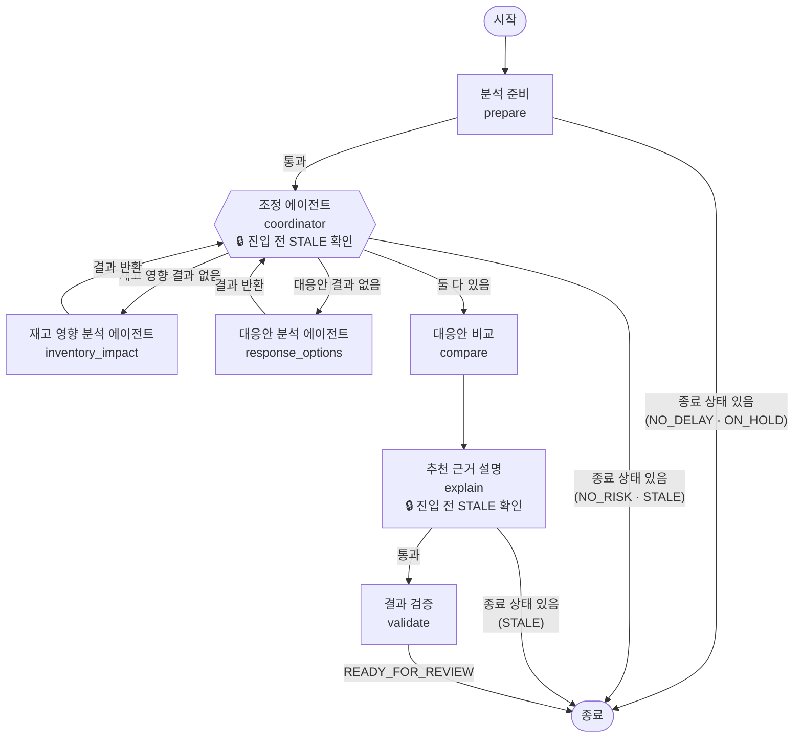
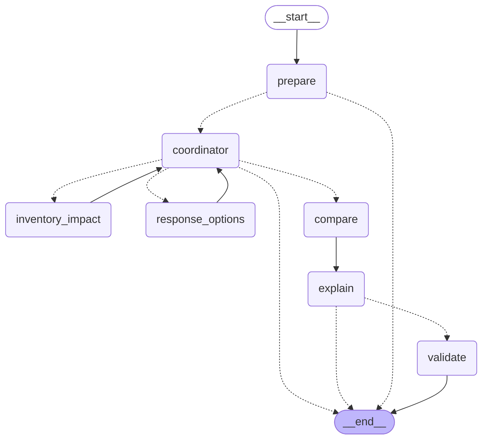
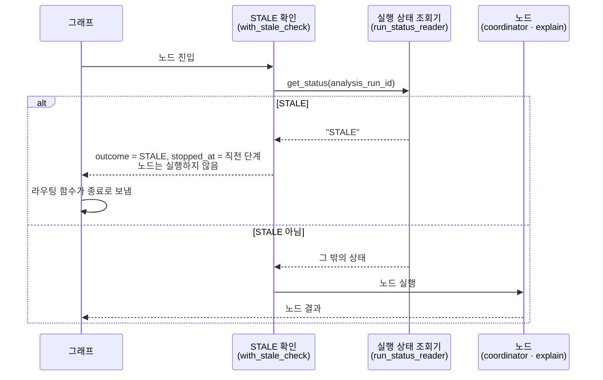

# 지연 분석 에이전트 그래프

`app/modules/delay_analysis/application/agent/`에 구현된 LangGraph 그래프의 **현재 동작**을 설명합니다. 노드는 모두 빈 결과를 반환하는 뼈대이며, 노드 연결·종료 분기·STALE 확인 위치만 실제로 동작합니다.

에이전트의 목표 흐름, 도구(T1~T12) 상세, 재시도·실패 정책은 설계 문서 `agentflow_glowship.md`를 따릅니다. 이 문서는 그 설계 중 **코드에 반영된 부분**만 다룹니다.

## 1. 전체 흐름



- 조정 에이전트가 중심(허브)입니다. 하위 에이전트는 결과를 조정 에이전트로 돌려주고, 조정 에이전트가 다음 분석을 고릅니다.
- 실선 분기의 판단은 모두 `graph.py`의 라우팅 함수가 합니다(3절).
- 🔒 표시는 노드에 들어가기 전에 실행 상태를 조회해 `STALE`이면 노드를 실행하지 않고 종료하는 지점입니다(4절).

### 정상 흐름에서 실제로 거치는 순서

```
prepare → coordinator → inventory_impact → coordinator → response_options → coordinator → compare → explain → validate
```

조정 에이전트는 세 번 실행됩니다(처음 진입, 재고 영향 결과 수신, 대응안 결과 수신). 테스트 `test_정상_흐름은_7개_노드를_문서_순서대로_거쳐_READY_FOR_REVIEW로_끝난다`와 dry-run API 응답의 `visited_nodes`가 이 순서입니다.

## 2. 코드에서 생성한 그래프

1절은 읽기 쉽게 이름과 조건을 붙인 그림입니다. 아래는 LangGraph가 컴파일된 그래프에서 직접 출력한 원본입니다. 점선은 조건부 분기, 실선은 고정 연결입니다.



그래프 연결을 바꾸면 아래 명령으로 다시 출력해 이 절을 갱신합니다.

```bash
uv run python -c "from app.modules.delay_analysis.application.agent.graph import build_analysis_graph as b; print(b().get_graph().draw_mermaid())"
```

## 3. 분기 규칙

| 위치 | 라우팅 함수 | 조건 | 다음 |
| --- | --- | --- | --- |
| 분석 준비 뒤 | `route_after_prepare` | 상태에 `outcome`이 있음(`NO_DELAY`·`ON_HOLD`) | 종료 |
| | | 그 밖 | 조정 에이전트 |
| 조정 에이전트 뒤 | `route_from_coordinator` | 상태에 `outcome`이 있음(`NO_RISK`·`STALE`) | 종료 |
| | | `impact_result` 없음 | 재고 영향 분석 |
| | | `option_results` 없음 | 대응안 분석 |
| | | 둘 다 있음 | 대응안 비교 |
| 설명 뒤 | `route_after_explain` | 상태에 `outcome`이 있음(`STALE`) | 종료 |
| | | 그 밖 | 결과 검증 |

- `NO_RISK`는 조정 에이전트 노드가 정합니다. 재고 영향 결과를 받았는데 `has_at_risk_orders`가 `false`면 `outcome = NO_RISK`를 남기고, 라우팅 함수가 종료로 보냅니다.
- 결과 검증 노드는 항상 `READY_FOR_REVIEW`로 끝납니다.

## 4. STALE 확인

서비스가 분석 도중 실행을 `STALE`로 바꾸면, 에이전트는 다음 경계에서 이를 확인하고 남은 단계를 진행하지 않습니다(`agentflow_glowship.md` 5.5절).



| 설계상 경계 | 확인하는 곳 | 멈췄을 때 `stopped_at` |
| --- | --- | --- |
| 분석 준비 뒤 | 조정 에이전트 첫 진입 | `VALIDATING` |
| 재고 영향 뒤 | 조정 에이전트 두 번째 진입 | `ANALYZING_IMPACT` |
| 대응안 분석 뒤 | 조정 에이전트 세 번째 진입 | `ANALYZING_OPTIONS` |
| 비교 뒤(설명 생성 전) | 설명 노드 진입 | `ANALYZING_OPTIONS` |

- 실행 상태 조회기는 그래프를 실행할 때 `config["configurable"]["run_status_reader"]`로 주입합니다. 주입하지 않으면 STALE 확인을 건너뜁니다(테스트·dry-run).
- 멈춘 위치는 `visited_nodes`에 `coordinator:stale_stop` 또는 `explain:stale_stop`으로 남습니다.
- 에이전트는 상태를 `STALE`로 바꾸지 않습니다. 판정과 기록은 서비스 책임입니다.

## 5. 노드별 구현 현황

| 노드 | 파일 | 지금 하는 일 | 붙일 것 |
| --- | --- | --- | --- |
| 분석 준비 | `nodes/prepare.py` | `step = VALIDATING`만 기록, 항상 통과 | 권한·중복·필수 자료 확인, 예상 3PL 입고일과 p90 계획 입고일 재비교 → `NO_DELAY`·`ON_HOLD` |
| 조정 에이전트 | `nodes/coordinator.py` | 결과 유무로 다음 단계(`step`) 기록, 위험 주문 없으면 `NO_RISK` | T1 지연 문맥 조회, 지연 단계·자료 상태에 따른 분석·도구 선택 |
| 재고 영향 분석 | `nodes/inventory_impact.py` | 빈 결과 + **항상 "위험 주문 있음"** 반환 | T2·T3·T4·T5·T8 조회, T6 재고 영향 계산, T7 위험 주문 판정 |
| 대응안 분석 | `nodes/response_options.py` | 빈 결과 반환 | T2·T8 조회, T9 실행 가능성 검사, T10 대응안별 결과 계산 |
| 대응안 비교 | `nodes/compare.py` | 빈 비교표 반환 | T11 동일 기준 비교 |
| 추천 근거 설명 | `nodes/explain.py` | 빈 설명 반환 | 언어 모델 호출, 출력 JSON 스키마 |
| 결과 검증 | `nodes/validate.py` | 항상 통과 → `READY_FOR_REVIEW` | T12 검증, 설명 재요청, 설명 실패 시 계산 결과만 반환 |

재고 영향 노드가 항상 "위험 주문 있음"을 반환하는 것은 그래프가 끝까지 흐르게 하기 위한 뼈대용 값입니다.

## 6. 설계 대비 아직 반영하지 않은 것

| 설계(`agentflow_glowship.md`) | 현재 코드 |
| --- | --- |
| 조정 에이전트가 비교 노드를 호출하고 결과를 돌려받은 뒤 설명을 생성 | 비교 → 설명 → 검증이 고정 연결 |
| 도구 실패 시 최초 1회 + 재시도 최대 2회, 소진 시 `FAILED` | 재시도·`FAILED` 경로 없음 |
| 설명 검증 실패 시 설명만 재생성 | 검증 노드가 항상 통과 |
| LangSmith 추적(`analysis_run_id`·`company_id` 메타데이터) | 없음 |
| 서비스가 실행 ID를 넘겨 분석 시작, 결과를 서비스가 저장 | dry-run API로 그래프만 실행. 실행 생성·결과 저장 없음 |

## 7. 상태 필드

`state.py`의 `AnalysisState`입니다.

| 묶음 | 필드 | 채우는 곳 |
| --- | --- | --- |
| 서비스 입력 | `analysis_run_id`, `company_id`, `delay_event_id`, `operating_rule_set_id` | 그래프 호출 시 입력. 에이전트는 바꾸지 않음 |
| 진행 | `step`(`VALIDATING`·`ANALYZING_IMPACT`·`ANALYZING_OPTIONS`·`VALIDATING_OUTPUT`), `visited_nodes` | 각 노드 |
| 단계별 결과 | `delay_context`, `impact_result`, `has_at_risk_orders`, `option_results`, `comparison`, `explanation` | 해당 노드 |
| 종료 | `outcome`(`READY_FOR_REVIEW`·`NO_DELAY`·`NO_RISK`·`ON_HOLD`·`FAILED`·`STALE`), `stopped_at` | 종료를 정한 노드, STALE 확인 |

`visited_nodes`는 노드가 반환한 목록을 이어 붙입니다(`operator.add`). 다른 필드는 마지막 값으로 덮어씁니다.

## 8. 실행해 보기

```bash
uv run pytest tests/modules/delay_analysis -q
```

서버 실행 후 `POST /api/v1/dev/agent/dry-run`(본문 `{}`)을 호출하면 거친 노드 순서(`visited_nodes`)와 종료 상태를 볼 수 있습니다. `APP_ENV=prod`에서는 이 API가 등록되지 않습니다.
