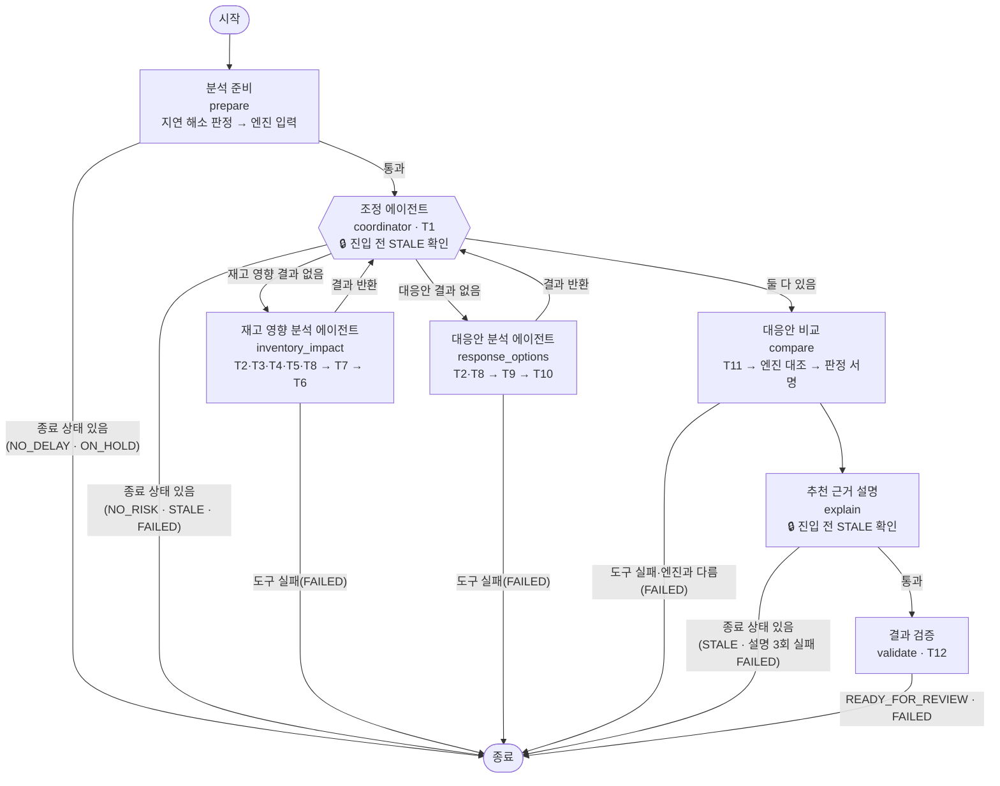
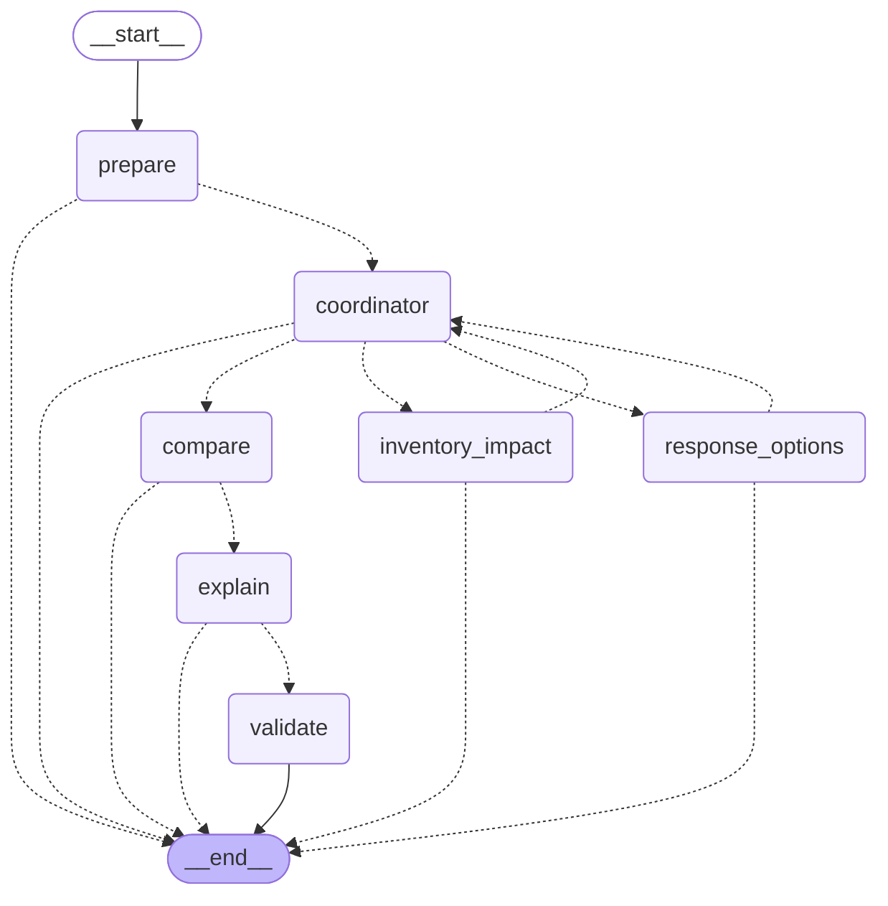
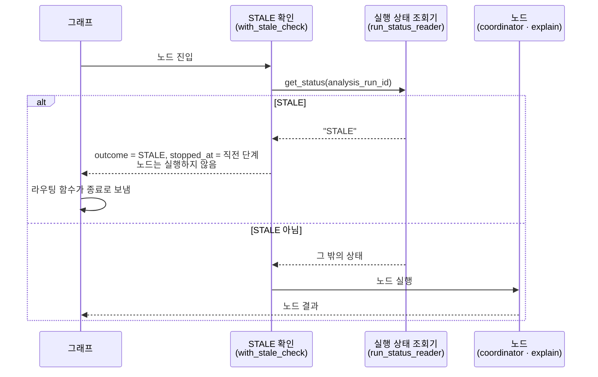

# 지연 분석 에이전트 그래프

`app/modules/delay_analysis/application/agent/`에 구현된 LangGraph 그래프의 **현재 동작**을 설명합니다. 노드는 도구 등록표를 거쳐 도구 T1~T12와 분석 준비·판정 서명·설명 함수를 부릅니다(GLOW-129). 실제 도구·함수는 아직 develop에 없어, 지금은 **가짜 실행 도구 묶음**(`fake_runtime.py`)으로 흐름(부르는 순서·종료 갈래·실패 처리)을 시험합니다.

에이전트의 목표 흐름, 도구(T1~T12) 상세, 재시도·실패 정책은 설계 문서 `agentflow_glowship.md`를 따릅니다. 도구 함수 모양·오류·등록표는 [도구 호출 인터페이스](agent-tool-interface.md), 도구 입출력은 [도구 입출력 계약](tool-contracts.md)에 있습니다. 이 문서는 그 설계 중 **코드에 반영된 부분**만 다룹니다.

## 1. 전체 흐름



- 조정 에이전트가 중심(허브)입니다. 하위 에이전트는 결과를 조정 에이전트로 돌려주고, 조정 에이전트가 다음 분석을 고릅니다.
- 실선 분기의 판단은 모두 `graph.py`의 라우팅 함수가 합니다(3절).
- 🔒 표시는 노드에 들어가기 전에 실행 상태를 조회해 `STALE`이면 노드를 실행하지 않고 종료하는 지점입니다(4절).
- 도구가 멈추면(재시도 소진·권한·코드 오류) 그 노드에서 `FAILED`와 실패 요약을 남기고 끝납니다(5절 "실패 처리").

### 정상 흐름에서 실제로 거치는 순서

```
prepare → coordinator → inventory_impact → coordinator → response_options → coordinator → compare → explain → validate
```

조정 에이전트는 세 번 실행됩니다(처음 진입, 재고 영향 결과 수신, 대응안 결과 수신). 도구는 14번 부릅니다.

```
T1 → T2 → T3 → T4 → T5 → T8 → T7 → T6 → T2 → T8 → T9 → T10 → T11 → T12
```

시험 `test_정상_흐름은_7개_노드와_도구_14번을_문서_순서대로_거쳐_READY_FOR_REVIEW로_끝난다`와 dry-run API 응답의 `visited_nodes`가 이 순서입니다.

## 2. 코드에서 생성한 그래프

1절은 읽기 쉽게 이름과 조건을 붙인 그림입니다. 아래는 LangGraph가 컴파일된 그래프에서 직접 출력한 원본입니다. 점선은 조건부 분기, 실선은 고정 연결입니다.



그래프 연결을 바꾸면 아래 명령으로 다시 출력해 이 절을 갱신합니다(출력 맨 앞의 `config` 머리말은 빼고 붙입니다).

```bash
uv run python -c "from app.modules.delay_analysis.application.agent.graph import build_analysis_graph as b; print(b().get_graph().draw_mermaid())"
```

## 3. 분기 규칙

| 위치 | 라우팅 함수 | 조건 | 다음 |
| --- | --- | --- | --- |
| 분석 준비 뒤 | `route_after_prepare` | 상태에 `outcome`이 있음(`NO_DELAY`·`ON_HOLD`) | 종료 |
| | | 그 밖 | 조정 에이전트 |
| 조정 에이전트 뒤 | `route_from_coordinator` | 상태에 `outcome`이 있음(`NO_RISK`·`STALE`·`FAILED`) | 종료 |
| | | `inventory_impact` 없음 | 재고 영향 분석 |
| | | `option_outcomes` 없음 | 대응안 분석 |
| | | 둘 다 있음 | 대응안 비교 |
| 재고 영향·대응안 분석 뒤 | `route_to_coordinator` | 상태에 `outcome`이 있음(도구 실패 `FAILED`) | 종료 |
| | | 그 밖 | 조정 에이전트 |
| 비교 뒤 | `route_after_compare` | 상태에 `outcome`이 있음(도구 실패·엔진과 다름 `FAILED`) | 종료 |
| | | 그 밖 | 설명 |
| 설명 뒤 | `route_after_explain` | 상태에 `outcome`이 있음(`STALE`·설명 3회 실패 `FAILED`) | 종료 |
| | | 그 밖 | 결과 검증 |

- `NO_RISK`는 조정 에이전트 노드가 정합니다. 재고 영향 결과(T6)의 `completed_status`가 `NO_RISK`면 판정 서명·의존 범위를 만들고(`decision`) `outcome = NO_RISK`를 남깁니다(agentflow 5.5 출력 표 "위험 주문 없음 = 재고 영향 결과·결과 분류·의존 범위·판정 서명").
- **위험 주문이 없어도 예측상 부족만 있으면(`FORECAST_ONLY_READY`) READY라 대응안 분석으로 갑니다**(agentflow 실행 상태 표). 그래서 종료 갈림은 `has_at_risk_orders`가 아니라 T6의 `completed_status`로 정합니다. `has_at_risk_orders`는 T7에 위험 주문이 있는지를 그대로 적은 값입니다(추적 안전 키).
- 결과 검증 노드는 T12가 통과하면 `READY_FOR_REVIEW`로 끝납니다.

## 4. STALE 확인

서비스가 분석 도중 실행을 `STALE`로 바꾸면, 에이전트는 다음 경계에서 이를 확인하고 남은 단계를 진행하지 않습니다(`agentflow_glowship.md` 5.5절).



| 설계상 경계 | 확인하는 곳 | 멈췄을 때 `stopped_at` |
| --- | --- | --- |
| 분석 준비 뒤 | 조정 에이전트 첫 진입 | `VALIDATING` |
| 재고 영향 뒤 | 조정 에이전트 두 번째 진입 | `ANALYZING_IMPACT` |
| 대응안 분석 뒤 | 조정 에이전트 세 번째 진입 | `ANALYZING_OPTIONS` |
| 비교 뒤(설명 생성 전) | 설명 노드 진입 | `VALIDATING_OUTPUT` |

- **비교 뒤 경계의 `stopped_at`이 `ANALYZING_OPTIONS`에서 `VALIDATING_OUTPUT`으로 바뀌었습니다(GLOW-129).** 비교 노드가 이제 자기 단계 `VALIDATING_OUTPUT`을 남깁니다. 도구 실패 때 실패 단계를 부르는 노드가 정하는데, 비교·설명·결과 검증은 `VALIDATING_OUTPUT`이기 때문입니다(인터페이스 문서 5절, agentflow 실행 상태 표 "비교표와 AI 설명 검증 중").
- 실행 상태 조회기는 그래프를 실행할 때 `config["configurable"]["run_status_reader"]`로 주입합니다. 주입하지 않으면 STALE 확인을 건너뜁니다(테스트·dry-run).
- DB 구현체는 `infrastructure/repository/run_status_repository.py`의 `AnalysisRunStatusReader(session_factory, company_id)`입니다. 실행마다 하나 만들어 넘깁니다.
  - 조회마다 짧은 세션을 새로 열고 닫아, 분석 내내 트랜잭션을 열어 두지 않고 다른 트랜잭션이 커밋한 STALE을 바로 봅니다.
  - `analysis_runs.status` 열만 읽고, 조회 전에 `app.company_id`를 설정합니다. 조회 조건에도 `company_id`를 넣어, RLS가 적용되지 않는 접속(로컬 superuser 등)에서도 다른 고객사 실행은 읽히지 않습니다.
  - **워커 역할 전용**입니다. 앱 역할 정책은 `app.user_id`의 사용자까지 확인하므로 실행이 보이지 않고 `None`(= STALE 아님)이 나옵니다.
  - **`None`은 조용히 넘어갑니다.** `None`은 정상 흐름에서는 나오지 않습니다. 앱 역할 세션을 넘겼거나, 다른 고객사 ID로 만들었거나, 고객사가 ACTIVE가 아니거나(DDL `app_context_allowed`), 실행이 지워진 경우(앱 역할만 DELETE 가능)입니다. 그래프(`is_run_stale`)는 `None`을 STALE 아님으로 보고 끝까지 진행하므로, 조회기는 이때 **경고 로그**를 남깁니다. `None`이면 멈출지는 그래프를 백그라운드 실행과 잇는 작업(자동 시작)에서 정합니다.
  - DB 조회가 실패하면(연결 오류 등) 예외를 그대로 올립니다. 재시도·실패 처리는 그래프 실행 쪽(재시도 정책) 몫입니다.
- 멈춘 위치는 `visited_nodes`에 `coordinator:stale_stop` 또는 `explain:stale_stop`으로 남습니다.
- 에이전트는 상태를 `STALE`로 바꾸지 않습니다. 판정과 기록은 서비스 책임입니다.

## 5. 노드별 구현 현황

| 노드 | 파일 | 하는 일 | 실패 단계 |
| --- | --- | --- | --- |
| 분석 준비 | `nodes/prepare.py` | ① 지연 해소 판정(`judge_no_delay`) → 해소면 `NO_DELAY`(엔진 저장소를 읽기 전) ② 엔진 입력 만들기(`build_engine_input`) → 보류면 `ON_HOLD`·실패 요약 `hold_summary` ③ 엔진 입력을 실행 도구 묶음에 한 번 담음 | `VALIDATING`(보류만) |
| 조정 에이전트 | `nodes/coordinator.py` | 처음: T1 지연 문맥. 재고 영향 뒤: T6이 `NO_RISK`면 판정 서명 → `NO_RISK`. 그 밖: 다음 단계(`step`) 기록 | `ANALYZING_IMPACT`(T1) |
| 재고 영향 분석 | `nodes/inventory_impact.py` | T2 가용 재고 → T3 입고 예정 → T4 28일 수요 → T5 미출고 주문 → T8 운영 기준 → T7 위험 주문 → T6 재고 영향(T7이 먼저, 계약 Q3) | `ANALYZING_IMPACT` |
| 대응안 분석 | `nodes/response_options.py` | T2·T8 다시 조회(설계 agentflow 5.3) → T9 후보·사전 판정 → T10 대응안 결과. T9 입력은 계약 5절, T10 입력은 계약 6절 | `ANALYZING_OPTIONS` |
| 대응안 비교 | `nodes/compare.py` | T11 추천 순위 → **T10·T11 출력을 엔진 판정 서명과 대조**(다르면 `FAILED`) → 판정 서명·의존 범위(`decision_of`) | `VALIDATING_OUTPUT` |
| 추천 근거 설명 | `nodes/explain.py` | 설명 생성(#45, 3회 재시도는 함수 안). 3회 실패면 `FAILED`(`EXPLANATION_GENERATION_FAILED`), 계산 결과는 상태에 남음 | `VALIDATING_OUTPUT` |
| 결과 검증 | `nodes/validate.py` | 통과한 설명을 T12로 한 번 더 확인 → `READY_FOR_REVIEW`. 떨어지면 연결 오류 `FAILED`(`UNEXPECTED_TOOL_ERROR`) | `VALIDATING_OUTPUT` |

- **실패 처리:** 도구는 노드가 직접 부르지 않고 등록표(`call_tool`)로 부릅니다. 등록 확인·입출력 형식 확인·재시도(최초 1 + 재시도 2)·추적 훅이 그 안에 있습니다(인터페이스 문서 5절). 도구가 멈추면 `call_tool`이 `ToolFailure`(실패 요약)를 올리고, `graph.with_failure_stop`이 `outcome = FAILED`·`failure`·`step`을 남기고 `<노드>:failed`를 `visited_nodes`에 적습니다. 그 전까지 채운 결과는 상태에 그대로 있습니다.
  - 이 래퍼는 **7개 노드 모두**에 있고, STALE 확인(`with_stale_check`)은 래퍼 안쪽입니다(이슈 #57 1번). 그래서 도구 밖 함수(분석 준비·`decide`·`explain`·`final_check_input`)나 실행 상태 조회가 예외를 내도 `FAILED`·`UNEXPECTED_TOOL_ERROR`·시도 1로 끝납니다. 문구는 고정이고 예외 내용은 서버 로그로만 갑니다. 실행 도구 묶음 연결 실수(`RuntimeWiringError`)·LangGraph 제어 신호(`GraphBubbleUp`)·작업 취소는 바꾸지 않고 올립니다([인터페이스 문서](agent-tool-interface.md) 5.1절·6절 결정 6).
- **엔진 대조(비교 노드):** 대응안 T9~T11은 A의 함수가 계약 입력으로 계산하지만, 판정 서명은 엔진 결과로 만들어집니다. 두 값이 다르면 화면에 보일 대응안과 STALE 판정 서명이 어긋나므로 멈춥니다. 대조하는 값은 판정 서명에 들어가는 것과 같습니다: 대응안마다 `feasibility_status`·`reason_code`·`delay_induced_recovered_orders`·`reduction_committed_total`, 그리고 추천 대응안(엔진 `pipeline.signature`, 공유 묶음 `glowship_engine/pipeline.py` 49~52행).
- **최종 확인(T12)에서 떨어질 때:** 설명 함수가 이미 같은 검증으로 통과시킨 설명이 떨어지면 두 검증이 어긋난 연결 오류로 봅니다. 실제 시도가 3번이 아니라 "3회 실패"(`EXPLANATION_GENERATION_FAILED`, DDL ck26은 3회·소진만 허용)로 적지 않습니다. 이 처리는 실제 설명 함수·T12를 연결할 때 다시 확인합니다.

### 실행 도구 묶음 (`runtime.py`)

노드가 쓰는 도구·함수는 상태가 아니라 실행 도구 묶음 `AnalysisRuntime`으로 넘깁니다. 그래프를 실행할 때 `config["configurable"]["analysis_runtime"]`에 넣습니다.

| 칸 | 내용 | 만드는 쪽 |
| --- | --- | --- |
| `registry` | 도구 12개 등록표(`ToolName` → `ToolSpec`). 하나라도 빠지면 묶음을 만들 때 `ValueError` | C(등록), 도구는 C·A |
| `preparer` | `judge_no_delay()`·`build_engine_input()` | C |
| `decide` | 판정 서명·의존 범위(`decision_of(엔진 입력)`) | C |
| `explain` | 설명 생성 `(도구 문맥, 생성 시각)` → 통과 또는 3회 실패 | C |
| `final_check_input` | 통과한 설명 → T12 입력 | C |
| `base_date`·`input_seq` | 기준일 D·실행 입력 순번 | 서비스(실행 생성) |
| `tracer`·`clock`·`sleep` | 추적 훅(GLOW-124)·설명 생성 시각·재시도 대기 | 서비스 |

- **상태에 두지 않는 이유:** 상태는 서비스가 받아 저장할 결과만 담습니다(7절). 실행 도구는 결과가 아니고, 엔진 입력은 고객사 전체 스냅샷이라 큽니다. 실행 상태 조회기(4절)와 같은 방식이라 넘기는 곳이 한 군데입니다.
- **묶음 하나 = 실행 하나:** 분석 준비가 엔진 입력을 담으면(`start`) 다시 담을 수 없습니다. 다른 실행에 같은 묶음을 쓰면 오류입니다.
- **묶음이 없으면 오류:** 노드가 `RuntimeError`를 냅니다. 설정이 빠진 실행이 빈 결과로 끝나 저장되는 일을 막습니다(예전 뼈대는 묶음 없이도 끝까지 흘렀음).
- **가짜 묶음(`fake_runtime.py`):** dry-run API와 그래프 시험이 씁니다. 가짜 도구 출력은 `model_construct`로 만들어 노드가 읽는 필드만 채웁니다. 출력 값이 계약에 맞는지는 도구를 만드는 쪽 시험과 실제 도구로 바꾼 뒤 통합 시험(T14)이 봅니다. 노드가 만드는 도구 입력(T7·T6·T9·T10·T11)은 실제 계약 모델이라 검증됩니다.

## 6. 설계 대비 아직 반영하지 않은 것

| 설계(`agentflow_glowship.md`) | 현재 코드 |
| --- | --- |
| 조정 에이전트가 비교 노드를 호출하고 결과를 돌려받은 뒤 설명을 생성 | 비교 → 설명 → 검증이 고정 연결 |
| 결과 검증 실패 시 설명만 재생성 | 재생성 3회는 설명 함수 안에서 함. 검증 노드는 최종 확인 한 번 |
| 분석 준비: 권한·중복 확인 | 실행 생성(#21, 고객사 잠금 L1)이 맡음. 분석 준비 노드는 지연 해소·엔진 입력(보류)만 |
| 서비스가 실행 ID를 넘겨 분석 시작, 결과를 서비스가 저장 | 그래프는 결과를 상태로 돌려주기만 함. 자동 시작·저장 연결은 다음 작업(GLOW-128 자동 시작) |
| 실제 도구 T1~T12, 분석 준비·판정 서명·설명 함수 | 가짜 묶음으로만 시험. 실제 함수는 머지되는 대로 바꿔 끼움 |

- **설계와 다르게 하면 더 나을 수 있는 것:** 개선안으로 검토 중입니다. ① 대응안 단계의 T2·T8 재조회 대신 재고 영향 단계 출력을 재사용(결과 같음, 호출 2번·실패 지점 2개 줄어듦). 사용자 결정(11-06)으로 지금은 설계대로 다시 부릅니다.
  ② 재고 영향 결과(T6)의 실행 상태·결과 분류·영향 SKU도 엔진 판정 서명과 대조(지금은 대응안만 대조. 문서에 없는 추가라 제안만).

## 7. 상태 필드

`state.py`의 `AnalysisState`입니다. 결과 필드는 도구 출력 모델 그대로입니다(계약 10). 서비스는 그래프가 끝난 상태를 받아 결과 저장 함수에 넘깁니다([인터페이스 문서](agent-tool-interface.md) 7절).

| 묶음 | 필드 | 채우는 곳 |
| --- | --- | --- |
| 서비스 입력 | `analysis_run_id`, `company_id`, `delay_event_id`, `operating_rule_set_id` | 그래프 호출 시 입력. 에이전트는 바꾸지 않음 |
| 진행 | `step`(`VALIDATING`·`ANALYZING_IMPACT`·`ANALYZING_OPTIONS`·`VALIDATING_OUTPUT`), `visited_nodes` | 각 노드 |
| 분석 준비 | `no_delay`(지연 해소 판정) | 분석 준비 |
| 재고 영향 | `delay_context`(T1), `inventory_snapshot`(T2), `inbound_schedule`(T3), `sales_history`(T4), `open_orders`(T5), `operating_rules`(T8), `at_risk_orders`(T7), `inventory_impact`(T6), `has_at_risk_orders` | 조정 에이전트(T1), 재고 영향 분석 |
| 대응안 | `option_feasibility`(T9), `option_outcomes`(T10) | 대응안 분석 |
| 비교·판정 | `option_ranking`(T11), `decision`(판정 서명·의존 범위) | 대응안 비교(NO_RISK면 조정 에이전트) |
| 설명 | `explanation`(통과한 설명), `explanation_failed`(3회 실패 때 모델·프롬프트 판) | 추천 근거 설명 |
| 종료 | `outcome`(`READY_FOR_REVIEW`·`NO_DELAY`·`NO_RISK`·`ON_HOLD`·`FAILED`·`STALE`), `failure`(실패 요약, #28), `stopped_at` | 종료를 정한 노드, 실패 처리, STALE 확인 |

`visited_nodes`는 노드가 반환한 목록을 이어 붙입니다(`operator.add`). 다른 필드는 마지막 값으로 덮어씁니다. 대응안 단계에서 다시 조회한 T2·T8 출력은 T9·T10 입력에만 쓰고 상태의 값(재고 영향 단계)을 덮어쓰지 않습니다(같은 값).

## 8. 실행해 보기

```bash
uv run pytest tests/modules/delay_analysis -q
```

서버 실행 후 `POST /api/v1/dev/agent/dry-run`(본문 `{}`)을 호출하면 가짜 실행 도구 묶음으로 그래프를 돌려 거친 노드 순서(`visited_nodes`)와 종료 상태를 볼 수 있습니다. DB를 읽거나 쓰지 않습니다. `APP_ENV=prod`에서는 이 API가 등록되지 않습니다.

## 9. 작업 중 실패와 원인 (GLOW-129)

- **가짜 출력이 다음 도구 입력에서 다시 검사됨:** 가짜 T7 출력의 위험 주문을 `object()`로 채웠더니 T10 입력(`CalculateOptionOutcomesInput`)을 만들 때 `AtRiskOrders`의 모델 뒤 검사가 돌아 멈췄습니다. Pydantic은 이미 만든 모델을 다른 모델에 넣을 때 필드 검사는 다시 하지 않지만 **모델 뒤 검사(`model_validator(mode="after")`)는 다시 돌립니다**(작은 예로 확인). 그래서 다음 입력에 들어가는 가짜(T7·T9·T6)는 그 뒤 검사를 통과하게 채웠습니다.
- **상태 타입을 `TYPE_CHECKING` 안에서만 import했다가 되돌림:** LangGraph는 상태 정의의 타입 표시를 실행 중에 읽어 채널을 만듭니다. 서로 import가 걸리는 것은 `retry`(→ `state`) 하나뿐이라, 도구 모델은 바로 import하고 실패 요약만 `Any`로 두었습니다.
- **음성 시험 실행기가 첫 변경에서 멈춤:** 하위 프로세스에 `.venv/Scripts/python.exe` 상대 경로를 넘겨 Windows가 찾지 못했습니다. 망가뜨린 파일은 `finally`로 되돌려진 것을 확인한 뒤, 실행 중인 Python 경로(`sys.executable`)로 다시 돌렸습니다. 8개 변경(엔진 대조 끄기, NO_RISK를 위험 주문 여부로 가르기, NO_RISK 판정 서명 빼기, 대응안 단계 T2 재조회 빼기, 실패 처리 빼기, 최종 확인 실패 통과, 지연 해소 판정 건너뛰기, 보류 통과)이 모두 시험에서 실패로 잡혔습니다.
