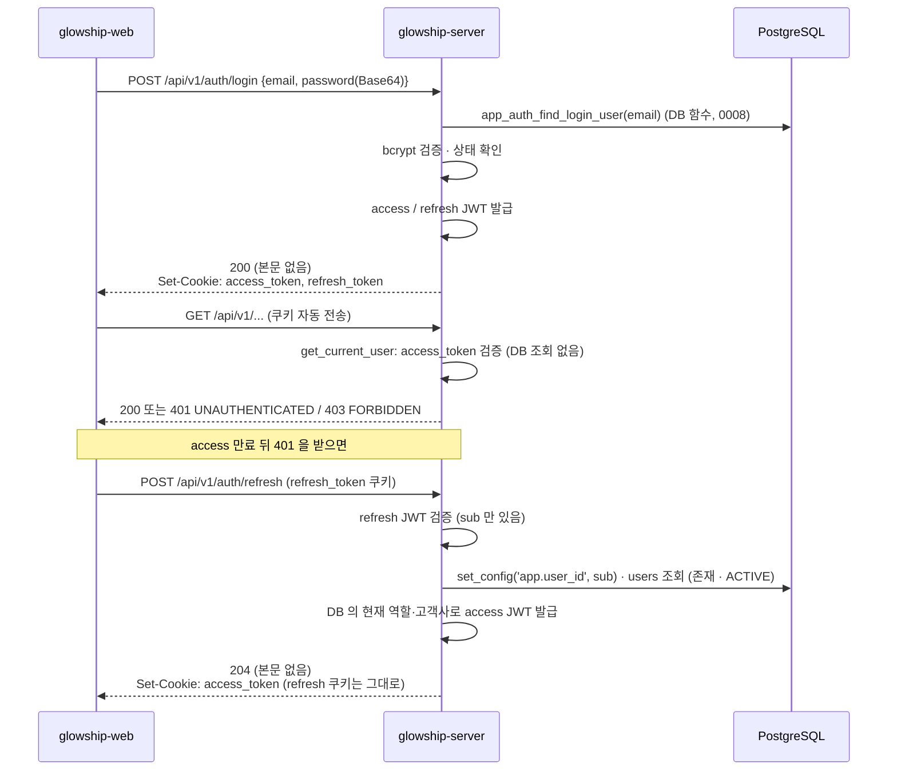

# 로그인과 인증 쿠키

`app/modules/user/`의 로그인·로그아웃·재발급 API와 `app/core/security/`의 토큰·쿠키·인증 의존성이 **현재 어떻게 동작하는지** 설명합니다.
토큰 폐기(jti 폐기 목록)는 구현하지 않았으며, 이 문서는 그 결정과 비워 둔 자리까지만 다룹니다(7절).

## 1. 전체 흐름



- 토큰은 응답 본문이 아니라 `HttpOnly` 쿠키로만 전달합니다. 프론트는 토큰을 읽거나 저장하지 않고, 요청에 `credentials: "include"`만 붙입니다.
- 보호된 API는 요청마다 쿠키의 access 토큰만 검증하며 DB를 조회하지 않습니다(5절).
- access 토큰이 만료되면 프론트가 `POST /api/v1/auth/refresh`로 access 쿠키만 새로 받습니다(2-2절). refresh 토큰은 회전하지 않으므로 로그인 뒤 7일이 지나면 다시 로그인합니다.

## 2. 로그인 API

`POST /api/v1/auth/login` — `app/modules/user/presentation/auth_api_router.py`

### 요청

```json
{ "email": "admin@glowship.com", "password": "cGFzc3dvcmQxMjM=" }
```

| 필드 | 규칙 |
| --- | --- |
| `email` | 50자 이하, 이메일 패턴. 공백은 앞뒤를 포함해 허용하지 않음(422). 소문자로 정규화 |
| `password` | 프론트가 `btoa()`로 Base64 인코딩한 비밀번호. 로그인에서는 비밀번호 정책(영문·숫자 6~16자)을 검사하지 않습니다 |

회원가입(`POST /api/v1/auth/signup`)과 같은 요청 스키마(`EmailLoginRequest`)를 사용합니다.

회원가입은 **개발용**입니다(이슈 #78). 운영(`APP_ENV=prod`)에서는 등록하지 않아 404이고, `users`에 직접 INSERT하므로 `POSTGRES_ROLE`을 비운 로컬 연결(superuser)에서만 동작합니다. 앱 역할 연결(`POSTGRES_ROLE=glowship_v4_app`)에서는 앱 역할에 `users` INSERT 권한이 없어(0001) 권한 오류(500)가 나며, 코드로 따로 처리하지 않습니다. 운영 계정은 DB에 직접 넣습니다(README "운영 배포 DB 계정" 5번).

### 성공 응답

```http
HTTP/1.1 200 OK
Set-Cookie: access_token=...; HttpOnly; Max-Age=28800; Path=/; SameSite=lax; Secure
Set-Cookie: refresh_token=...; HttpOnly; Max-Age=604800; Path=/api/v1/auth/refresh; SameSite=lax; Secure
```

본문은 비어 있습니다. `Secure`는 `COOKIE_SECURE` 설정에 따라 붙습니다(6절).

### 실패 응답

모든 실패는 공통 에러 형식 `{"code", "message", "request_id"}`로 응답하며, 쿠키는 발급되지 않습니다.

| 상태 | code | 상황 |
| --- | --- | --- |
| 400 | `INVALID_PASSWORD_FORMAT` | `password`가 Base64가 아님 |
| 401 | `INVALID_CREDENTIALS` | 이메일 없음 **또는** 비밀번호 불일치. 계정 존재 여부를 노출하지 않기 위해 구분하지 않습니다 |
| 403 | `ACCOUNT_DISABLED` | `users.status`가 `DISABLED` |
| 422 | `VALIDATION_ERROR` | 필수 필드 누락, 이메일 패턴 불일치 |

### 서비스 로직 (`AuthService.login`)

```
Base64 해제 → 72바이트 초과면 401 → 로그인 조회(find_login_user) → bcrypt 검증 → status 확인 → TokenPair 반환
```

- **로그인 조회는 DB 함수로 합니다(이슈 #41).** 로그인 순간에는 아직 사용자를 모르므로 RLS 컨텍스트(`app.user_id`·`app.company_id`)가 없습니다. 운영의 앱 DB 역할(`glowship_v4_app`)은 `users`를 "같은 고객사이거나 본인"일 때만 보여 주므로(`users_select_tenant_or_self`, 0001) `select(User)`로 찾으면 0행이 되어 모든 로그인이 401 입니다. 그래서 `UserRepository.find_login_user`가 소유자 권한의 `SECURITY DEFINER` 함수 `app_auth_find_login_user(email)`(마이그레이션 0008, 실행 권한은 앱 역할만)를 부르고, 그 이메일 한 명의 식별자·고객사·역할·비밀번호 해시·상태만 받습니다. 로컬(superuser)에서도 같은 함수를 씁니다.

- **더미 해시 검증**: 이메일이 없어도 고정된 더미 해시(`DUMMY_PASSWORD_HASH`)로 bcrypt 검증을 한 번 수행합니다. 응답 시간 차이로 계정 유무를 추측하지 못하게 하기 위해서입니다.
- **72바이트 한도**: bcrypt는 72바이트를 넘는 입력에 `ValueError`를 던집니다(bcrypt 5.x). 정책상 비밀번호는 16자 이하이므로 이를 넘는 입력은 조회 없이 `INVALID_CREDENTIALS`로 거절해 500을 막습니다.
- 토큰 발급은 서비스가 하고(`TokenPair`), 쿠키에 싣는 일은 라우터가 `set_auth_cookies`로 합니다.

## 2-1. 로그아웃 API

`POST /api/v1/auth/logout` — `app/modules/user/presentation/auth_api_router.py`

### 요청

본문·쿼리·경로 변수가 없습니다. **인증을 요구하지 않습니다.** 쿠키가 없거나 만료·위조된 토큰이어도 같은 응답입니다.

### 응답

```http
HTTP/1.1 204 No Content
Set-Cookie: access_token=""; expires=<응답 시각>; HttpOnly; Max-Age=0; Path=/; SameSite=lax; Secure
Set-Cookie: refresh_token=""; expires=<응답 시각>; HttpOnly; Max-Age=0; Path=/api/v1/auth/refresh; SameSite=lax; Secure
```

`expires`에는 과거 고정 시각이 아니라 **응답 시각**이 찍힙니다(Starlette `delete_cookie`가 `expires=0`을 넘김. 예: `expires=Thu, 05 Nov 2026 05:00:18 GMT`). `Max-Age=0`이 `Expires`보다 우선이므로 지워지는 동작은 같습니다.

- 서버가 두 쿠키를 발급 때와 **같은 이름·Path·SameSite·HttpOnly**로 `Max-Age=0` 처리해 브라우저가 지우게 합니다(`clear_auth_cookies`). HttpOnly 쿠키는 프론트가 지울 수 없습니다. 브라우저는 이름·도메인·Path가 같은 쿠키만 덮어쓰므로 Path가 다르면 지워지지 않습니다. `tests/core/test_cookies.py`가 발급과 삭제의 쌍을 대조합니다.
- 브라우저는 refresh 쿠키를 `/api/v1/auth/refresh`에만 보내므로 로그아웃 요청에는 refresh 쿠키가 실려 오지 않습니다. 서버는 토큰 값을 볼 필요 없이 삭제 지시만 내립니다.
- 프론트는 204를 받으면 로그인 화면으로 이동합니다. 보관하는 토큰 상태가 없으므로 그 밖의 정리는 없습니다.

| 상태 | code | 상황 |
| --- | --- | --- |
| 204 | – | 항상. 멱등 |
| 403 | `INVALID_ORIGIN` | 허용되지 않은 `Origin`의 요청(3-1절). 다른 사이트가 사용자를 강제로 로그아웃시키는 것은 **출처 검사만** 막습니다. 로그아웃은 쿠키 없이도 동작하므로 SameSite=Lax는 이 경우 방어가 되지 않습니다(SameSite는 쿠키를 **보내는** 것만 막고, 다른 사이트 폼 POST 응답의 `Set-Cookie`는 브라우저가 적용합니다). 출처 검사 범위를 조정할 때 로그아웃을 빼면 안 됩니다 |

### 왜 인증을 요구하지 않는가

- 로그아웃은 "이 브라우저의 세션을 끝낸다"는 뜻이고, 세션이 이미 만료되어 실패하는 로그아웃은 사용자에게 의미가 없습니다. 항상 성공해야 버튼이 꼬이지 않습니다.
- access 토큰이 만료된 상태에서 401을 돌려주면 프론트가 재발급을 시도한 뒤 다시 로그아웃하는 우회 경로가 생깁니다.
- 인증 없이도 서버 상태는 바뀌지 않고, 교차 사이트 요청은 출처 검사가 막습니다. 명세 v6.2는 이 결정에 맞춰 로그아웃을 인증 예외로 고쳤습니다(C35: 2절 인증 예외에 로그아웃 추가, 3절 2번 권한 "없음").

### 한계 (무상태 로그아웃)

- 서버는 토큰을 기록하지 않습니다. **로그아웃 전에 복사된 토큰은 만료까지 유효합니다**: access 최대 8시간(개발 단계 프론트와 합의한 값), refresh 최대 7일.
- 같은 쿠키 값을 다시 보내면 `GET /me`는 여전히 200입니다. 즉시 무효화가 필요하면 refresh `jti` 폐기 목록이 필요하며, 재발급 API 구현 때 저장소와 함께 정합니다(7절).
- 폐기 목록을 넣으려면 로그아웃이 refresh `jti`를 읽어야 하는데, refresh 쿠키는 Path가 `/api/v1/auth/refresh`로 좁혀져 로그아웃 요청에 실려 오지 않습니다. 따라서 그때는 **쿠키 Path 조정**(예: `/api/v1/auth`로 넓혀 인증 엔드포인트에만 실리게)이 함께 필요합니다(7절).

## 2-2. 재발급 API

`POST /api/v1/auth/refresh` — `app/modules/user/presentation/auth_api_router.py` (명세 4.1, API 27, GLOW-152)

### 요청

본문·쿼리·경로 변수가 없습니다. 브라우저가 `refresh_token` 쿠키를 보냅니다(Path가 `/api/v1/auth/refresh`라 이 요청에만 실립니다). access 쿠키도 Path `/`라 함께 실리지만 서버는 보지 않습니다.

### 성공 응답

```http
HTTP/1.1 204 No Content
Set-Cookie: access_token=...; HttpOnly; Max-Age=28800; Path=/; SameSite=lax; Secure
```

- `access_token` 쿠키만 새로 내립니다. 로그인 발급분과 같은 이름·Path·속성(`set_access_cookie`)이어서 브라우저가 기존 access 쿠키를 덮어씁니다. `tests/core/test_cookies.py`가 로그인 발급분과 쌍으로 대조합니다.
- `refresh_token` 쿠키는 **그대로 둡니다(회전하지 않음)**. 로그인 때 받은 7일이 지나면 재발급도 401이 되어 다시 로그인합니다.
- 프론트는 보호된 API가 401 `UNAUTHENTICATED`를 돌려주면 이 API를 한 번 호출한 뒤 원래 요청을 다시 보내고, 재발급도 401이면 로그인 화면으로 이동합니다. (2026-11-13 기준 `glowship-web`은 아직 재발급을 호출하지 않고 401이면 로그아웃 처리합니다. 연동은 프론트 작업.)

### 실패 응답

모든 실패는 공통 에러 형식 `{"code", "message", "request_id"}`로 응답하며, 쿠키는 내리지 않습니다. 기존 쿠키를 지우지도 않습니다(지우는 것은 로그아웃의 일).

| 상태 | code | 상황 |
| --- | --- | --- |
| 401 | `UNAUTHENTICATED` | refresh 쿠키 없음, 서명 불일치, 만료, access 토큰을 refresh 자리에 보냄, 클레임 구성 불일치, **토큰의 사용자가 DB에 없음**. 사유를 구분하지 않습니다 |
| 403 | `ACCOUNT_DISABLED` | `users.status`가 `DISABLED`. 로그인·`GET /me`와 같은 코드. 401로 주면 프론트가 재발급을 반복할 수 있어 구분합니다 |
| 403 | `INVALID_ORIGIN` | 허용되지 않은 `Origin`의 요청(3-1절) |

### 서비스 로직 (`AuthService.refresh_access_token`)

```
decode_token(REFRESH) · sub UUID 해석 (실패 401) → set_rls_context(user_id=sub, company_id=None)
→ users.find_by_id (없음 401 · DISABLED 403) → create_access_token(DB 의 user_id·role_code·company_id)
```

- **권한의 출처는 토큰이 아니라 DB 행입니다.** refresh 토큰에는 `sub`·`jti`만 있고(4절) 역할·고객사가 없으므로, 재발급 시점에 사용자를 다시 읽어 **현재** 역할로 access 토큰을 만듭니다. 토큰 발급 뒤 역할이 바뀌었으면 새 access 토큰에 반영됩니다. 계정 비활성화도 여기서 막힙니다.
- **RLS 컨텍스트**: 운영 앱 DB 역할(`glowship_v4_app`)에서는 `users_select_tenant_or_self` 정책(0001)이 `user_id = app.user_id`인 자기 행을 보여 주므로 조회 전에 `set_rls_context(user_id=토큰의 사용자)`를 넣습니다. 고객사 컨텍스트는 필요 없어 비웁니다. `GET /me`(`docs/auth/me.md` 4절)와 같은 경로이며, 로그인처럼 SECURITY DEFINER 함수를 쓰지 않습니다(토큰으로 사용자를 이미 아는 상태).
- 토큰 검증 실패는 DB를 읽기 전에 거절합니다. 위조 토큰으로 DB 조회를 일으키지 않습니다.
- 서비스는 access 토큰 문자열 하나를 돌려주고, 쿠키에 싣는 일은 라우터가 `set_access_cookie`로 합니다.

### 결정 사항 (2026-11-13, GLOW-152)

명세 4.1·C35가 "재발급 API 때 함께 정한다"고 둔 항목을 다음과 같이 정했습니다.

| 항목 | 결정 | 이유 |
| --- | --- | --- |
| refresh 토큰 회전 | 하지 않음 | 명세 4.1은 "새 `access_token` 쿠키"만 말합니다. 폐기 목록이 없는 상태에서 회전하면 쓸 때마다 7일이 연장되어 세션 상한이 사라지고 D4 "쿠키 수명 고정"과 어긋납니다. 재사용 감지도 저장소 없이는 불가능합니다 |
| `jti` 폐기 목록 | 도입하지 않음(무상태 유지) | 저장 표가 v6.2 DDL에 없어 데이터 팀 DDL 요청이 선행되어야 합니다. 로그아웃도 무상태로 합의되어 있습니다(C35) |
| refresh 쿠키 Path | `/api/v1/auth/refresh` 유지 | 폐기 목록을 넣지 않으면 로그아웃이 refresh 쿠키를 받을 이유가 없습니다. 넓히는 일은 폐기 목록 도입 때 전환 처리와 함께 합니다(7절) |

## 3. 쿠키

`app/core/security/cookies.py`에 이름·Path·속성이 상수로 정의되어 있으며, 재발급(`set_access_cookie`)·로그아웃(`clear_auth_cookies`)도 같은 값을 씁니다.

| 쿠키 | Path | Max-Age | 속성 |
| --- | --- | --- | --- |
| `access_token` | `/` | 28800초 (`ACCESS_TOKEN_EXPIRE_MINUTES`) | `HttpOnly; SameSite=Lax; Secure(설정)` |
| `refresh_token` | `/api/v1/auth/refresh` | 604800초 (`REFRESH_TOKEN_EXPIRE_DAYS`) | 동일 |

- refresh 쿠키는 Path를 재발급 엔드포인트로 좁혀 다른 요청에는 실리지 않습니다. 따라서 재발급 API는 **반드시** `/api/v1/auth/refresh`에 있어야 합니다(2-2절).
- 로컬에서 프론트(`localhost:3000`)와 API(`localhost:8000`)는 포트만 다르므로 `SameSite=Lax`로 쿠키가 전송됩니다. 운영에서 프론트와 API가 **다른 등록 도메인**이면 `COOKIE_SAMESITE`를 `none`으로 바꿔야 합니다.
- 쿠키 속성 순서와 `SameSite=lax` 소문자 표기는 Starlette의 직렬화 결과이며, 브라우저는 순서·대소문자를 구분하지 않습니다.

## 3-1. 출처 검사 (CSRF 방어)

`app/core/middleware.py` 의 `OriginCheckMiddleware`. 두 토큰을 모두 쿠키에 두면 브라우저가 쿠키를 자동으로 보내므로, 다른 사이트에서 띄운 요청도 로그인된 것처럼 처리될 수 있습니다. `SameSite=Lax` 가 1차 방어이고, 이 미들웨어가 서버에서 요청의 `Origin` 헤더를 직접 확인하는 2차 방어입니다.

| 항목 | 규칙 |
| --- | --- |
| 검사 대상 | `POST`, `PUT`, `PATCH`, `DELETE`. `GET`·`HEAD`·`OPTIONS` 는 검사하지 않음 (같은 오리진의 GET 에는 브라우저가 `Origin` 을 붙이지 않는 경우가 있음) |
| 허용 목록 | `CORS_ORIGINS`. CORS 와 같은 목록을 사용 |
| `Origin` 헤더 없음 | `APP_ENV=local` 에서만 통과 (curl 등). 그 외 환경은 거절 |
| 거절 응답 | 403 `INVALID_ORIGIN` (공통 에러 형식) |

미들웨어 순서는 바깥에서 안쪽으로 `CORSMiddleware` → `OriginCheckMiddleware` → `UnhandledExceptionMiddleware` 입니다.

| 요청 출처 | 결과 |
| --- | --- |
| 허용 오리진, 정상 처리 또는 401·403·500 | 응답에 CORS 헤더가 붙어 프론트가 상태 코드와 본문을 읽을 수 있음 |
| 허용되지 않은 오리진 | 403 `INVALID_ORIGIN`. CORS 헤더가 없어 브라우저가 본문을 읽지 못하지만, 막는 것이 목적이므로 정상 |
| 프리플라이트(`OPTIONS`) | CORS 미들웨어가 직접 응답. OriginCheck 는 관여하지 않음 |

- **Swagger**: `/docs` 에서 POST 를 호출하면 브라우저가 `Origin: http://localhost:8000` 을 붙이므로, 이 값이 `CORS_ORIGINS` 에 없으면 403 `INVALID_ORIGIN` 이 납니다. `.env.example` 기본값에 포함되어 있습니다.
- **curl 테스트**: local 외 환경에서는 `-H "Origin: <허용 오리진>"` 을 붙여야 합니다.

## 4. 토큰

`app/core/security/jwt.py`. HS256으로 서명하며 키는 `JWT_SECRET_KEY`입니다.

| 클레임 | access | refresh | 설명 |
| --- | --- | --- | --- |
| `sub` | ✓ | ✓ | `users.user_id` (문자열) |
| `type` | `access-token` | `refresh-token` | 용도. 검증 시 기대하는 용도와 다르면 거절 |
| `iat` / `exp` | ✓ | ✓ | 발급·만료 시각 |
| `jti` | ✓ | ✓ | UUIDv7. 이후 폐기·회전 구현 시 식별 키 |
| `role` | ✓ | – | `UserRoleCode` 값 |
| `company_id` | ✓ | – | 소속 회사. OWNER·ADMIN은 `null`로 **명시** |

- refresh 토큰에 `role`·`company_id`를 넣지 않는 이유: 재발급 시점에 DB에서 사용자를 다시 읽어 **현재** 권한으로 access 토큰을 만들기 위해서입니다(2-2절). 7일짜리 토큰에 오래된 권한이 복사되는 것을 막습니다.
- `iss`·`aud`는 현재 넣지 않습니다. 검증 서버가 늘어나면 `_create_token`에 상수로 추가하고 `decode_token`에서 함께 검증합니다.
- `decode_token(token, config, expected_type)`은 서명·만료·필수 클레임(`sub, type, iat, exp, jti`)·용도를 검사하고 실패 시 `TokenError`를 던집니다. HTTP 변환은 호출 측이 합니다.

## 5. 보호된 API 작성법

`app/core/security/auth.py`. FastAPI는 데코레이터 대신 `Depends`로 인증을 겁니다.

```python
from fastapi import APIRouter, Depends

from app.core.security.auth import CurrentUser, get_current_user, require_roles
from app.modules.user.infrastructure.user_enums import UserRoleCode

router = APIRouter(prefix="/api/v1/orders")


# 1) 요청 주체가 필요할 때: 매개변수로 받는다
@router.get("")
async def list_my_orders(
    current_user: CurrentUser = Depends(get_current_user),
): ...  # current_user.user_id / role_code / company_id


# 2) 로그인 여부만 확인할 때
@router.get("/summary", dependencies=[Depends(get_current_user)])
async def summary(): ...


# 3) 역할 제한
@router.delete(
    "/{order_id}",
    dependencies=[Depends(require_roles(UserRoleCode.ADMIN, UserRoleCode.OWNER))],
)
async def delete_order(order_id: str): ...


# 라우터 전체 보호
router = APIRouter(prefix="/api/v1/orders", dependencies=[Depends(get_current_user)])
```

| 결과 | 응답 |
| --- | --- |
| 통과 | `CurrentUser(user_id, role_code, company_id)`가 주입되고 엔드포인트 실행 |
| 쿠키 없음, 서명 불일치, 만료, refresh 토큰을 access로 사용, 클레임 구성 불일치 | 401 `UNAUTHENTICATED` (사유를 구분하지 않음). 프론트는 이 코드를 받으면 재발급을 시도 |
| 역할 불일치 | 403 `FORBIDDEN` |

- `get_current_user`는 DB를 조회하지 않습니다. 계정 비활성화·역할 변경은 access 토큰 만료(최대 8시간)까지 반영되지 않으며, 즉시 차단이 필요한 API는 해당 엔드포인트에서 DB를 재조회해야 합니다.
- `CurrentUser.role_code`는 문자열이지만 `UserRoleCode`는 `str` Enum이므로 `current_user.role_code == UserRoleCode.ADMIN` 비교가 그대로 동작합니다.
- 쿠키 인증 방식은 OpenAPI `securitySchemes`(`APIKeyCookie`)에 기록됩니다. Swagger UI에서 `/auth/login`을 호출하면 브라우저가 쿠키를 보관하므로 이어서 보호된 API를 바로 호출할 수 있습니다.

## 6. 설정

`app/core/config.py` — `.env.example` 참고.

| 변수 | 기본값 | 설명 |
| --- | --- | --- |
| `JWT_SECRET_KEY` | 없음 (**필수**) | 32자 이상. 짧으면 기동 시 pydantic 검증 오류. 생성: `python -c "import secrets; print(secrets.token_urlsafe(48))"` |
| `JWT_ALGORITHM` | `HS256` | 서명 알고리즘 |
| `ACCESS_TOKEN_EXPIRE_MINUTES` | `480` | access 토큰·쿠키 수명 (8시간, 개발 단계 프론트와 합의한 값) |
| `REFRESH_TOKEN_EXPIRE_DAYS` | `7` | refresh 토큰·쿠키 수명 |
| `COOKIE_SECURE` | 없음 | 생략 시 `APP_ENV=local`만 `false`, 그 외 `true`. 로컬 HTTP에서 Safari는 `Secure` 쿠키를 버리기 때문 |
| `CORS_ORIGINS` | `[]` | CORS 와 출처 검사가 함께 쓰는 허용 오리진 목록. 프론트 오리진과, Swagger 를 쓸 경우 API 자신의 오리진 포함 |

`Settings.jwt_config`가 `JwtConfig`(서명 키·알고리즘·만료)를 만들어 발급·검증 함수에 넘기고, `Settings.cookie_secure_enabled`가 `Secure` 여부를 결정합니다.

## 7. 아직 없는 것

| 기능 | 비워 둔 자리 |
| --- | --- |
| ~~토큰 재발급~~ | 구현됨. `POST /api/v1/auth/refresh`가 refresh 토큰을 검증하고 DB의 현재 권한으로 access 쿠키만 새로 내린다 (2-2절, GLOW-152) |
| ~~로그아웃~~ | 구현됨. `POST /api/v1/auth/logout`이 `clear_auth_cookies`로 두 쿠키를 만료시킨다 (2-1절) |
| ~~로그인 직후 사용자 정보~~ | 구현됨. `GET /api/v1/me`가 DB에서 계정·역할·고객사명을 돌려준다 (`docs/auth/me.md`) |
| 토큰 폐기·회전 | **도입하지 않기로 결정**(2-2절 결정 사항, 2026-11-13). 즉시 무효화가 필요해지면: `jti` 클레임을 식별 키로 폐기 목록 저장소(테이블은 데이터 팀 DDL 요청, 또는 Redis)를 두고, 재발급은 회전(새 refresh 발급 + 옛 `jti` 폐기)하며, 로그아웃이 refresh `jti`를 폐기하도록 `REFRESH_TOKEN_COOKIE_PATH`를 `/api/v1/auth`로 넓힌다(인증 엔드포인트에만 실림. `cookies.py` 상수 한 곳이면 발급·삭제가 함께 따라가고, 명세 D4·C31의 Path 문구도 같이 고침). Path가 다르면 브라우저가 별개 쿠키로 취급해 이미 로그인한 사용자에게 옛 Path 쿠키가 7일간 남으므로, 전환 기간에는 로그아웃에서 옛·새 Path를 모두 삭제하고 재발급은 같은 이름의 쿠키가 둘 실리는 경우를 처리한다 |
| 서버 간 호출 | 로그인 토큰이 아니라 별도 자격(서비스 토큰·API 키)으로 다룸 |

## 8. 관련 파일

| 파일 | 역할 |
| --- | --- |
| `app/modules/user/presentation/auth_api_router.py` | `/auth/login`·`/auth/logout`·`/auth/refresh` 엔드포인트, 쿠키 응답 |
| `app/modules/user/presentation/signup_api_router.py` | `/auth/signup` 엔드포인트(개발용, 운영 미등록. 등록은 `app/main.py` `include_dev_routers`) |
| `app/modules/user/application/auth_service.py` | `login`·`refresh_access_token` 비즈니스 로직, `TokenPair` |
| `app/modules/user/application/exception/user_exceptions.py` | `INVALID_CREDENTIALS`, `ACCOUNT_DISABLED` |
| `app/core/security/jwt.py` | 토큰 발급·검증, `JwtConfig`, `TokenType`, `TokenError` |
| `app/core/security/cookies.py` | 쿠키 상수, `set_auth_cookies`, `set_access_cookie`, `clear_auth_cookies` |
| `app/core/security/auth.py` | `CurrentUser`, `get_current_user`, `require_roles` |
| `app/core/security/hashing.py` | bcrypt 해싱·검증, `DUMMY_PASSWORD_HASH`, 72바이트 한도 |
| `app/core/exceptions.py` | `UNAUTHENTICATED`, `FORBIDDEN`, `INVALID_ORIGIN` 공통 에러 코드 |
| `app/core/rls_context.py` | `set_rls_context` (재발급의 자기 행 조회) |
| `tests/modules/user/test_auth_service_refresh.py` · `test_auth_refresh_api.py` | 재발급 서비스·라우터 테스트 (DB 없이 실행) |
| `app/core/middleware.py` | `OriginCheckMiddleware`(출처 검사), 미들웨어 등록 순서 |
| `app/core/config.py` | JWT·쿠키 설정 |
