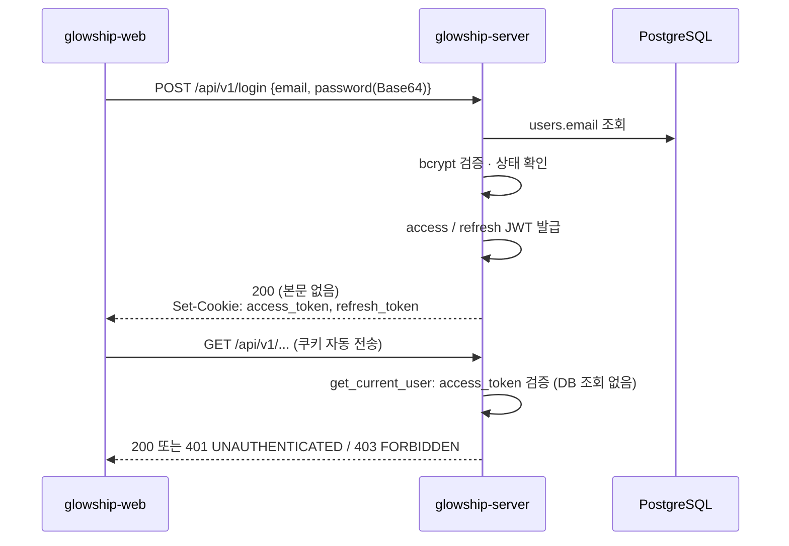

# 로그인과 인증 쿠키

`app/modules/user/`의 로그인 API와 `app/core/security/`의 토큰·쿠키·인증 의존성이 **현재 어떻게 동작하는지** 설명합니다.
토큰 재발급(refresh)과 로그아웃은 아직 구현되지 않았으며, 이 문서는 그 자리를 어떻게 비워 두었는지까지만 다룹니다(7절).

## 1. 전체 흐름



- 토큰은 응답 본문이 아니라 `HttpOnly` 쿠키로만 전달합니다. 프론트는 토큰을 읽거나 저장하지 않고, 요청에 `credentials: "include"`만 붙입니다.
- 보호된 API는 요청마다 쿠키의 access 토큰만 검증하며 DB를 조회하지 않습니다(5절).

## 2. 로그인 API

`POST /api/v1/login` — `app/modules/user/presentation/auth_api_router.py`

### 요청

```json
{ "email": "admin@glowship.com", "password": "cGFzc3dvcmQxMjM=" }
```

| 필드 | 규칙 |
| --- | --- |
| `email` | 50자 이하, 이메일 패턴. 공백은 앞뒤를 포함해 허용하지 않음(422). 소문자로 정규화 |
| `password` | 프론트가 `btoa()`로 Base64 인코딩한 비밀번호. 로그인에서는 비밀번호 정책(영문·숫자 6~16자)을 검사하지 않습니다 |

회원가입(`POST /api/v1/signup`)과 같은 요청 스키마(`EmailLoginRequest`)를 사용합니다.

### 성공 응답

```http
HTTP/1.1 200 OK
Set-Cookie: access_token=...; HttpOnly; Max-Age=1800; Path=/; SameSite=lax; Secure
Set-Cookie: refresh_token=...; HttpOnly; Max-Age=604800; Path=/api/v1/auth/refresh; SameSite=lax; Secure
```

본문은 비어 있습니다. `Secure`는 `COOKIE_SECURE` 설정에 따라 붙습니다(6절).

### 실패 응답

모든 실패는 공통 에러 형식 `{"code", "message", "request_id"}`로 응답하며, 쿠키는 발급되지 않습니다.

| 상태 | code | 상황 |
| --- | --- | --- |
| 400 | `INVALID_PASSWORD_FORMAT` | `password`가 Base64가 아님 |
| 401 | `INVALID_CREDENTIALS` | 이메일 없음 **또는** 비밀번호 불일치. 계정 존재 여부를 노출하지 않기 위해 구분하지 않습니다 |
| 403 | `ACCOUNT_DISABLED` | `users.status`가 `DISABLED` |
| 422 | `VALIDATION_ERROR` | 필수 필드 누락, 이메일 패턴 불일치 |

### 서비스 로직 (`AuthService.login`)

```
Base64 해제 → 72바이트 초과면 401 → users.email 조회 → bcrypt 검증 → status 확인 → TokenPair 반환
```

- **더미 해시 검증**: 이메일이 없어도 고정된 더미 해시(`DUMMY_PASSWORD_HASH`)로 bcrypt 검증을 한 번 수행합니다. 응답 시간 차이로 계정 유무를 추측하지 못하게 하기 위해서입니다.
- **72바이트 한도**: bcrypt는 72바이트를 넘는 입력에 `ValueError`를 던집니다(bcrypt 5.x). 정책상 비밀번호는 16자 이하이므로 이를 넘는 입력은 조회 없이 `INVALID_CREDENTIALS`로 거절해 500을 막습니다.
- 토큰 발급은 서비스가 하고(`TokenPair`), 쿠키에 싣는 일은 라우터가 `set_auth_cookies`로 합니다.

## 3. 쿠키

`app/core/security/cookies.py`에 이름·Path·속성이 상수로 정의되어 있으며, 재발급·로그아웃도 같은 값을 써야 합니다.

| 쿠키 | Path | Max-Age | 속성 |
| --- | --- | --- | --- |
| `access_token` | `/` | 1800초 (`ACCESS_TOKEN_EXPIRE_MINUTES`) | `HttpOnly; SameSite=Lax; Secure(설정)` |
| `refresh_token` | `/api/v1/auth/refresh` | 604800초 (`REFRESH_TOKEN_EXPIRE_DAYS`) | 동일 |

- refresh 쿠키는 Path를 재발급 엔드포인트로 좁혀 다른 요청에는 실리지 않습니다. 따라서 재발급 API는 **반드시** `/api/v1/auth/refresh`에 있어야 합니다.
- 로컬에서 프론트(`localhost:3000`)와 API(`localhost:8000`)는 포트만 다르므로 `SameSite=Lax`로 쿠키가 전송됩니다. 운영에서 프론트와 API가 **다른 등록 도메인**이면 `COOKIE_SAMESITE`를 `none`으로 바꿔야 합니다.
- 쿠키 속성 순서와 `SameSite=lax` 소문자 표기는 Starlette의 직렬화 결과이며, 브라우저는 순서·대소문자를 구분하지 않습니다.

## 3-1. 출처 검사 (CSRF 방어)

`app/core/middleware.py` 의 `OriginCheckMiddleware`. 두 토큰을 모두 쿠키에 두면 브라우저가 쿠키를 자동으로 보내므로, 다른 사이트에서 띄운 요청도 로그인된 것처럼 처리될 수 있습니다. `SameSite=Lax` 가 1차 방어이고, 이 미들웨어가 서버에서 요청의 `Origin` 헤더를 직접 확인하는 2차 방어입니다.

| 항목 | 규칙 |
| --- | --- |
| 검사 대상 | `POST`, `PUT`, `PATCH`, `DELETE`. `GET`·`HEAD`·`OPTIONS` 는 검사하지 않음 (같은 오리진의 GET 에는 브라우저가 `Origin` 을 붙이지 않는 경우가 있음) |
| 허용 목록 | `CORS_ORIGINS`. CORS 와 같은 목록을 사용 |
| `Origin` 헤더 없음 | `APP_ENV=local` 에서만 통과 (curl 등). 그 외 환경은 거절 |
| 거절 응답 | 403 `INVALID_ORIGIN` (공통 에러 형식) |

미들웨어 순서는 바깥에서 안쪽으로 `CORSMiddleware` → `OriginCheckMiddleware` → `UnhandledExceptionMiddleware` 입니다.

| 요청 출처 | 결과 |
| --- | --- |
| 허용 오리진, 정상 처리 또는 401·403·500 | 응답에 CORS 헤더가 붙어 프론트가 상태 코드와 본문을 읽을 수 있음 |
| 허용되지 않은 오리진 | 403 `INVALID_ORIGIN`. CORS 헤더가 없어 브라우저가 본문을 읽지 못하지만, 막는 것이 목적이므로 정상 |
| 프리플라이트(`OPTIONS`) | CORS 미들웨어가 직접 응답. OriginCheck 는 관여하지 않음 |

- **Swagger**: `/docs` 에서 POST 를 호출하면 브라우저가 `Origin: http://localhost:8000` 을 붙이므로, 이 값이 `CORS_ORIGINS` 에 없으면 403 `INVALID_ORIGIN` 이 납니다. `.env.example` 기본값에 포함되어 있습니다.
- **curl 테스트**: local 외 환경에서는 `-H "Origin: <허용 오리진>"` 을 붙여야 합니다.

## 4. 토큰

`app/core/security/jwt.py`. HS256으로 서명하며 키는 `JWT_SECRET_KEY`입니다.

| 클레임 | access | refresh | 설명 |
| --- | --- | --- | --- |
| `sub` | ✓ | ✓ | `users.user_id` (문자열) |
| `type` | `access-token` | `refresh-token` | 용도. 검증 시 기대하는 용도와 다르면 거절 |
| `iat` / `exp` | ✓ | ✓ | 발급·만료 시각 |
| `jti` | ✓ | ✓ | UUIDv7. 이후 폐기·회전 구현 시 식별 키 |
| `role` | ✓ | – | `UserRoleCode` 값 |
| `company_id` | ✓ | – | 소속 회사. OWNER·ADMIN은 `null`로 **명시** |

- refresh 토큰에 `role`·`company_id`를 넣지 않는 이유: 재발급 시점에 DB에서 사용자를 다시 읽어 **현재** 권한으로 access 토큰을 만들기 위해서입니다. 7일짜리 토큰에 오래된 권한이 복사되는 것을 막습니다.
- `iss`·`aud`는 현재 넣지 않습니다. 검증 서버가 늘어나면 `_create_token`에 상수로 추가하고 `decode_token`에서 함께 검증합니다.
- `decode_token(token, config, expected_type)`은 서명·만료·필수 클레임(`sub, type, iat, exp, jti`)·용도를 검사하고 실패 시 `TokenError`를 던집니다. HTTP 변환은 호출 측이 합니다.

## 5. 보호된 API 작성법

`app/core/security/auth.py`. FastAPI는 데코레이터 대신 `Depends`로 인증을 겁니다.

```python
from fastapi import APIRouter, Depends

from app.core.security.auth import CurrentUser, get_current_user, require_roles
from app.modules.user.infrastructure.user_enums import UserRoleCode

router = APIRouter(prefix="/api/v1/orders")


# 1) 요청 주체가 필요할 때: 매개변수로 받는다
@router.get("")
async def list_my_orders(
    current_user: CurrentUser = Depends(get_current_user),
): ...  # current_user.user_id / role_code / company_id


# 2) 로그인 여부만 확인할 때
@router.get("/summary", dependencies=[Depends(get_current_user)])
async def summary(): ...


# 3) 역할 제한
@router.delete(
    "/{order_id}",
    dependencies=[Depends(require_roles(UserRoleCode.ADMIN, UserRoleCode.OWNER))],
)
async def delete_order(order_id: str): ...


# 라우터 전체 보호
router = APIRouter(prefix="/api/v1/orders", dependencies=[Depends(get_current_user)])
```

| 결과 | 응답 |
| --- | --- |
| 통과 | `CurrentUser(user_id, role_code, company_id)`가 주입되고 엔드포인트 실행 |
| 쿠키 없음, 서명 불일치, 만료, refresh 토큰을 access로 사용, 클레임 구성 불일치 | 401 `UNAUTHENTICATED` (사유를 구분하지 않음). 프론트는 이 코드를 받으면 재발급을 시도 |
| 역할 불일치 | 403 `FORBIDDEN` |

- `get_current_user`는 DB를 조회하지 않습니다. 계정 비활성화·역할 변경은 access 토큰 만료(최대 30분)까지 반영되지 않으며, 즉시 차단이 필요한 API는 해당 엔드포인트에서 DB를 재조회해야 합니다.
- `CurrentUser.role_code`는 문자열이지만 `UserRoleCode`는 `str` Enum이므로 `current_user.role_code == UserRoleCode.ADMIN` 비교가 그대로 동작합니다.
- 쿠키 인증 방식은 OpenAPI `securitySchemes`(`APIKeyCookie`)에 기록됩니다. Swagger UI에서 `/login`을 호출하면 브라우저가 쿠키를 보관하므로 이어서 보호된 API를 바로 호출할 수 있습니다.

## 6. 설정

`app/core/config.py` — `.env.example` 참고.

| 변수 | 기본값 | 설명 |
| --- | --- | --- |
| `JWT_SECRET_KEY` | 없음 (**필수**) | 32자 이상. 짧으면 기동 시 pydantic 검증 오류. 생성: `python -c "import secrets; print(secrets.token_urlsafe(48))"` |
| `JWT_ALGORITHM` | `HS256` | 서명 알고리즘 |
| `ACCESS_TOKEN_EXPIRE_MINUTES` | `30` | access 토큰·쿠키 수명 |
| `REFRESH_TOKEN_EXPIRE_DAYS` | `7` | refresh 토큰·쿠키 수명 |
| `COOKIE_SECURE` | 없음 | 생략 시 `APP_ENV=local`만 `false`, 그 외 `true`. 로컬 HTTP에서 Safari는 `Secure` 쿠키를 버리기 때문 |
| `CORS_ORIGINS` | `[]` | CORS 와 출처 검사가 함께 쓰는 허용 오리진 목록. 프론트 오리진과, Swagger 를 쓸 경우 API 자신의 오리진 포함 |

`Settings.jwt_config`가 `JwtConfig`(서명 키·알고리즘·만료)를 만들어 발급·검증 함수에 넘기고, `Settings.cookie_secure_enabled`가 `Secure` 여부를 결정합니다.

## 7. 아직 없는 것

| 기능 | 비워 둔 자리 |
| --- | --- |
| 토큰 재발급 `POST /api/v1/auth/refresh` | 쿠키 Path가 이 경로로 고정되어 있음. `decode_token(..., TokenType.REFRESH)`로 검증 후 DB에서 사용자를 다시 읽어 `set_auth_cookies`로 재발급 |
| 로그아웃 | `cookies.py`의 이름·Path 상수로 두 쿠키를 삭제 |
| 토큰 폐기·회전 | `jti` 클레임을 식별 키로 사용. 저장소(테이블 또는 Redis)는 별도 결정 |
| 서버 간 호출 | 로그인 토큰이 아니라 별도 자격(서비스 토큰·API 키)으로 다룸 |

## 8. 관련 파일

| 파일 | 역할 |
| --- | --- |
| `app/modules/user/presentation/auth_api_router.py` | `/login` 엔드포인트, 쿠키 응답 |
| `app/modules/user/application/auth_service.py` | `login` 비즈니스 로직, `TokenPair` |
| `app/modules/user/application/exception/user_exceptions.py` | `INVALID_CREDENTIALS`, `ACCOUNT_DISABLED` |
| `app/core/security/jwt.py` | 토큰 발급·검증, `JwtConfig`, `TokenType`, `TokenError` |
| `app/core/security/cookies.py` | 쿠키 상수, `set_auth_cookies` |
| `app/core/security/auth.py` | `CurrentUser`, `get_current_user`, `require_roles` |
| `app/core/security/hashing.py` | bcrypt 해싱·검증, `DUMMY_PASSWORD_HASH`, 72바이트 한도 |
| `app/core/exceptions.py` | `UNAUTHENTICATED`, `FORBIDDEN`, `INVALID_ORIGIN` 공통 에러 코드 |
| `app/core/middleware.py` | `OriginCheckMiddleware`(출처 검사), 미들웨어 등록 순서 |
| `app/core/config.py` | JWT·쿠키 설정 |
