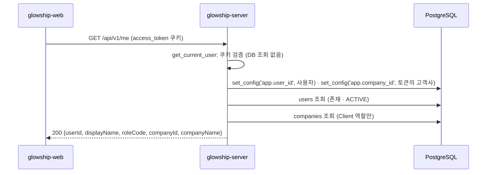

# 내 계정 조회

로그인한 사용자가 자기 계정·역할·소속 고객사명을 받는 API가 **현재 어떻게 동작하는지** 설명합니다.
로그인 응답에는 사용자 정보가 없으므로(API 명세 v6.2 C31) 로그인 직후 화면과 공통 헤더가 이 API를 호출합니다.
ADMIN의 담당 고객사 목록과 고객사 선택(명세 D7)은 아직 없으며, 이 문서는 그 자리를 어떻게 비워 두었는지까지만 다룹니다(6절).

## 1. 전체 흐름



- 다른 Client API와 달리 **모든 역할**이 호출합니다. 고객사 범위 의존성(`get_tenant_context`)은 OWNER·ADMIN을 403으로 막으므로 쿠키 검증만 하는 `get_current_user`를 씁니다.
- 값의 출처는 토큰이 아니라 **DB 행**입니다. 토큰 발급 뒤 표시 이름·역할이 바뀌어도 현재 값을 돌려줍니다. 보호된 API가 토큰만 보는 것(`docs/auth/login.md` 5절)과 다릅니다.
- RLS 컨텍스트는 첫 DB 조회 전에 설정합니다(4절).

## 2. 조회 API

`GET /api/v1/me` — `app/modules/user/presentation/me_api_router.py`

### 권한

`access_token` 쿠키가 유효하면 됩니다. 역할 제한은 없습니다. 요청 본문·경로 변수·쿼리는 없습니다.

### 성공 응답

```http
HTTP/1.1 200 OK
```

```json
{
  "userId": "01a18a64-97e5-77ce-b6d1-6bd3dbf58d48",
  "displayName": "홍길동",
  "roleCode": "CLIENT_LEAD",
  "companyId": "0199c2a8-7d4e-7b3c-9f1a-2e5d6c7b8a90",
  "companyName": "A Beauty"
}
```

| 필드 | 출처 | 설명 |
| --- | --- | --- |
| `userId` | `users.user_id` | |
| `displayName` | `users.display_name` | 생성 때 생략했으면 이메일과 같다 |
| `roleCode` | `users.role_code` | `OWNER`·`ADMIN`·`CLIENT_MEMBER`·`CLIENT_LEAD` |
| `companyId` | `users.company_id` | Client 역할만 값이 있다. OWNER·ADMIN은 `null` (`users_ck2`) |
| `companyName` | `companies.company_name` | 공통 헤더의 고객사 영역에 표시(명세 U7). OWNER·ADMIN은 `null` |

OWNER·ADMIN 응답 예:

```json
{
  "userId": "0198f2c4-7a1e-7c3b-9d2e-4f5a6b7c8d9e",
  "displayName": "admin@glowship.com",
  "roleCode": "ADMIN",
  "companyId": null,
  "companyName": null
}
```

값이 없어도 필드를 빼지 않고 `null`로 보냅니다(응답 본문 규칙 4절).

### 명세와 다른 점

명세 4.1 `GET /me`의 `email`과 ADMIN의 `assignedCompanies[]`는 **프론트 합의로 응답에 넣지 않습니다**(2026-11-05).

- `email`: 화면이 쓰지 않는다.
- `assignedCompanies[]`: Client 사용자에게는 배정이 없고, ADMIN의 고객사 선택(D7)은 아직 설계되지 않았다. 필요해지면 필드 추가로 더한다(응답 본문 규칙 7절, 추가는 자유).

### 실패 응답

모든 실패는 공통 에러 형식 `{"code", "message", "request_id"}`로 응답합니다.

| 상태 | code | 상황 |
| --- | --- | --- |
| 401 | `UNAUTHENTICATED` | 쿠키 없음·만료·위조, refresh 토큰을 access 쿠키로 보냄. **토큰의 사용자가 DB에 없을 때**도 같은 코드(세션이 유효하지 않은 것으로 본다) |
| 403 | `ACCOUNT_DISABLED` | `users.status`가 `DISABLED`. 로그인과 같은 코드 |

- 비활성 계정을 401이 아니라 403으로 구분하는 이유: 프론트는 401을 받으면 토큰 재발급을 시도합니다. 비활성 계정이 재발급 루프에 빠지지 않도록 로그인과 같은 `ACCOUNT_DISABLED`로 바로 알립니다.
- `get_current_user`는 DB를 보지 않으므로 다른 보호된 API는 토큰 만료(최대 8시간)까지 비활성 계정을 통과시킵니다. 이 API는 DB를 읽어 그 전에 막습니다.

### 서비스 로직 (`MeService.get_me`)

```
RLS 컨텍스트 설정 → users.find_by_id (없음 401 · DISABLED 403) → company_id 있으면 companies.find_by_id → MeProfile
```

- `app/modules/user/application/me_service.py`. 결과는 `MeProfile` dataclass이고, 라우터가 `MeResponse.of`로 camelCase 응답에 담습니다.
- OWNER·ADMIN은 `company_id`가 비어 있어 `companies`를 조회하지 않습니다.
- 고객사 행이 없으면(FK상 생기지 않음) `companyName`만 `null`입니다.

## 3. 역할별 결과

| 요청자 | 결과 |
| --- | --- |
| CLIENT_MEMBER · CLIENT_LEAD (ACTIVE) | 200, `companyId`·`companyName` 있음 |
| ADMIN · OWNER (ACTIVE) | 200, `companyId`·`companyName` `null` |
| 어느 역할이든 DISABLED | 403 `ACCOUNT_DISABLED` |
| 토큰은 유효하나 `users` 행 없음 | 401 `UNAUTHENTICATED` |

## 4. RLS 컨텍스트

운영(앱 DB 역할 `glowship_v4_app`)에서는 다음 정책이 행을 보여 줍니다(v6.2 DDL, 마이그레이션 `0001`의 `_create_rls()`).

| 표 | 정책 | 이 API에서 |
| --- | --- | --- |
| `users` | `users_select_tenant_or_self`: 같은 고객사 범위이거나 `user_id = app.user_id` | `app.user_id`로 자기 행을 읽는다. 고객사가 없는 OWNER·ADMIN도 자기 행은 보인다 |
| `companies` | `companies_tenant`: `company_id = app.company_id`이고 `app_context_allowed()` | 토큰의 `company_id`를 `app.company_id`로 넣어 소속 고객사를 읽는다 |

```python
# app/modules/user/application/me_service.py
await set_rls_context(
    self.db, user_id=current_user.user_id, company_id=current_user.company_id
)
```

- `set_config(..., true)`는 현재 트랜잭션에서만 유효하므로 요청 단위 세션(`get_db`)이 끝나면 사라집니다.
- 로컬은 superuser로 접속해 정책을 우회합니다. 그래도 운영과 같은 경로를 타도록 컨텍스트를 항상 설정합니다.

## 5. 테스트

`tests/modules/user/` — DB 없이 실행됩니다.

| 파일 | 내용 |
| --- | --- |
| `test_me_service.py` | 가짜 Repository로 서비스 로직 검증. Client 성공(고객사명 포함), 토큰이 아니라 DB 값 사용, ADMIN·OWNER는 `None`이고 `companies`를 읽지 않음, 첫 조회 전 RLS 컨텍스트 설정 순서, 사용자 없음 401, DISABLED 403, 고객사 행 없음 |
| `test_me_api.py` | 라우터 검증. 쿠키 없음·만료 토큰·refresh 토큰 401, 성공 200과 camelCase 키 5개, OWNER·ADMIN의 `null` 직렬화, 서비스 예외의 401·403 변환. 서비스는 `dependency_overrides`로 대체, 쿠키는 `create_access_token`으로 발급 |

로컬 DB 확인: 2026 H1 합성 계정은 로그인할 수 없으므로(명세 D24) `POST /auth/signup`(개발용, `POSTGRES_ROLE`을 비운 로컬 연결에서만 동작)으로 만든 ADMIN과, 그 ADMIN을 `admin_assignments`에 넣은 뒤 `POST /admin/users`로 만든 Client 계정으로 Swagger에서 로그인한 다음 `GET /api/v1/me`를 호출합니다.

## 6. 아직 없는 것

| 기능 | 비워 둔 자리 |
| --- | --- |
| ADMIN의 담당 고객사 목록 `assignedCompanies[]` | `AdminAssignmentRepository`에 배정 목록 조회를 더하고 `MeProfile`·`MeResponse`에 필드를 추가. 운영 RLS에서는 `admin_assignments_self_company` 정책이 `app.company_id`와 같은 배정 1건만 보여 주므로, 목록을 읽으려면 SECURITY DEFINER 조회 함수(데이터 팀 DDL)가 함께 필요하다 |
| ADMIN의 고객사 선택 (D7 `X-Company-Id`) | `get_tenant_context`가 헤더를 받아 배정 여부를 검사하는 방식으로 확장 |
| `email` 응답 | 프론트가 필요해지면 `MeProfile`·`MeResponse`에 추가(필드 추가는 자유) |

## 7. 관련 파일

| 파일 | 역할 |
| --- | --- |
| `app/modules/user/presentation/me_api_router.py` | `GET /api/v1/me` 엔드포인트 |
| `app/modules/user/presentation/me_schemas.py` | `MeResponse` (camelCase) |
| `app/modules/user/application/me_service.py` | `MeService`, `MeProfile`, 검사 순서 |
| `app/modules/user/application/exception/user_exceptions.py` | `ACCOUNT_DISABLED` |
| `app/modules/user/dependencies.py` | `get_me_service` 조립 |
| `app/modules/user/infrastructure/repository/user_repository.py` | `find_by_id` |
| `app/modules/company/infrastructure/repository/company_repository.py` | 고객사 조회 |
| `app/core/security/auth.py` | `get_current_user`, `CurrentUser` |
| `app/core/exceptions.py` | `UNAUTHENTICATED` 공통 에러 코드 |
| `app/core/rls_context.py` | `set_rls_context` |
