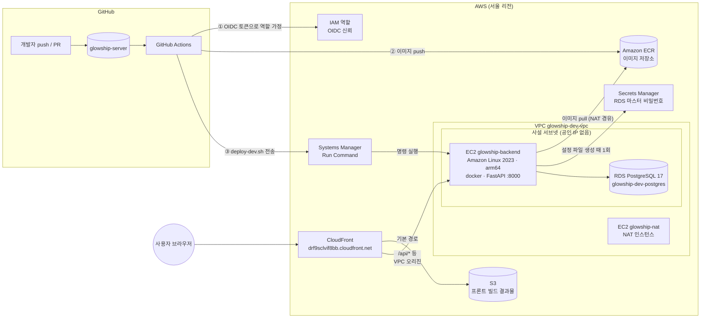
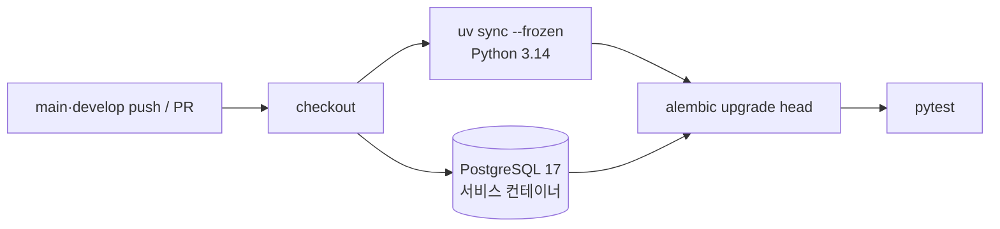
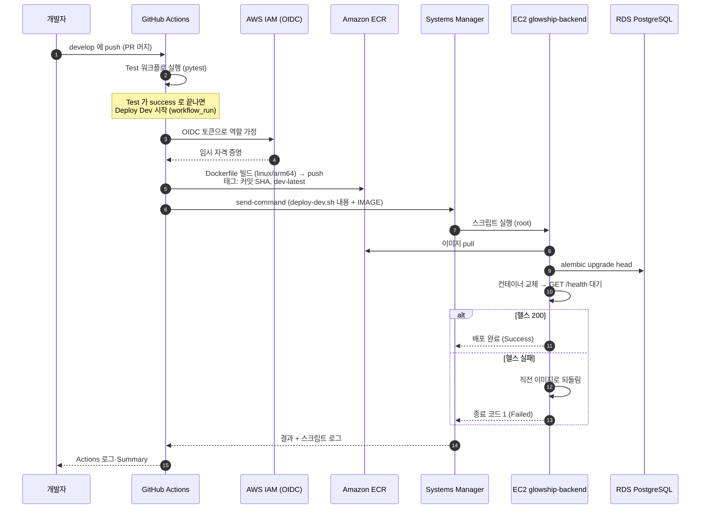
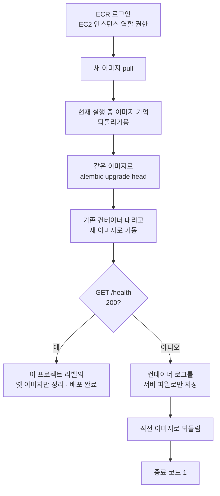
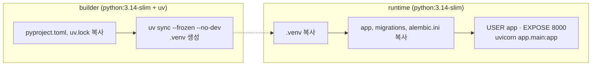
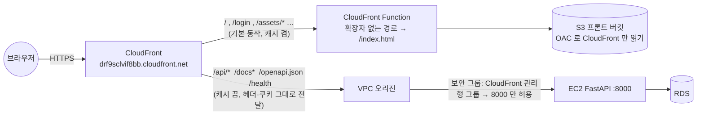

# CI/CD: 테스트 · 이미지 빌드 · dev 서버 배포

> 티켓 GLOW-142 (2026-11-09). 프론트(glowship-web) 배포는 그 저장소의 `docs/deploy.md`에 있습니다.
>
> 이 문서에는 계정 ID, 인스턴스 ID, 역할 ARN, DB 주소, 비밀값을 적지 않습니다. 실제 값은 AWS 콘솔과 GitHub 저장소 Settings에서 확인합니다.

**관련 파일**

| 파일 | 역할 |
| --- | --- |
| `.github/workflows/test.yml` | PR·push 때 pytest 실행 (CI) |
| `.github/workflows/deploy-dev.yml` | develop push 때 이미지 빌드 → ECR → EC2 배포 (CD) |
| `Dockerfile`, `.dockerignore` | FastAPI 서버 이미지 |
| `scripts/deploy/deploy-dev.sh` | EC2 안에서 실행되는 배포 스크립트 |
| `app/core/health.py` | 배포 확인용 `GET /health` |

---

## 1. 한눈에 보기



핵심 세 가지만 기억하면 됩니다.

1. **서버는 담장 안에 있다.** EC2는 사설 서브넷에 있어 밖에서 직접 닿을 수 없습니다. 들어오는 길은 CloudFront(사용자용)와 SSM(배포용) 둘뿐이고, SSH 포트도 공인 IP도 없습니다.
2. **비밀키를 저장소에 두지 않는다.** GitHub Actions는 OIDC 토큰으로 AWS 역할을 잠깐 빌려 씁니다. RDS 비밀번호는 Secrets Manager가 관리하고 EC2 안에서만 읽습니다.
3. **프론트와 API가 같은 주소다.** CloudFront 하나가 기본 경로는 S3(프론트)로, `/api/*`는 EC2(서버)로 보냅니다. 같은 출처라 쿠키 로그인이 그대로 동작합니다.

---

## 2. 쓰는 서비스와 역할

### 2.1 GitHub 쪽

| 서비스 | 무엇인가 | 여기서 하는 일 |
| --- | --- | --- |
| **GitHub Actions** | 저장소 이벤트(push, PR)에 반응해 가상 머신에서 작업을 실행하는 자동화 도구 | 린트, 테스트, 이미지 빌드, 배포 명령 전송 |
| **Secrets / Variables** | 저장소 Settings의 값 저장소. Secret은 가려지고 Variable은 보임 | 역할 ARN(Secret), 리전·ECR 이름·EC2 ID·플랫폼(Variables) |
| **Environment `dev`** | 배포 대상 환경 단위. 이력이 남고 승인자를 둘 수 있음 | 배포 job이 사용. 운영 환경을 만들 때 승인자를 붙이는 자리 |
| **OIDC 토큰** | Actions 실행마다 GitHub가 발급하는 짧은 신분증. "어느 저장소의 어느 브랜치에서 왔는지"가 적혀 있음 | AWS가 이 신분증을 믿고 역할을 빌려줌. Access Key를 저장할 필요가 없음 |

### 2.2 AWS 쪽

| 서비스 | 무엇인가 | 여기서 하는 일 |
| --- | --- | --- |
| **IAM (Identity and Access Management)** | 누가 무엇을 할 수 있는지 정하는 권한 체계 | OIDC 공급자 등록, Actions용 역할 `glowship-github-deploy`, EC2용 역할 `glowship-ec2-role` |
| **ECR (Elastic Container Registry)** | Docker 이미지 창고 | 저장소 `glowship-server`. 커밋 SHA 태그와 `dev-latest` 태그 |
| **EC2 (Elastic Compute Cloud)** | 가상 서버 | `glowship-backend`에서 docker로 FastAPI 컨테이너 실행. Graviton(arm64) t4g.small |
| **Systems Manager (SSM) Run Command** | 서버에 들어가지 않고 명령을 실행시키는 관리 서비스. 서버의 에이전트가 AWS로 먼저 연결을 맺어 둠 | 배포 스크립트 실행. 인바운드 포트를 열지 않아도 됨 |
| **RDS (Relational Database Service)** | 관리형 데이터베이스 | PostgreSQL 17. 사설 서브넷, SSL 강제 |
| **Secrets Manager** | 비밀값 금고 | RDS 마스터 비밀번호를 AWS가 직접 관리. 사람이 알 필요 없음 |
| **VPC / 서브넷 / 보안 그룹** | 가상 네트워크, 그 안의 구역, 구역별 방화벽 | EC2·RDS는 사설 서브넷. 보안 그룹으로 "누가 어느 포트로 들어올 수 있나"를 제한 |
| **NAT 인스턴스** | 사설 서브넷에서 인터넷으로 나가는 출구 | EC2가 ECR·Secrets Manager·패키지 저장소에 나갈 때 사용 |
| **CloudFront** | 전 세계 엣지에서 요청을 받아 뒤쪽으로 전달하는 CDN. HTTPS 주소를 무료로 제공 | 사용자 진입점. S3와 EC2 두 곳으로 경로별 분배 |
| **CloudFront VPC 오리진** | CloudFront가 사설 서브넷 안의 서버로 직접 연결하는 기능 | EC2를 공인 서브넷으로 옮기지 않고도 외부 접근 제공 |
| **S3 (Simple Storage Service)** | 파일 저장소 | 프론트 빌드 결과물. 비공개이며 CloudFront만 읽을 수 있음 |

---

## 3. CI: Test 워크플로 (`test.yml`)



- Ruff 검사는 기존 `code-style.yml`이 맡고, 이 워크플로는 pytest만 돌립니다.
- **DB를 띄우고 마이그레이션까지 적용**하는 이유: `tests/conftest.py`의 `db_session` 픽스처는 DB가 없거나 head가 아니면 건너뜁니다. 빈 DB라도 head 상태로 만들어 두면 저장소 SQL 스모크 시험이 실제로 돕니다.
- 설정은 `.env` 대신 워크플로 `env`에 넣습니다. DB 접속 정보, CI 전용 더미 JWT 키(32자 이상), 허용 오리진입니다. 저장소에 `.env`는 없습니다.
- 엔진(`GLOWSHIP_ENGINE_DIR`)은 저장소에 없어 CI는 엔진 없이 돌고, 엔진 대조 시험은 설계대로 건너뜁니다(`docs/analysis/engine-local-path.md`).
- **합성데이터가 있어야 하는 시험은 행이 없으면 건너뛰어야 합니다.** 빈 DB에서 `scalar_one()`처럼 행을 전제하면 CI가 실패합니다. 첫 실행에서 이런 시험 3건이 실패해 `pytest.skip`으로 고쳤습니다.

---

## 4. CD: Deploy Dev 워크플로 (`deploy-dev.yml`)

### 4.1 배포 흐름



### 4.2 두 job

| job | 하는 일 | 참고 |
| --- | --- | --- |
| **build-and-push** | OIDC 역할 가정 → ECR 로그인 → buildx로 빌드 → push | 플랫폼은 Variables `IMAGE_PLATFORM`(dev EC2는 Graviton이라 `linux/arm64`). 빌드 캐시는 Actions 캐시 |
| **deploy** (Environment `dev`) | `scripts/deploy/deploy-dev.sh` 내용을 jq로 SSM 파라미터에 담아 전송 → 끝날 때까지 10초 간격으로 상태 폴링(최대 660초) → 스크립트 stdout·stderr를 로그에 펼침 → SSM 상태가 Success가 아니면 실패 | 스크립트를 EC2에 미리 복사해 둘 필요가 없음. 저장소가 유일한 원본 |

- **시작 조건**: develop에서 Test 워크플로가 끝나면(`workflow_run`) 그 결론이 success이고, 그 Test가 **이 저장소의 develop에 직접 push된 커밋**에서 돈 것일 때만 진행합니다. 테스트가 실패한 커밋은 배포하지 않습니다. 배포 대상 커밋은 Test가 검사한 커밋(`workflow_run.head_sha`)입니다. 수동 실행(Run workflow)은 현재 develop 커밋을 배포합니다.
- **fork 차단**: `workflow_run`의 `branches: [develop]`은 Test를 일으킨 브랜치 이름만 봅니다. 공개 저장소라 누구든 fork의 develop 브랜치에서 PR을 열 수 있고, 그 PR의 Test도 이름이 develop이라 조건을 통과합니다. `workflow_run`은 이 저장소 권한(비밀값·OIDC)으로 돌기 때문에, job 조건에서 `workflow_run.event == 'push'`와 `head_repository == 이 저장소`를 함께 확인해 fork 코드가 배포되지 않게 합니다.
- 배포끼리 겹치지 않게 직렬로 실행하고, 진행 중인 배포는 취소하지 않습니다.
- SSM은 전달받은 줄들을 `sh`로 실행합니다. 스크립트는 bash 전용 문법(배열, pipefail)을 쓰므로, 워크플로가 스크립트를 EC2의 임시 파일(`mktemp`로 매번 다른 이름)로 쓴 뒤 `bash`로 실행하고 끝나면 지웁니다. EC2의 `/bin/sh`가 bash가 아니어도 동작하고, 고정 이름의 파일을 미리 만들어 두는 식의 간섭도 받지 않습니다.
- `aws ssm wait command-executed`는 최대 100초만 기다려서 쓰지 않습니다. 되돌리기 경로는 헬스 대기 두 번으로 120초를 넘길 수 있습니다.

### 4.3 deploy-dev.sh (EC2 안에서 실행)



- 설정은 EC2의 `/etc/glowship/server.env`(root 전용 600)에서 읽습니다. 키는 `.env.example`과 같고, 이 파일은 서버에만 있습니다.
- **헬스 실패 때 컨테이너 로그는 Actions로 보내지 않습니다.** 이 저장소는 공개라 Actions 로그도 공개인데, 앱 로그에는 SQL 바인딩 값(로그인 이메일 등)이 섞일 수 있기 때문입니다. 로그는 EC2의 `/var/log/glowship/deploy-failed-<시각>.log`(root 전용)에 남고 Actions에는 경로만 찍힙니다. 보려면 SSM 세션이나 콘솔에서 그 파일을 엽니다.
- 되돌리기는 컨테이너만 바꿉니다. 이미 적용된 마이그레이션은 되돌리지 않습니다(downgrade는 수동 판단). 그래서 **새 마이그레이션은 직전 이미지와도 맞아야(뒤로 호환) 합니다.** 열 삭제·이름 변경처럼 옛 코드가 깨지는 변경은 두 번에 나눠(먼저 추가, 다음 배포에서 제거) 적용합니다.
- 옛 이미지 정리는 이 프로젝트 이미지(`LABEL app=glowship-server`)만, 24시간 넘게 안 쓴 것만 지웁니다. 로컬 시험(`ECR_LOGIN=0`)에서는 정리를 건너뛰어 다른 프로젝트 이미지를 건드리지 않습니다.
- 엔진 폴더가 EC2에 있으면 Variables `DEV_ENGINE_DIR`로 경로를 줍니다. 읽기 전용으로 마운트되고 `GLOWSHIP_ENGINE_DIR`이 설정됩니다. 비우면 엔진 없이 뜨고 분석 기능은 비활성입니다.
- 로컬에서도 돌려볼 수 있습니다. `ECR_LOGIN=0`이면 ECR 로그인을 건너뛰고 로컬 이미지를 그대로 씁니다.
  ```bash
  ECR_LOGIN=0 IMAGE=glowship-server:local ENV_FILE=<env 파일> PORT=18000 scripts/deploy/deploy-dev.sh
  ```

---

## 5. Dockerfile



- 2단계 빌드라 최종 이미지에는 uv와 빌드 캐시가 없습니다. 의존성 레이어는 `uv.lock`이 바뀔 때만 다시 만들어집니다.
- 비root 사용자 `app`으로 실행합니다. 코드·마이그레이션·`.venv`는 root 소유(읽기·실행만)라 실행 사용자가 코드를 고칠 수 없습니다.
- `LABEL app=glowship-server`는 배포 스크립트의 옛 이미지 정리가 이 프로젝트 이미지만 고르는 표식입니다.
- uv 판은 Dockerfile·`test.yml`·로컬이 같은 판(0.12.17)으로 고정돼 `uv.lock`을 같은 방식으로 읽습니다.
- `.env`·`tests`·`docs`·`resource`·`scripts`는 `.dockerignore`로 빌드 컨텍스트에서 뺍니다. 설정은 환경변수로만 받습니다.
- 마이그레이션을 이미지에 포함해 배포 스크립트가 같은 이미지로 `alembic upgrade head`를 실행합니다.
- 엔진 코드는 이미지에 넣지 않습니다(공개 저장소·데이터 팀 결과물).
- 로컬 확인:
  ```bash
  docker build -t glowship-server:local .
  docker run --rm -p 8000:8000 --env-file .env -e POSTGRES_HOST=host.docker.internal glowship-server:local
  curl http://localhost:8000/health   # {"status":"ok","database":"ok"}
  ```

---

## 6. 사용자 요청 경로 (CloudFront)



| 경로 | 가는 곳 | 캐시 |
| --- | --- | --- |
| `/api/*` | EC2 (FastAPI) | 끔. 쿠키·헤더·쿼리 전부 서버로 전달 |
| `/docs*`, `/openapi.json`, `/health` | EC2 | 끔. 개발 확인용 |
| 그 외 전부 | S3 (프론트 빌드) | 켬. `/login` 같은 SPA 경로는 Function이 `index.html`로 바꿈 |

- HTTP로 오면 HTTPS로 리다이렉트합니다. 도메인을 사지 않아도 CloudFront 기본 도메인으로 HTTPS가 됩니다.
- S3 버킷은 비공개이고 OAC(Origin Access Control)로 이 CloudFront 배포만 읽을 수 있습니다.
- backend 보안 그룹의 8000 포트는 CloudFront VPC 오리진 전용 보안 그룹에서만 열려 있습니다. 인터넷 전체에는 열려 있지 않습니다.

---

## 7. GET /health

- `app/core/health.py`. 서버가 요청을 받고 앱 DB 엔진으로 `SELECT 1`이 3초 안에 되면 200 `{"status":"ok","database":"ok"}`, 아니면 503 `{"status":"error","database":"error"}`.
- 인증 없음, `/api/v1` 밖, OpenAPI 문서에서 제외. 실패 사유는 응답에 넣지 않고 로그에만 남깁니다.
- 배포 스크립트의 헬스 확인과 외부 동작 확인(`https://<CloudFront 도메인>/health`)에 씁니다. 프론트 API 목록(`docs/frontend-api.md`)에는 넣지 않습니다.

---

## 8. 한 번만 하는 준비 (어디에 무엇이 있나)

### 8.1 GitHub 저장소 Settings

| 종류 | 이름 | 내용 |
| --- | --- | --- |
| Secret | `AWS_ROLE_ARN` | Actions가 가정할 IAM 역할 ARN |
| Variable | `AWS_REGION` | ECR·EC2 리전 |
| Variable | `ECR_REPOSITORY` | `glowship-server` |
| Variable | `DEV_EC2_INSTANCE_ID` | dev 서버 EC2 인스턴스 ID |
| Variable | `IMAGE_PLATFORM` | `linux/arm64` |
| Variable | `DEV_ENGINE_DIR` | 선택. EC2의 엔진 폴더 경로 |
| Environment | `dev` | 배포 job이 사용. **Deployment branches를 `develop`만으로 제한**(아래). 승인자를 두려면 여기서 설정 |

**저장소 설정 두 가지 (관리자 권한)**

| 설정 | 왜 필요한가 |
| --- | --- |
| Environment `dev` → Deployment branches → Selected branches: `develop` | IAM 신뢰 정책이 `environment:dev` 토큰을 허용하므로, 제한이 없으면 아무 브랜치의 워크플로나 이 환경을 써서 역할을 가정하고 EC2에 명령을 보낼 수 있음 |
| develop 규칙 세트 → Required status checks: `pytest` (+ `Ruff`) | 테스트가 실패한 PR이 머지되지 않게. `deploy-dev.yml`의 `workflow_run` 조건은 이 설정이 빠졌을 때의 2차 방어 |

### 8.2 AWS 자원

| 자원 | 내용 |
| --- | --- |
| IAM OIDC 공급자 | `token.actions.githubusercontent.com`. 계정에 하나 |
| IAM 역할 `glowship-github-deploy` | Actions용. 신뢰 정책은 이 저장소의 `develop`(ref)과 `environment:dev` 토큰만 허용. 권한은 ECR 저장소 `glowship-server` push, dev EC2 한 대에 대한 `ssm:SendCommand`(문서 `AWS-RunShellScript`), `ssm:GetCommandInvocation` |
| ECR 저장소 `glowship-server` | 태그 가변(`dev-latest` 덮어쓰기), push 시 취약점 스캔 |
| EC2 인스턴스 역할 `glowship-ec2-role` | `AmazonSSMManagedInstanceCore`, `AmazonEC2ContainerRegistryReadOnly`, RDS 마스터 비밀번호(Secrets Manager) 읽기 |
| EC2 `glowship-backend` | Amazon Linux 2023 arm64, t4g.small(메모리 2GB) + 스왑 파일 2GB(8.4절). docker, aws cli, `/etc/glowship/server.env`. SSM으로 설치·작성 |
| RDS `glowship-dev-postgres` | PostgreSQL 17. 마스터 비밀번호는 Secrets Manager 관리형. SSL 강제(`rds.force_ssl=1`) |
| 보안 그룹 | backend: CloudFront VPC 오리진 관리형 그룹 → 8000. DB: backend → 5432 |
| CloudFront 배포 | VPC 오리진(EC2 8000, http-only) + S3 오리진(OAC). 경로별 동작은 6절 |
| CloudFront Function `glowship-dev-web-spa-router` | 확장자 없는 경로를 `/index.html`로 바꿈 (viewer-request) |
| S3 버킷 (프론트) | 비공개. 퍼블릭 접근 전부 차단. 버킷 정책으로 이 CloudFront 배포만 `GetObject` |

- 이 저장소의 GitHub OIDC 주체(sub)는 ID 포함 불변 형식(`repo:<조직>@<id>/<저장소>@<id>:...`)입니다. 신뢰 정책을 다시 쓸 때는 다음으로 확인합니다.
  ```bash
  gh api repos/<조직>/<저장소>/actions/oidc/customization/sub
  ```
- 같은 AWS 계정에 다른 프로젝트 자원이 있습니다. glowship 이름의 자원만 다룹니다.

### 8.3 dev 서버 설정 파일 (`/etc/glowship/server.env`)

- `APP_ENV=dev`, RDS 접속 정보(마스터 계정), `CORS_ORIGINS=["https://<CloudFront 도메인>"]`, 서버 안에서 생성한 `JWT_SECRET_KEY`.
- RDS 비밀번호는 EC2가 Secrets Manager에서 읽어 파일에 썼습니다. 사람 손을 거치지 않았고 로그에도 남기지 않았습니다.
- dev는 데모(합성데이터) 환경이라 `VIRTUAL_CLOCK_START`는 기본값을 씁니다. 실제 원천을 붙이는 환경에서는 비웁니다(`.env.example`).
- 역할 분리(`POSTGRES_ROLE`, 워커 계정)는 dev에서 쓰지 않습니다. 운영 단계에서 도입합니다.

### 8.4 dev 서버 메모리와 스왑

dev EC2는 t4g.small(메모리 약 1.8GiB)입니다. 분석 실행 하나가 최고 1.53GB(재계산이 끼면 1.69GB)를 쓰므로(`docs/analysis/auto-start.md` 7절 3번) 분석 자동 시작을 켜면 여유가 거의 없습니다. 메모리가 바닥나면 커널이 컨테이너 프로세스를 죽여(OOM) 서버가 재시작됩니다. 그래서 자동 시작을 켜기 전에 **스왑 파일 2GB**를 두었습니다(2026-11-13).

- 스왑은 디스크를 메모리처럼 쓰는 것이라 RAM보다 훨씬 느립니다. 평소 쓰라고 둔 것이 아니라, 순간적으로 넘칠 때 죽지 않게 하는 안전 여유입니다. 분석 동시 실행 수는 그대로 1입니다(`ANALYSIS_MAX_CONCURRENT_RUNS=1`, `ENGINE_STORE_CACHE_MAX_ENTRIES=1`).
- `vm.swappiness`를 기본 60에서 10으로 낮춰 RAM이 거의 찼을 때만 스왑으로 넘어가게 했습니다.
- 서버 컨테이너에는 메모리 제한을 두지 않았으므로(`docker run`에 `--memory` 없음) 컨테이너가 호스트 스왑을 그대로 씁니다.
- 루트 디스크는 gp3 20GB이고 스왑 파일을 넣은 뒤 약 15GB가 남습니다.

SSM `AWS-RunShellScript`로 root 권한에서 실행한 내용입니다(루트 파일시스템이 XFS라 `fallocate` 대신 `dd`로 실제 기록).

```bash
dd if=/dev/zero of=/swapfile bs=1M count=2048 status=none
chmod 600 /swapfile
mkswap /swapfile
swapon /swapfile
echo '/swapfile none swap sw 0 0' >> /etc/fstab          # 재부팅 뒤에도 유지
printf 'vm.swappiness = 10\n' > /etc/sysctl.d/90-glowship-swap.conf
sysctl -p /etc/sysctl.d/90-glowship-swap.conf
```

확인은 `free -m`(Swap total 2047), `swapon --show`, `swapon -a`(fstab 항목이 올바르면 오류 없음)입니다. 컨테이너 재시작은 필요 없습니다.

**켠 뒤 볼 것.** 분석이 돌 때 `free -m`의 Swap used 와 `docker stats --no-stream`을 봅니다. 스왑 사용량이 수백 MB 넘게 꾸준히 남으면 스왑만으로는 분석이 느려지므로 인스턴스를 t4g.medium(4GB)으로 바꾸는 것을 검토합니다(그때는 `docs/analysis/auto-start.md` 7절 3번 표의 4GB 값으로 설정을 되돌릴 수 있습니다).

---

## 9. 운영 절차

| 상황 | 하는 일 |
| --- | --- |
| **배포** | PR을 develop에 머지하면 Test → (성공 시) Deploy Dev 순으로 자동. 수동은 Actions → Deploy Dev → Run workflow |
| **확인** | Actions 로그의 deploy job에 `deploy-dev.sh` 출력이 펼쳐져 있음. `배포 완료`가 찍히면 `https://<CloudFront 도메인>/health`가 200 |
| **헬스 실패** | 스크립트가 직전 이미지로 되돌림. 컨테이너 로그는 EC2의 `/var/log/glowship/deploy-failed-<시각>.log`에만 있음(Actions에는 경로만). 되돌린 서버가 동작하려면 그 사이 마이그레이션이 뒤로 호환이어야 함(4.3절) |
| **권한 오류** | ECR·SSM 거절은 IAM 역할 `glowship-github-deploy`의 정책, pull 거절은 `glowship-ec2-role` |
| **빌드 실패** | `Dockerfile`, `uv.lock`. 로컬 `docker build`로 재현 |
| **롤백** | 커밋 SHA 태그가 ECR에 남아 있음. EC2에서 `IMAGE=<ECR 주소>:<이전 SHA> AWS_REGION=<리전> scripts/deploy/deploy-dev.sh`를 SSM으로 실행 |
| **설정 변경** | `/etc/glowship/server.env`를 SSM으로 고친 뒤 재배포(또는 컨테이너 재시작). 비밀값은 출력에 찍지 않음 |
| **메모리 부족·OOM** | `free -m`, `docker stats --no-stream`, `dmesg -T`에서 `oom`·`Killed process` 검색으로 확인. 스왑 2GB와 설정값(동시 1·캐시 1)은 8.4절. 그래도 반복되면 인스턴스 크기 변경 |

---

## 10. 아직 안 한 것

- dev DB에 합성데이터 적재(seed)와 관리자 계정 생성. 배포 뒤 로그인까지 확인하려면 필요합니다.
- 엔진 폴더를 EC2에 두고 `DEV_ENGINE_DIR` 설정(분석 기능 활성). 데이터 팀과 전달 방식 합의가 필요합니다.
- 운영 배포(main → 운영 서버) 워크플로. dev와 같은 모양에 Environment 승인자를 더하는 것을 권장합니다.
- 운영에서는 `/docs`·`/openapi.json`을 CloudFront 동작에서 빼거나 앱에서 끕니다. dev는 합성데이터라 열어 두었습니다.
- 앱 DB 엔진의 `echo=True`(`app/core/database.py`)를 local에서만 켜거나 `hide_parameters=True`로 바꾸기. 지금은 모든 환경에서 SQL과 바인딩 값이 INFO 로그에 남습니다. 배포 스크립트는 그 로그를 Actions로 보내지 않지만 서버 로그 자체의 노출 범위를 줄이는 후속 과제입니다.
- 베이스 이미지(`python:3.14-slim`, uv)를 digest로 고정하기.
- Docker 이미지 크기(약 460MB) 축소, CloudFront 접근 로그.
