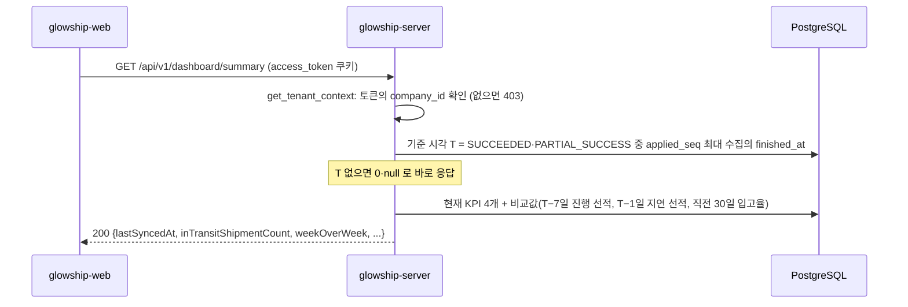

# 대시보드 요약·입고 추이

고객사 사용자가 홈 대시보드(SCR-002)에서 보는 **KPI 카드 4개**와 **입고 추이 그래프** API가 현재 어떻게 동작하는지 설명합니다.
정의는 API 명세 v6.2 4.4 `GET /dashboard/summary`·`GET /dashboard/inbound-trend`와 0절 C22, 응답 모양은 응답 본문 규칙(`api_response_body_rule_glowship.md`)을 따릅니다. 두 문서는 `glowship-plan` 저장소에 있습니다.

## 1. 기준 시각 T (명세 C22)

- **T = 고객사의 마지막 적재 수집 완료 시각**입니다. `status`가 `SUCCEEDED`·`PARTIAL_SUCCESS`인 `data_sync_runs` 중 적용 순번(`applied_seq`)이 가장 큰 수집의 `finished_at`이고, 응답 `lastSyncedAt`입니다(명세 C32). `finished_at` 최댓값이 아니라 순번으로 고르는 것은 serviceflow 5.2절 "왜 시각이 아니라 순번인가"를 따릅니다. `GET /data-sync-runs/latest`의 `lastSyncedAt`과 같은 기준입니다.
- **기준일 = T의 UTC 날짜**입니다. 서버의 지금 시각이 아닙니다. 2026 H1 합성 데이터는 2026-07-01 00:04:30Z 수집에서 멈춰 있어서, 지금 시각을 쓰면 "최근 30일" 값이 모두 비게 됩니다.
- 적재된 수집이 없으면 `lastSyncedAt`은 `null`이고, 건수는 0, 비율·비교값은 `null`, 입고 추이 `points`는 `[]`입니다.
- 두 API 모두 조회할 때 계산하고 저장하지 않습니다.



## 2. `GET /api/v1/dashboard/summary` (API 22)

`app/modules/dashboard/presentation/dashboard_api_router.py`, 계산은 `application/dashboard_query_service.py`·`infrastructure/repository/dashboard_repository.py`

| 필드 | 정의 | 비교값 |
| --- | --- | --- |
| `inTransitShipmentCount` | `current_stage <> RECEIVED`인 선적 수 | `weekOverWeek` = 현재 − T−7일 값. T−7일 값은 그 시각까지 관측된 마지막 일정 스냅샷(`observed_at` ≤ 시각)의 `stage`가 `RECEIVED`가 아닌 선적 수(그때까지 스냅샷이 없는 선적은 세지 않음) |
| `delayedShipmentCount` | **열린 에피소드**(`closed_at` 없음) 중 현재 실행(`is_latest`)이 `NO_DELAY`가 아니고(실행이 없어도 셈) 그 지연의 어느 실행에도 최종 선택이 없는 것의 서로 다른 선적 수 | `dayOverDay` = 현재 − T−1일 값. T−1일 값은 그 시각에 감지되어 있고 닫히지 않았으며, 그때까지 끝난 최신 실행(`finished_at` ≤ 시각, `version_no` 최대)이 `NO_DELAY`가 아니고, 그때까지 최종 선택(`decided_at` ≤ 시각)이 없는 지연의 선적 수 |
| `onTimeInboundRate` | `(기준일 − 30일, 기준일]`에 입고된 선적 중 `actual_3pl_inbound_date ≤ planned_3pl_inbound_date` 비율(0~1). 입고 0건이면 `null` | `monthOverMonth` = 현재 − 직전 30일 `(기준일 − 60일, 기준일 − 30일]` 비율. 어느 쪽이든 `null`이면 `null` |
| `atRiskOrderCount` | **열린 에피소드** 중 현재 실행이 `READY_FOR_REVIEW`인 지연들의 위험 주문 수(입고로 닫혀 `READY_FOR_REVIEW`로 남은 실행은 동결이라 세지 않음, C22). `at_risk_orders`는 주문 상세 단위라 **서로 다른 주문 수**로 센다(D21). 대상이 없으면 0(`null` 아님) | `atRiskOrderRate` = 위험 주문 ÷ 미출고 주문(`OPEN`·`PARTIALLY_SHIPPED`). 미출고 주문이 0건이면 `null` |

- 과거 값은 시각이 남는 열로만 되살립니다. 실행 `status`는 지금 값이지만 `NO_DELAY`는 끝난 실행의 최종 상태라 과거 판정에 써도 바뀌지 않습니다.
- 지연 선적과 위험 주문에 열린 에피소드 조건을 둔 것은 C22 결정입니다. 명세 문장대로면 입고·회복으로 닫힌 에피소드도 지연 선적이 되고, 입고로 닫힌 에피소드는 새 실행 없이 `READY_FOR_REVIEW`로 남을 수 있어(serviceflow 4절) 그 위험 주문도 KPI에 남습니다.

### 성공 응답 (확정 DB, A_BEAUTY)

```json
{
  "lastSyncedAt": "2026-07-01T00:04:30Z",
  "inTransitShipmentCount": 5,
  "weekOverWeek": 1,
  "delayedShipmentCount": 0,
  "dayOverDay": 0,
  "onTimeInboundRate": 1.0,
  "monthOverMonth": 0.0,
  "atRiskOrderCount": 0,
  "atRiskOrderRate": 0.0
}
```

- 확정 DB는 지연 8건이 모두 닫혀 있고 `READY_FOR_REVIEW` 실행이 없어 지연 선적·위험 주문이 0입니다. 규칙은 테스트에서 롤백되는 트랜잭션 안에서 데이터를 바꿔 확인합니다(지연 8건을 열면 A 3·B 2, 위험 주문이 있는 실행을 현재 실행·`READY_FOR_REVIEW`로 바꾸면 그 지연이 닫혀 있을 때 0건, 열면 상세 7행 → 주문 3건).
- 과거 지연 선적 수는 지연 8건 이력에서 손으로 센 값과 비교합니다(예: A_BEAUTY 1/1 01:00 4건 → 1/2 12:00 2건, 최종 선택 2건이 빠짐).

## 3. `GET /api/v1/dashboard/inbound-trend` (API 23)

| 이름 | 타입 | 기본값 | 설명 |
| --- | --- | --- | --- |
| `days` | `7`·`30`·`90` | `7` | 기간(일). 글자 그대로만 받는다. `07`·`7.0`·`+7`·`14`는 422 |
| `warehouseId` | UUID | 없음 | 입고 창고 |

- 기간은 `[기준일 − days + 1일, 기준일]`이고 날짜마다 점 하나를 날짜 순으로 줍니다. 0건인 날도 `0`으로 넣습니다.
- `plannedCount` = 그날이 `planned_3pl_inbound_date`인 선적 수, `actualCount` = 그날이 `actual_3pl_inbound_date`인 선적 수(단위 건).

```json
{
  "points": [
    { "date": "2026-06-25", "plannedCount": 0, "actualCount": 0 },
    { "date": "2026-06-28", "plannedCount": 1, "actualCount": 0 }
  ]
}
```

(일부만 보임. 확정 DB A_BEAUTY 30일: 예정 5건·실제 4건, 7일: 06-28 예정 1건.)

## 4. 오류

| 상태 | `code` | 경우 |
| --- | --- | --- |
| `401` | `UNAUTHENTICATED` | 쿠키 없음·만료 |
| `403` | `FORBIDDEN` | 토큰에 `company_id` 없음(OWNER·ADMIN) |
| `422` | `VALIDATION_ERROR` | `days`가 `7`·`30`·`90`이 아님, `warehouseId` UUID 형식 오류 |

## 5. 테스트

| 파일 | 내용 |
| --- | --- |
| `tests/modules/dashboard/test_dashboard_query_service.py` | 입고 추이 0건 채움·90개 점·수집 없음·UTC 기준일 |
| `tests/modules/dashboard/test_dashboard_summary_service.py` | KPI·비교값 계산, 30일 범위, 비율 `null` 규칙 |
| `tests/modules/dashboard/test_dashboard_api.py`, `test_dashboard_summary_api.py` | 401·403·422, 응답 모양 |
| `tests/modules/dashboard/test_dashboard_repository_sql.py`, `test_dashboard_summary_sql.py`, `test_dashboard_compare_sql.py` | 확정 DB 값, 롤백 트랜잭션으로 지연·위험 주문 규칙, 과거 지연 선적 수 8개 시각 |
