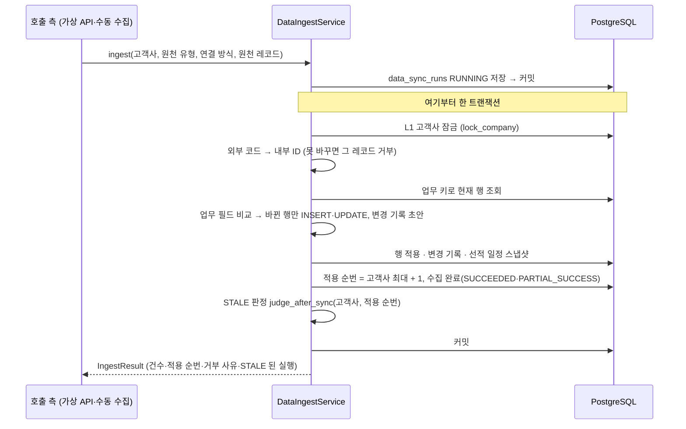

# 수집 적재 (GLOW-13)

원천 시스템(ERP·WMS·TMS)에서 받은 레코드를 업무 테이블에 반영하는 **수집 적재 서비스가 현재 어떻게 동작하는지** 설명합니다.
기준은 serviceflow 5.2 "수집 적재", `data_schema_storage_glowship.md` 4.2·4.3, 결정 1-10(초기 선적 스냅샷), 후보 2 보고서 H-4(시장 리드타임 대체)입니다.
수집을 부르는 쪽(가상 API GLOW-49, 수동 수집 API 25)과 검증 오류 기록(GLOW-15)은 아직 없습니다(7절).

## 1. 전체 흐름

- 처리 중 예외가 나면 그 트랜잭션을 되돌리고 수집을 `FAILED`(적용 순번 없음)로 남긴 뒤 예외를 다시 올립니다.
- 같은 값을 다시 수집하면 업무 행·변경 기록은 그대로이고, 적용 순번만 하나 늘어난 `SUCCEEDED` 수집이 남습니다.
- 코드: `app/modules/data_sync/application/ingest/`(서비스·규칙), `app/modules/data_sync/infrastructure/repository/ingest_repository.py`(SQL)

## 2. 원천 레코드 (`source_payload.py`)

| 원천 유형 | 원천 시스템 | 레코드 | 코드 변환 |
| --- | --- | --- | --- |
| `PRODUCT` | ERP | `SourceSku` | 없음 (업무 키 `sku_code`) |
| `WAREHOUSE` | ERP | `SourceWarehouse` | 없음 (업무 키 `warehouse_code`) |
| `ORDER` | ERP | `SourceOrder` + 상세 | 내부 SKU·창고 코드 그대로 |
| `SHIPMENT` | TMS | `SourceShipment` + 상세 | `external_entity_mappings`(`MAPPED`) TMS 코드 (`TMS-LAX`·`TMS-SKU-001` …) |
| `INVENTORY` | WMS | `SourceInventory` | `external_entity_mappings`(`MAPPED`) WMS 코드 |

- 선적은 TMS 응답 그대로입니다(`shipmentNo`·`mode`·`destWh`·`plannedKrRelease`·`stage`·`etaPort`·`eta3pl`·`actual3pl`·`items`). 운송 수단은 `OCEAN`·`AIR`입니다.
- 원천 삭제는 행을 지우지 않고 상태 `REMOVED_AT_SOURCE`로 옵니다(UPDATE). 응답에서 빠진 행·상세는 삭제로 보지 않습니다.

## 3. 선적의 항구·리드타임 기준·계획 입고일 (`code_resolver.py`)

TMS 는 이 값들을 보내지 않으므로 서버가 정합니다. **새 선적일 때만** 정하고, 이미 있는 선적은 저장된 기준·계획일을 그대로 씁니다(한국 계획 출고일이 바뀌어도 다시 계산하지 않음).

| 값 | 규칙 | 근거 |
| --- | --- | --- |
| 미국 항구 | (도착 창고 지역, 운송 수단) 경로표: 서부+`OCEAN` → `2704`, 동부+`AIR` → `1003`, 서부+`AIR` → `2720` | 생성기 경로표 `ROUTES`, 확정 선적 166건 |
| 시장 리드타임 기준 | 출고 월 기준 → 인정 범위(≤ `2026-01`) 안 가장 최근 연도의 같은 달 → 같은 경로의 가장 가까운 이전 달. 없으면 거부 | 생성기 `market_row`, 후보 2 보고서 H-4 (마스터의 2026-02 이후 추정 행은 쓰지 않음) |
| 계획 3PL 입고일 | 한국 계획 출고일 + 올림(p90) | `data_schema_storage_glowship.md` 4.3 |

- 인정 범위의 끝 월은 `LAST_ACCEPTED_REFERENCE_MONTH`(코드표 `CodeBook.last_accepted_reference_month`)입니다. 시장 마스터를 새로 적재하면 이 값을 바꿉니다.
- 생성기의 마지막 단계(운영 기준)는 쓰지 않습니다. `shipments.market_leadtime_reference_id`가 NOT NULL·FK 라 운영 기준을 저장할 자리가 없고, 운영 리드타임에는 해상 운송 기간·p90 이 없습니다.

## 4. 변경 판정과 변경 기록 (`change_detection.py`)

- 업무 키로 현재 행을 찾아 업무 필드(`FIELDS`)를 비교합니다. 다른 필드만 `changed_fields`(DB 열 이름)에 넣고, 문자열 앞뒤 공백은 무시합니다.
- 변경 기록은 **영향 SKU마다 1건**입니다. 상세의 SKU가 바뀌면 변경 전·후 SKU 모두 남깁니다. 창고 변경은 창고로 남깁니다.
- 상세만 바뀌어도 상위 주문·선적의 `data_sync_run_id`를 그 수집으로 바꿉니다.
- **변경 요약은 STALE 판정과의 약속입니다.** 정상 출고는 정확히 아래 문장이어야 관련 변경에서 빠집니다(`delay_analysis/application/stale/relevance.py`). 테스트가 두 쪽 문장을 직접 비교합니다.

| 변경 | 요약 |
| --- | --- |
| 주문 상태만 바뀜 | `주문 상태 {STATUS}` (예: `주문 상태 SHIPPED`·`주문 상태 DELIVERED`) |
| 주문 상세 출고 수량만 바뀜 | `출고 수량` |
| 새 주문·상세 | `주문 {코드}`·`주문 상세 {코드}#{줄}` |
| 선적 머리 | `선적 {코드} {현재 단계}` |
| 새 선적 상세 | `선적 상세 {코드}#{줄}` |
| 재고 | `재고 {날짜} {창고 코드} {SKU 코드}` |
| 그 밖의 UPDATE | `{대상} 변경: {필드, …}` |

## 5. 선적 일정 스냅샷

`shipment_schedule_snapshots`는 지연 감지(할 일 9)가 비교할 관측 기록입니다. 수집 1회에 선적당 최대 1건입니다.

- 새 선적: **운송 중이면** 기준 스냅샷 1건. 처음 들어올 때 이미 `RECEIVED`면 남기지 않습니다(결정 1-10).
- 이미 있는 선적: 단계·예상 항구 도착일·예상 3PL 입고일 중 하나라도 바뀌면 1건(실제 입고일만 바뀌면 남기지 않음).
- `observed_at`은 수집 시작 시각입니다. 결정 1-10에 따라 초기 기준 스냅샷만으로는 지연 이벤트·분석 실행을 만들지 않습니다(지연 감지에서 처리).

## 6. 거부와 건수

| 사유 코드 | 언제 |
| --- | --- |
| `UNMAPPED_SKU_CODE`·`UNMAPPED_WAREHOUSE_CODE` | 코드표에 없는 SKU·창고 코드 (상세 하나라도 없으면 레코드 전체) |
| `UNSUPPORTED_TRANSPORT_MODE` | `OCEAN`·`AIR`가 아닌 운송 수단 |
| `NO_ROUTE_PORT` | 경로표에 없는 (창고 지역, 운송 수단) |
| `NO_LEADTIME_REFERENCE` | 새 선적의 시장 리드타임 기준을 찾지 못함 |
| `DUPLICATE_IN_BATCH` | 같은 수집 안에 업무 키가 같은 레코드가 2건 이상 (모두 거부) |

- 받은 건수 = 적재 건수 + 거부 건수. 거부가 없으면 `SUCCEEDED`, 있으면 `PARTIAL_SUCCESS`입니다.
- 거부 사유는 `IngestResult.rejections`로 돌려줍니다. `data_validation_issues` 기록은 GLOW-15 가 붙입니다.

## 7. 아직 없는 것

- 수집을 부르는 쪽: 가상 API(GLOW-49), 수동 수집 API 25(`POST /data-sync-runs`, 11/04)
- 검증 오류 기록·분석 보류(GLOW-15)
- 지연 감지·후속 AUTO 실행(할 일 9). 지연 이벤트·분석 시나리오는 수집이 아니라 지연 감지·분석 실행이 만듭니다.

## 8. 검증

| 테스트 | 확인하는 것 |
| --- | --- |
| `test_change_detection.py` | 변경 판정·요약 문장·스냅샷 조건 (DB 없음) |
| `test_code_resolver.py` | 코드 변환·경로표·기준 찾기 순서·거부 사유 (DB 없음) |
| `test_ingest_repository_sql.py` | 조회·적용 SQL, 확정 선적 166건의 기준·계획 입고일·항구 분포(2704 83·1003 82·2720 1) |
| `test_ingest_service_sql.py` | 재수집 무변경, 변경 적용, 부분 성공, 실패 시 롤백·`FAILED`, 새 선적 스냅샷, 실제 STALE 판정 연결 |
| `test_ingest_replay_sql.py` | 확정 선적 관측을 날짜순 TMS 응답으로 재수집 → 일정 스냅샷 223건과 최종 선적 행이 확정 DB와 같음 |

DB 테스트는 실제 DB 에 쓰고 끝나면 롤백합니다(`tests/conftest.py`의 `db_write_session`, SAVEPOINT 모드). DB 가 없으면 건너뜁니다.
