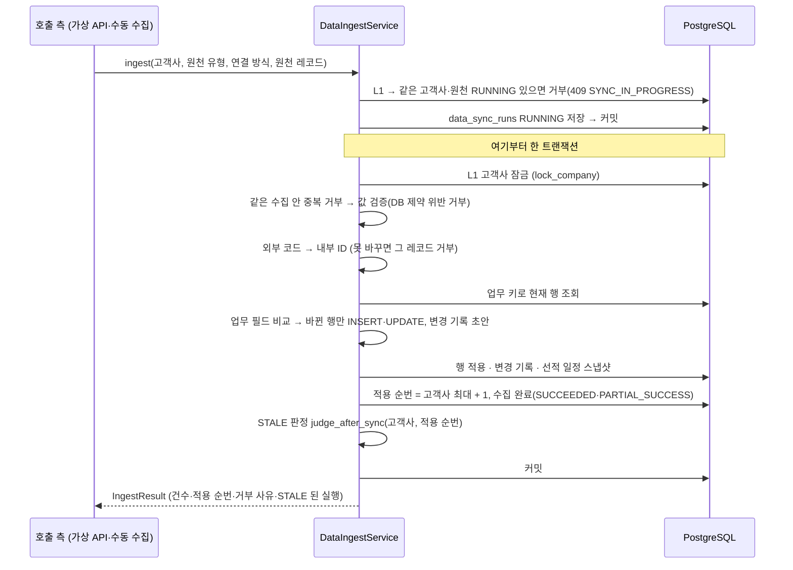

# 수집 적재 (GLOW-13)

원천 시스템(ERP·WMS·TMS)에서 받은 레코드를 업무 테이블에 반영하는 **수집 적재 서비스가 현재 어떻게 동작하는지** 설명합니다.
기준은 serviceflow v6.2 1절 "계획 입고일"·5.2절 "수집 적재"·7절 결정표 "선적 계획 기준"과, 합성데이터 결정 1-10(초기 선적 스냅샷)·H-4(시장 리드타임 대체)입니다. 두 합성데이터 결정은 공유 문서에 없어 원문을 9절에 옮겨 두었습니다.
수집을 부르는 쪽(가상 API GLOW-49, 수동 수집 API 25)과 검증 오류 기록(GLOW-15)은 아직 없습니다(7절).

## 1. 전체 흐름

- 처리 중 예외가 나면 그 트랜잭션을 되돌리고 수집을 `FAILED`(적용 순번 없음)로 남긴 뒤 예외를 다시 올립니다. `FAILED` 기록이 또 실패해도(연결 끊김, 이미 `RUNNING` 아님 등) **원래 예외**를 올리고, 기록 실패는 그 예외의 note 로 붙입니다. 이때 수집은 `RUNNING`으로 남을 수 있습니다(7절 정리 작업).
- **같은 고객사·원천의 수집은 한 번에 하나만 돕니다.** 시작할 때 L1 안에서 `RUNNING` 수집이 있으면 시작 시각과 관계없이 `SyncInProgressException`(409 `SYNC_IN_PROGRESS`, 명세 4.3)으로 거부합니다. 그래서 늦게 잠금을 얻은 수집이 먼저 적용된 최신 값을 과거 값으로 덮어쓰지 않습니다.
- **오래 남은 `RUNNING`(작업이 죽은 경우)도 막습니다.** 시간이 지났다고 무시하지 않습니다. 살아 있는 긴 수집과 새 수집이 둘 다 적용되는 역전을 막기 위해서입니다. 정리 절차는 7절(후속 운영 작업)입니다.
- 순서대로 따로 들어온 응답의 선후(관측 시각)는 호출 측 계약입니다. 가상 API 는 관측 시각 순서대로 응답합니다.
- **입력 크기:** 업무 키 IN 조회와 수집 ID 교체는 키 5,000개씩 나눠 실행합니다(asyncpg 바인딩 한도 32,767, 재고 복합 키는 키당 값 3개). 나눠도 수집 1회 = 한 트랜잭션입니다.
- 같은 값을 다시 수집하면 업무 행·변경 기록은 그대로이고, 적용 순번만 하나 늘어난 `SUCCEEDED` 수집이 남습니다.
- **실행 전제(호출 측 계약):**
  - DB 역할은 워커 역할(`glowship_v4_worker`)입니다. 서비스는 RLS 컨텍스트에 고객사만 넣고(`user_id=None`), 워커 역할의 `app_context_allowed`는 고객사가 `ACTIVE`인지만 봅니다. 앱 역할(`glowship_v4_app`)은 `ACTIVE` 사용자(그 고객사 CLIENT 또는 배정된 ADMIN)도 요구하므로, 앱 역할로 돌리면 행이 모두 숨겨져 조회가 비고 INSERT 가 고유 제약 위반으로 실패합니다(마이그레이션 0001 `app_context_allowed`). 워커 역할 권한은 이 서비스가 쓰는 표를 모두 포함합니다(상품·창고·주문·선적·재고·수집 실행·분석 실행은 SELECT·INSERT·UPDATE, 변경 기록·일정 스냅샷은 SELECT·INSERT, DELETE 없음).
  - 세션은 이 서비스 전용입니다. 서비스가 직접 commit·rollback 하므로(`RUNNING` 기록, 적용, `FAILED` 기록) 요청 세션(`get_db`)을 공유하면 안 됩니다.
  - **아직 정하지 않은 것:** 지금 앱 연결은 설정의 `postgres_user` 하나뿐이고 워커 역할 연결이 없습니다. 수동 수집 API 25(`POST /data-sync-runs`, 202 뒤 백그라운드 실행)를 붙일 때 워커 역할 전용 세션을 새로 여는 방식으로 연결을 정합니다. 로컬 테스트는 superuser 연결이라 RLS 를 거치지 않습니다.
- 코드: `app/modules/data_sync/application/ingest/`(서비스·규칙), `app/modules/data_sync/infrastructure/repository/ingest_repository.py`(SQL)

## 2. 원천 레코드 (`source_payload.py`)

| 원천 유형 | 원천 시스템 | 레코드 | 코드 변환 |
| --- | --- | --- | --- |
| `PRODUCT` | ERP | `SourceSku` | 없음 (업무 키 `sku_code`) |
| `WAREHOUSE` | ERP | `SourceWarehouse` | 없음 (업무 키 `warehouse_code`) |
| `ORDER` | ERP | `SourceOrder` + 상세 | 내부 SKU·창고 코드 그대로 |
| `SHIPMENT` | TMS | `SourceShipment` + 상세 | `external_entity_mappings`(`MAPPED`) TMS 코드 (`TMS-LAX`·`TMS-SKU-001` …) |
| `INVENTORY` | WMS | `SourceInventory` | `external_entity_mappings`(`MAPPED`) WMS 코드 |

- 선적은 TMS 응답 그대로입니다(`shipmentNo`·`mode`·`destWh`·`plannedKrRelease`·`stage`·`etaPort`·`eta3pl`·`actual3pl`·`items`). 운송 수단은 `OCEAN`·`AIR`입니다.
- 원천 삭제는 행을 지우지 않고 상태 `REMOVED_AT_SOURCE`로 옵니다(UPDATE). 응답에서 빠진 행·상세는 삭제로 보지 않습니다.
- **파서가 보장할 조건**(원천 응답 → 레코드, 적재 서비스는 다시 검사하지 않음):
  1. 선언한 타입 그대로 넘깁니다(날짜 `date`, 일시 `datetime`, 수량 `int`, 참거짓 `bool`).
  2. `| None`이 아닌 필드는 None이 아닙니다. 값이 없으면 그 레코드를 `MISSING_REQUIRED`로 거부합니다. 상품의 `hs10`·`subcategory`도 필수입니다(DDL NOT NULL).
  3. 일시는 시간대가 있는 UTC입니다. 시간대가 없거나 읽을 수 없는 날짜·일시는 `INVALID_DATE`로 거부합니다.
  4. 거부는 레코드 단위이고, 키·`field_name`·오류 코드 형식은 6절과 같습니다.
- 값의 의미(음수·수량 관계·상태 값 등 DB 제약)는 파서가 아니라 적재 서비스가 적용 전에 검사합니다(`record_validation.py`, 6절).

## 3. 선적의 항구·리드타임 기준·계획 입고일 (`code_resolver.py`)

TMS 는 이 값들을 보내지 않으므로 서버가 정합니다. **새 선적일 때만** 정하고, 이미 있는 선적은 저장된 기준·계획일을 그대로 씁니다(한국 계획 출고일이 바뀌어도 다시 계산하지 않음).

| 값 | 규칙 | 근거 |
| --- | --- | --- |
| HS10 | 선적 상세 SKU(내부)의 HS10. **정확히 하나**여야 함. 둘 이상이면 `MIXED_HS10_IN_SHIPMENT`, 상세가 없어 정할 수 없으면 `MISSING_REQUIRED`로 부모 1건 거부(첫 값을 고르지 않음) | 기준 고유 키 `market_leadtime_references_uk1 (month, us_port_code, hs10, transport_mode)`, 선적은 기준 하나만 가리킴(`shipments.market_leadtime_reference_id` NOT NULL FK) |
| 미국 항구 | (도착 창고 지역, 운송 수단) 경로표: 서부+`OCEAN` → `2704`, 동부+`AIR` → `1003`, 서부+`AIR` → `2720` | 생성기 경로표 `ROUTES`, 확정 선적 166건 |
| 시장 리드타임 기준 | 같은 (항구, HS10, 운송 수단) 안에서 출고 월 기준 → 인정 범위(≤ `2026-01`) 안 가장 최근 연도의 같은 달 → 같은 경로의 가장 가까운 이전 달. 없으면 거부 | serviceflow v6.2 1절, 합성데이터 결정 H-4(9절. 마스터의 2026-02 이후 추정 행은 쓰지 않음) |
| 계획 3PL 입고일 | 한국 계획 출고일 + 올림(p90) | serviceflow v6.2 1절 "계획 입고일"(결정) |

- **다시 계산하지 않음(결정):** serviceflow v6.2 1절 "이후 수집에서 다시 계산하지 않는다", 7절 결정표 "선적 계획 기준 | 결정"입니다. 그래서 한국 계획 출고일만 뒤로 밀린 선적도 계획 3PL 입고일은 처음 값 그대로이고, 예상 3PL 입고일이 그보다 늦으면 지연 감지가 에피소드를 엽니다(serviceflow 4절 "지연 에피소드와 분석 실행"의 시작 조건 `예상 3PL 입고일 > 계획 3PL 입고일`). 지연 감지(할 일 9)는 이 동작을 전제로 합니다.
- **HS10 검사와 상세 필수는 새 선적에만 합니다.** 기존 선적은 저장된 기준을 쓰므로 HS10 을 보지 않고, 상세 없이 머리(단계·예상일)만 와도 됩니다. 응답에서 빠진 기존 상세는 그대로 남고, 머리 변경 기록은 기존 상세의 SKU 마다 남습니다. 이번 응답에 들어온 상세는 기존처럼 SKU 매핑·수량 검증을 합니다.
- 확정 데이터는 SKU 50개의 HS10 이 모두 `3304995000`이라 선적 166건의 기준·계획일이 그대로입니다(8절 재현 테스트).
- 인정 범위의 끝 월은 `LAST_ACCEPTED_REFERENCE_MONTH`(코드표 `CodeBook.last_accepted_reference_month`)입니다. 시장 마스터를 새로 적재하면 이 값을 바꿉니다.
- 생성기의 마지막 단계(운영 기준)는 쓰지 않습니다. `shipments.market_leadtime_reference_id`가 NOT NULL·FK 라 운영 기준을 저장할 자리가 없고, 운영 리드타임에는 해상 운송 기간·p90 이 없습니다.

## 4. 변경 판정과 변경 기록 (`change_detection.py`)

- 업무 키로 현재 행을 찾아 업무 필드(`FIELDS`)를 비교합니다. 다른 필드만 `changed_fields`(DB 열 이름)에 넣고, 문자열 앞뒤 공백은 무시합니다.
- 변경 기록은 **영향 SKU마다 1건**입니다. 상세의 SKU가 바뀌면 변경 전·후 SKU 모두 남깁니다. 창고 변경은 창고로 남깁니다.
- 상세만 바뀌어도 상위 주문·선적의 `data_sync_run_id`를 그 수집으로 바꿉니다.
- **창고가 바뀐 주문·선적:** 변경 기록에는 새 창고만 남습니다(`data_change_records_uk2`가 같은 SKU 에 창고별 두 기록을 허용하지 않음). 그래서 STALE 판정(`relevance.py`)이 `changed_fields`의 `warehouse_id`를 보고 보수적으로 판정합니다. 주문은 의존 범위의 SKU 면 창고 쌍과 관계없이, 선적은 지연 선적이 아니고 의존 SKU 면 입고 창고·예상 입고일 비교와 관계없이 관련 변경입니다(완료·진행 중 실행 모두).
- **변경 요약은 STALE 판정과의 약속입니다.** 정상 출고는 정확히 아래 문장이어야 관련 변경에서 빠집니다(`delay_analysis/application/stale/relevance.py`). 테스트가 두 쪽 문장을 직접 비교합니다.

| 변경 | 요약 |
| --- | --- |
| 주문 상태만 바뀜 | `주문 상태 {STATUS}` (예: `주문 상태 SHIPPED`·`주문 상태 DELIVERED`) |
| 주문 상세 출고 수량만 바뀜 | `출고 수량` |
| 새 주문·상세 | `주문 {코드}`·`주문 상세 {코드}#{줄}` |
| 선적 머리 | `선적 {코드} {현재 단계}` |
| 새 선적 상세 | `선적 상세 {코드}#{줄}` |
| 재고 | `재고 {날짜} {창고 코드} {SKU 코드}` |
| 그 밖의 UPDATE | `{대상} 변경: {필드, …}` |

## 5. 선적 일정 스냅샷

`shipment_schedule_snapshots`는 지연 감지(할 일 9)가 비교할 관측 기록입니다. 수집 1회에 선적당 최대 1건입니다.

- 새 선적: **운송 중이면** 기준 스냅샷 1건. 처음 들어올 때 이미 `RECEIVED`면 남기지 않습니다(결정 1-10, 9절).
- 이미 있는 선적: 단계·예상 항구 도착일·예상 3PL 입고일 중 하나라도 바뀌면 1건(실제 입고일만 바뀌면 남기지 않음).
- `observed_at`은 수집 시작 시각입니다. 결정 1-10에 따라 초기 기준 스냅샷만으로는 지연 이벤트·분석 실행을 만들지 않습니다(지연 감지에서 처리).

## 6. 거부와 건수

| 사유 코드 | 언제 |
| --- | --- |
| `UNKNOWN_SKU`·`UNKNOWN_WAREHOUSE` | 코드표에 없는 SKU·창고 코드 (상세 하나라도 없으면 레코드 전체) |
| `UNSUPPORTED_TRANSPORT_MODE` | `OCEAN`·`AIR`가 아닌 운송 수단 |
| `NO_ROUTE_PORT` | 경로표에 없는 (창고 지역, 운송 수단) |
| `NO_LEADTIME_REFERENCE` | 새 선적의 시장 리드타임 기준을 찾지 못함 (같은 항구·HS10·운송 수단) |
| `MIXED_HS10_IN_SHIPMENT` | 새 선적 상세 SKU 의 HS10 이 둘 이상 (`field_name = lines`, 3절) |
| `MISSING_REQUIRED` | 새 선적에 상세가 없음 (`field_name = lines`, 3절). 파서가 필수값 없음으로 거부할 때도 같은 코드(2절) |
| `DUPLICATE_SOURCE_RECORD` | 같은 수집 안에 업무 키가 같은 레코드가 2건 이상. 첫 레코드만 적재하고 두 번째부터 1건씩 거부 (기준선과 같음). 재고는 외부 코드가 달라도 변환 뒤 내부 (날짜, 창고, SKU)가 같으면 같은 규칙으로 거부 (매핑이 외부 코드 N → 내부 1 을 막지 않음, `inventory_daily_uk2`) |
| `DUPLICATE_LINE_NO` | 주문·선적 안에 같은 상세 줄 번호가 2개 이상 (겹친 번호 개수와 관계없이 부모 레코드 1건 거부) |
| `NEGATIVE_QUANTITY` | 음수 수량. 재고 4개 수량(`inventory_daily_ck1~4`), 주문 상세 주문·출고 수량, 선적 상세 수량, 상품 `units_per_case` (기준선과 같은 이름) |
| `INVALID_QUANTITY` | 0 보다 커야 하는 수량이 0. 주문 상세 주문 수량(`order_lines_ck1`), 선적 상세 수량(`shipment_lines_ck1`), `units_per_case`(`skus_ck2`) |
| `INVALID_VALUE` | 허용 목록에 없는 값. 상품 인기 등급·상태(`skus_ck1·3`), 창고 유형·지역(`warehouses_ck1~2`), 주문 고객 지역·판매 채널·상태(`orders_ck1~3`), 주문 상세 상태(`order_lines_ck3`), 선적 단계(`shipments_ck2`) |
| `INCONSISTENT_VALUE` | 필드 사이 관계가 어긋남. 출고 > 주문 수량(`order_lines_ck2`), 입고 완료(`RECEIVED`) ⇔ 실제 3PL 입고일(`shipments_ck3`), 보유 ≠ 예약 + 가용(`inventory_daily_ck5`, 음수가 아니면 `ck6`·`ck7`도 보장) |

- **처리 순서:** 같은 수집 안 중복 → 값 검증 → 코드 변환. 값 검증은 레코드에서 처음 어긴 값 하나를 사유로 돌려주고(레코드당 1건), DB CHECK 위반 1건이 수집 전체를 `FAILED`로 만들지 않게 합니다. 허용 값 목록은 ORM CHECK 와 같은지 테스트로 묶었습니다.

- 오류 코드 이름은 확정 기준선 `data_validation_issues.csv`와 같습니다.
- **거부 키(`source_record_key`):** 주문·선적은 부모 코드입니다. 상세 줄이 원인이면 위치를 `field_name`(`lines[i].sku_code`, i는 0부터)에 둡니다. 재고는 `창고|SKU|일자`입니다.
  - 창고 자리는 매핑 여부와 관계없이 원천 외부 창고 코드입니다. 기준선의 매핑 없는 `WMS-ATL01|SKU-201|2025-12-31`, 매핑된 `WMS-EWR01|SKU-215|2026-01-01` 모두 외부 코드이고, 검증 엔진(`04_적재검증도구\glowship_engine\snapshot.py`)도 이 자리를 외부 코드로 조회합니다.
  - SKU 자리는 매핑되면 내부 `sku_code`, 매핑이 없으면 원천 외부 SKU 코드입니다. 상품 탭 `GET /skus`가 `split_part(source_record_key, '|', 2)`를 내부 `sku_code`로 읽습니다.
  - 형식은 `code_resolver.inventory_record_key` 한 곳에서 만들고, 같은 수집 안 중복 거부도 이 함수를 씁니다.
- 받은 건수 = 적재 건수 + 거부 건수이고, 셋 다 **최상위 레코드**(상품·창고·주문·선적·재고 행) 기준입니다. 거부가 없으면 `SUCCEEDED`, 있으면 `PARTIAL_SUCCESS`입니다.
- 파서가 거부한 레코드(`MISSING_REQUIRED`·`INVALID_DATE`, 2절 파서 계약)는 `ingest(..., parse_rejections=...)`로 넘깁니다. 받은 건수와 거부 건수에 들어가고 `rejections` 앞쪽에 담깁니다. 기준선 B사 주문 수집(2025-12-31)처럼 형식 오류가 섞여도 나머지는 적재되고 `PARTIAL_SUCCESS`가 됩니다.
- 거부 사유는 `IngestResult.rejections`로 돌려줍니다. `data_validation_issues` 기록은 GLOW-15 가 붙입니다.

## 7. 아직 없는 것

- 수집을 부르는 쪽: 가상 API(GLOW-49), 수동 수집 API 25(`POST /data-sync-runs`, 11/04)
- 검증 오류 기록·분석 보류(GLOW-15)
- **HS10 이 섞인 선적의 운영 규칙(후속 결정).** 확정 데이터에는 없습니다. 실제 운영에서 생기면 선적 분할 또는 대표 HS10 규칙을 정해야 하고, 그 전까지는 `MIXED_HS10_IN_SHIPMENT`로 거부합니다.
- 지연 감지·후속 AUTO 실행(할 일 9). 지연 이벤트·분석 시나리오는 수집이 아니라 지연 감지·분석 실행이 만듭니다.
- **오래 남은 `RUNNING` 정리(후속 운영 작업).** 지금은 작업이 죽어 남은 `RUNNING`이 그 원천의 다음 수집을 계속 막습니다. 자동 만료를 넣으려면 fencing 이 필요합니다: 만료 실행을 원자적으로 `FAILED`로 바꾸고, 기존 작업은 L1 을 얻은 뒤 자기 실행이 아직 유효한 `RUNNING`인지 다시 확인해 아니면 아무것도 적용하지 않고 끝내며, 예외 처리 중에도 완료 상태를 다시 바꾸지 않아야 합니다. 단순히 오래된 `RUNNING`을 조회에서 빼는 방식은 쓰지 않습니다.

## 8. 검증

| 테스트 | 확인하는 것 |
| --- | --- |
| `test_change_detection.py` | 변경 판정·요약 문장·스냅샷 조건 (DB 없음) |
| `test_code_resolver.py` | 코드 변환·경로표·기준 찾기 순서(HS10 포함)·새 선적 HS10 규칙·거부 사유 (DB 없음) |
| `test_record_validation.py` | 값 검증: CHECK 제약별 거부 코드·위치, 허용 값 목록 = ORM CHECK (DB 없음) |
| `test_ingest_repository_sql.py` | 조회·적용 SQL, 확정 선적 166건의 기준·계획 입고일·항구 분포(2704 83·1003 82·2720 1), 키 4만 개·재고 키 1.2만 개 나눠 조회 |
| `delay_analysis/test_stale_relevance.py` | 창고가 바뀐 주문·선적의 보수적 STALE 판정 (완료·진행 중) |
| `test_ingest_service_sql.py` | 재수집 무변경, 변경 적용, 부분 성공, 중복은 첫 레코드 적재(재고는 변환 뒤 내부 키 기준 포함), 파서 거부 건수 포함, CHECK 위반 레코드만 거부(`FAILED` 아님), 실패 시 롤백·`FAILED`, 실패 기록도 실패하면 원래 예외 유지, 새 선적 스냅샷, 새 선적 혼합 HS10·빈 상세 거부(`PARTIAL_SUCCESS`), 기존 선적 빈 상세 + 일정 변경(상세 유지), 실제 STALE 판정 연결, 같은 원천 `RUNNING` 거부(1초·3일 전), 상세 줄 번호 중복 1건 거부 |
| `test_ingest_replay_sql.py` | 확정 선적 관측을 날짜순 TMS 응답으로 재수집 → 일정 스냅샷 223건과 최종 선적 행이 확정 DB와 같음 |

DB 테스트는 실제 DB 에 쓰고 끝나면 롤백합니다(`tests/conftest.py`의 `db_write_session`, SAVEPOINT 모드). DB 가 없으면 건너뜁니다.

## 9. 합성데이터 결정 원문 (공유 문서에 없는 근거)

설계 담당이 보관하는 합성데이터 결정 문서의 해당 행을 그대로 옮깁니다. 팀원이 받은 공유 묶음(`00_필수_최신DB_전체재적재`)에는 이 문서들이 없습니다.

| 결정 | 원본 문서 | 내용 |
| --- | --- | --- |
| 1-10 초기 선적 스냅샷 | `synthetic_2025_final_decisions.md` | SHIPMENT 초기 적재 시 운송 중 선적마다 `shipment_schedule_snapshots` 기준 행 1개 생성. 이 기준 스냅샷으로는 `delay_events`·`analysis_runs`를 만들지 않음. 2026년 새 스냅샷부터 이전 스냅샷과 비교 |
| H-4 시장 리드타임 대체 | `synthetic_2026_h1_candidate2_report_v1.md` | 2026-01은 시장 마스터 값, 2026-02~06은 같은 경로·방식의 2025년 같은 달 값. 마스터의 2026-02~08 저신뢰 추정 행은 쓰지 않는다. 사용한 값은 외부 실측 시장 자료가 아니라 합성 규칙이다 |

- 1-10의 "운송 중 선적마다"에 따라 처음 들어올 때 이미 `RECEIVED`인 선적은 기준 스냅샷을 남기지 않습니다(5절). 확정 데이터 223건 재현 테스트가 이 규칙을 확인합니다(8절).
- H-4는 `LAST_ACCEPTED_REFERENCE_MONTH = "2026-01"`과 3절의 기준 찾는 순서 2)로 구현했습니다.
