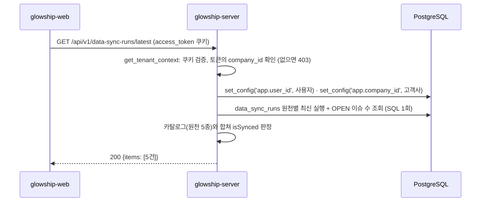

# 원천 유형별 마지막 수집 상태 조회

고객사 사용자가 "연동 데이터 조회" 화면과 대시보드에서 보는 원천 유형별 마지막 수집 상태 API가 **현재 어떻게 동작하는지** 설명합니다.
응답 모양은 API 명세 v6.2 4.3 `GET /data-sync-runs/latest`를 따르고, 카드 표시에 편한 서버 판정값(`isSynced`·`lastSyncedAt`)을 더했습니다.
이 API는 이 저장소의 첫 번째 Client(고객사 사용자)용 조회 API이며, 이후 상품·주문·선적·재고 조회 API가 같은 고객사 범위 의존성(4절)을 재사용합니다.
카드 버튼이 부르는 수동 동기화(API 25 `POST /data-sync-runs`)는 [manual-sync.md](manual-sync.md)에 있습니다. 어느 카드를 눌러도 다섯 원천을 함께 수집하므로, 누른 뒤 이 API 를 다시 조회하면 세 카드가 함께 바뀝니다(2026-11-09 결정).

## 1. 전체 흐름



- 고객사 범위는 요청 본문이 아니라 **토큰의 `company_id`** 입니다. OWNER·ADMIN은 소속 고객사가 없어 403입니다.
- RLS 컨텍스트는 첫 DB 조회 전에 설정합니다. `data_sync_runs`·`data_validation_issues`는 고객사 범위 테이블이라 운영(앱 DB 역할)에서는 컨텍스트 없이 조회하면 행이 보이지 않습니다.
- 응답은 항상 다섯 항목입니다. 수집 이력이 없는 원천도 빠지지 않습니다.

## 2. 조회 API

`GET /api/v1/data-sync-runs/latest` — `app/modules/data_sync/presentation/data_sync_run_api_router.py`

### 권한

`access_token` 쿠키가 유효하고 토큰에 `company_id`가 있어야 합니다(`CLIENT_MEMBER`·`CLIENT_LEAD`). 요청 본문·경로 변수·쿼리는 없습니다.

### 성공 응답

```http
HTTP/1.1 200 OK
```

```json
{
  "items": [
    {
      "dataSyncRunId": "0199a1b2-…",
      "sourceDomain": "ORDER",
      "connectionMethod": "API",
      "status": "PARTIAL_SUCCESS",
      "startedAt": "2026-11-02T10:50:00Z",
      "finishedAt": "2026-11-02T10:50:30Z",
      "receivedCount": 43806,
      "loadedCount": 43800,
      "rejectedCount": 6,
      "openIssueCount": 6,
      "sourceSystemName": "SAP ERP",
      "syncIntervalMinutes": 10,
      "isSynced": true,
      "lastSyncedAt": "2026-11-02T10:50:30Z"
    },
    { "sourceDomain": "INVENTORY", "sourceSystemName": "WMS", "…": "…" },
    { "sourceDomain": "SHIPMENT", "sourceSystemName": "TMS", "…": "…" },
    {
      "dataSyncRunId": null,
      "sourceDomain": "PRODUCT",
      "connectionMethod": null,
      "status": null,
      "startedAt": null,
      "finishedAt": null,
      "receivedCount": null,
      "loadedCount": null,
      "rejectedCount": null,
      "openIssueCount": 0,
      "sourceSystemName": "SAP ERP",
      "syncIntervalMinutes": 10,
      "isSynced": false,
      "lastSyncedAt": null
    },
    { "sourceDomain": "WAREHOUSE", "sourceSystemName": "WMS", "…": "…" }
  ]
}
```

토큰을 재발급하지 않으므로 `Set-Cookie`는 없습니다. JSON 필드는 camelCase입니다(`CamelModel`). 고정 다섯 건이라 페이지 필드(`page`·`size`·`totalCount`·`totalPages`)는 없습니다.

| 필드 | 타입 | 출처 | 설명 |
| --- | --- | --- | --- |
| `dataSyncRunId` | UUID · `null` | 가장 최근 실행 | 상태와 무관한 가장 최근 실행(`RUNNING` 포함). 이력이 없으면 `null` |
| `sourceDomain` | `ORDER` · `INVENTORY` · `SHIPMENT` · `PRODUCT` · `WAREHOUSE` | 카탈로그 | 항목을 구분하는 키. `data_sync_runs.source_domain`과 같은 코드값 |
| `connectionMethod` | `API` · `FILE` · `null` | 가장 최근 실행 | 연결 방식 |
| `status` | `RUNNING` · `SUCCEEDED` · `PARTIAL_SUCCESS` · `FAILED` · `null` | 가장 최근 실행 | 화면 표시명은 명세 2절 표(정상 / 일부 오류 / 수집 오류 / 수집 중) |
| `startedAt`, `finishedAt` | UTC ISO 8601 · `null` | 가장 최근 실행 | 진행 중이면 `finishedAt`은 `null` |
| `receivedCount`, `loadedCount`, `rejectedCount` | 정수 · `null` | 가장 최근 실행 | 받은 수 = 적재 + 거절. `RUNNING`·`FAILED`면 `null`일 수 있음 |
| `openIssueCount` | 정수 | `data_validation_issues` | 이 원천의 **모든** 실행에 걸린 `status = OPEN` 이슈 수. 연동 데이터 탭의 오류 건수 배지(예: "상품 2") |
| `sourceSystemName` | 문자열 | 카탈로그 | 원천 시스템 이름(운영 설정 값). 카드 부제 |
| `syncIntervalMinutes` | 정수 | 카탈로그 | 자동 수집 주기(분). 운영 10. **가상 시각(데모)이면 0**(자동 수집 없음, 수동 동기화만): 화면은 카드 문구 "수동 동기화(누를 때마다 10분)"와 "다음 날로" 버튼을 씁니다(2026-11-09 결정) |
| `isSynced` | 불리언 | 서버 판정 | 명세에 더한 값. 판정 규칙은 3절 |
| `lastSyncedAt` | UTC ISO 8601 · `null` | 마지막 성공 실행의 `finished_at` | 명세에 더한 값. 응답 규칙 2.3의 "마지막 수집 시각"과 같은 뜻(데이터가 실제로 반영된 마지막 시각). 최근 실행이 실패해도 그 전 성공 시각이 유지됨. 성공한 적이 없으면 `null` |

시각은 UTC이며 KST 표시는 프론트가 합니다.

### 프론트의 해석

| 화면 | 값 |
| --- | --- |
| 카드 3장(주문·재고·선적) | `sourceDomain`이 `ORDER`·`INVENTORY`·`SHIPMENT`인 항목 |
| 카드 부제("SAP ERP") | `sourceSystemName` |
| 카드 배지 | `isSynced: true` → 정상, `false`이고 `lastSyncedAt` 있음 → 수집 오류(마지막 수집 실패 또는 수집 멈춤), `false`이고 `null` → 미연동 |
| "마지막 수집 10.21 09:30" | `lastSyncedAt` |
| "10분마다 자동 수집" | `syncIntervalMinutes` |
| 수집 중 표시 | `status: "RUNNING"` |
| 탭 옆 오류 건수(상품·주문·선적·재고) | 각 원천의 `openIssueCount`. 상품 탭은 `PRODUCT` |

### 실패 응답

모든 실패는 공통 에러 형식 `{"code", "message", "request_id"}`로 응답합니다.

| 상태 | code | 상황 |
| --- | --- | --- |
| 401 | `UNAUTHENTICATED` | 쿠키 없음·만료·위조 |
| 403 | `FORBIDDEN` | 토큰에 `company_id`가 없음 (OWNER·ADMIN) |
| 405 | `METHOD_NOT_ALLOWED` | GET 외 메서드 |
| 500 | `INTERNAL_SERVER_ERROR` | DB 장애 등 처리되지 않은 예외 |

요청 입력이 없어 422는 발생하지 않습니다. GET은 출처 검사(`OriginCheckMiddleware`) 대상이 아니라 `INVALID_ORIGIN`도 없습니다. 이력이 없어도 항상 200이므로 404는 없습니다.
명세 5절의 `UNAUTHORIZED`·`ROLE_NOT_ALLOWED` 코드와 `requestId` 표기는 core 공통 변경이라 별도 작업입니다.

## 3. `isSynced` 판정 규칙

`DataSyncStatusService._is_synced` — `app/modules/data_sync/application/data_sync_status_service.py`

다음 두 조건을 **모두** 만족할 때만 `true`입니다.

| # | 조건 | 기준 실행 | 이유 |
| --- | --- | --- | --- |
| 1 | 상태가 `SUCCEEDED` 또는 `PARTIAL_SUCCESS` | 마지막으로 **끝난** 실행 (`RUNNING` 제외) | 진행 중 실행은 결과를 모르므로 직전에 끝난 실행으로 판정. 수집 중이라는 이유로 배지가 "수집 오류"로 바뀌지 않게 함 |
| 2 | 현재 시각 − `startedAt` ≤ `syncIntervalMinutes × SYNC_STALE_MULTIPLIER` | 가장 최근 실행 (`RUNNING` 포함) | 수집기가 멈춰 새 실행이 기록되지 않는 경우를 잡음. 배수가 0이거나 가상 시각(`VIRTUAL_CLOCK_START`가 있음)이면 이 조건을 검사하지 않음 |

수집 이력이 없으면 `false`입니다. `PARTIAL_SUCCESS`(일부 레코드 거절)는 데이터가 반영되었으므로 `true`로 봅니다. 거절 레코드는 `rejectedCount`와 `openIssueCount`로 따로 드러납니다.

### 네 가지 CTE

원천마다 세 실행과 이슈 수를 다른 용도로 씁니다. 리포지토리가 SQL 한 번으로 원천별 한 행에 모읍니다.

| CTE | 조건 | 쓰는 값 | 용도 |
| --- | --- | --- | --- |
| `latest` | 없음 | 실행 필드 전부 | 명세의 "마지막 수집 1건", 조건 2 (`startedAt`) |
| `completed` | `status <> 'RUNNING'` | `status` | 조건 1 |
| `applied` | `status IN ('SUCCEEDED','PARTIAL_SUCCESS')`, `applied_seq` 최대 | `finished_at` | `lastSyncedAt` |
| `open_issues` | `data_validation_issues.status = 'OPEN'`, 실행을 거쳐 원천으로 묶음 | `COUNT(*)` | `openIssueCount` |

예: 10:40 성공 → 10:50 실패 → 10:55 진행 중이면 `latest`는 10:55(`status: RUNNING`), `completed`는 실패(10:50), `applied`는 성공(10:40)입니다. 결과는 `isSynced: false`, `lastSyncedAt: 10:41`(10:40 실행의 종료 시각)입니다.

### 설정

| 변수 | 기본값 | 설명 |
| --- | --- | --- |
| `SYNC_STALE_MULTIPLIER` | `2` | 수집 멈춤 판정 배수. `0`이면 조건 2를 끔. 합성데이터(2025년 이력)로 화면을 확인할 때는 `0`으로 두어야 `isSynced: true`가 보임 |
| `VIRTUAL_CLOCK_START` | `2026-07-02T00:00:00Z` | 값이 있으면(데모) **조건 2(수집 멈춤)를 보지 않고 조건 1만 봅니다.** 가상 시각에는 "지금"이 없습니다. 데이터가 7월 초에 멈춰 있어 서버 시각(11월)으로 보면 모든 원천이 멈춘 것으로 보이고, 가장 최근 수집 시각을 지금으로 보면 데모 중 버튼을 누르지 않은 동안 카드가 "수집 오류"로 바뀌고 되돌릴 방법이 없습니다(PR #40 리뷰). 그래서 데모에서는 수집기 전체가 멈춰도 `true`로 보입니다. 같은 설정이면 `syncIntervalMinutes`는 0 입니다. **실제 원천을 붙이는 환경에서는 `VIRTUAL_CLOCK_START=`로 비워야** 서버 시각으로 멈춤을 판정합니다(수동 수집 가상 시각과 같은 설정, `docs/data-sync/ingest.md`) |

## 4. 고객사 범위 의존성

`get_tenant_context` — `app/core/security/tenant.py`

```python
from app.core.security.tenant import TenantContext, get_tenant_context


@router.get("")
async def list_orders(
    tenant: TenantContext = Depends(get_tenant_context),
): ...  # tenant.user_id / tenant.company_id
```

| 단계 | 동작 |
| --- | --- |
| 1 | `get_current_user`로 쿠키 검증 (실패 시 401) |
| 2 | 토큰의 `company_id`가 `None`이면 403 `FORBIDDEN` |
| 3 | `set_rls_context(db, user_id, company_id)`로 같은 트랜잭션에 RLS 컨텍스트 설정 |
| 4 | `TenantContext(user_id, company_id)` 반환 |

- `get_db`는 요청당 한 세션이므로(FastAPI 의존성 캐시) 여기서 설정한 컨텍스트가 뒤따르는 리포지토리 조회에 그대로 적용됩니다.
- `docs/admin/client-account.md` 4절과 같은 `set_rls_context`를 쓰며, 그 문서 7절이 비워 두었던 "Client API용 컨텍스트 의존성"이 이것입니다.
- 고객사가 `INACTIVE`인지는 검사하지 않습니다. 운영에서는 RLS 정책(`app_context_allowed`)이 비활성 고객사의 행을 숨기므로 다섯 항목 모두 미연동으로 보입니다. 비활성 고객사 사용자의 로그인 차단은 별도 과제입니다.

## 5. 카탈로그

`app/modules/data_sync/application/data_source_catalog.py`

원천 시스템 이름과 수집 주기는 운영 설정 값이라 DB에 없습니다(명세 4.3). 서버 상수로 두고 응답에 함께 내려줍니다.

| `sourceDomain` | `sourceSystemName` | 주기(분) |
| --- | --- | --- |
| `ORDER` | SAP ERP | 10 |
| `INVENTORY` | WMS | 10 |
| `SHIPMENT` | TMS | 10 |
| `PRODUCT` | SAP ERP | 10 |
| `WAREHOUSE` | WMS | 10 |

- 배열 순서가 곧 응답 순서입니다. 화면 카드 3장을 앞에, 마스터 데이터 2종을 뒤에 둡니다.
- 상품 마스터는 ERP, 창고 마스터는 WMS에서 온다고 봅니다. 명세에 명시가 없어 둔 가정입니다.
- 고객사별 연동 설정(시스템 이름·주기·사용 여부)이 필요해지면 `data_source_connections` 같은 테이블로 옮깁니다(7절).

## 6. 테스트

DB 없이 실행됩니다. 이 PR의 테스트 24건, 전체 116건.

| 파일 | 내용 |
| --- | --- |
| `tests/core/test_tenant.py` | `company_id` 없음 → 403이고 DB 접근 없음. 있음 → `set_config` SQL 실행과 `TenantContext` 반환 |
| `tests/modules/data_sync/test_data_sync_run_repository.py` | SQL에 `DISTINCT ON` 세 개·실행 컬럼·이슈 집계·조건·정렬이 있는지, 파라미터, 행 → `LatestRunSummary` 매핑, 이력 없는 원천 제외 |
| `tests/modules/data_sync/test_data_sync_status_service.py` | 다섯 항목 순서·카탈로그 값, 이력 없음(실행 필드 `null`·이슈 0), 실행 필드 전달, 성공, 부분 성공, 실패(이전 성공 시각 유지), 진행 중(직전 완료 기준), 끝난 실행 없음, 멈춤 경계(배수와 같으면 `true`, 1초 초과면 `false`), 배수 0 |
| `tests/modules/data_sync/test_data_sync_run_api.py` | 쿠키 없음 401, OWNER·ADMIN 403, CLIENT_MEMBER·CLIENT_LEAD 200과 camelCase·다섯 항목·`Set-Cookie` 없음, 실패 실행의 `null` 건수, 이력 없는 원천의 `null` 필드(빼지 않음), 토큰의 고객사로 RLS SQL 실행과 서비스 전달 |

리포지토리 SQL은 로컬 DB에 적재한 합성데이터(glowship_synthetic_2025_v5)로 실행해 확인했습니다(자동화되어 있지 않음).
A사는 다섯 원천 모두 `SUCCEEDED`·이슈 0건, B사는 `ORDER`·`INVENTORY`·`SHIPMENT`가 `PARTIAL_SUCCESS`이고 `openIssueCount`가 6·1·1로 `data_validation_issues.csv`와 일치했습니다.

## 7. 아직 없는 것

| 기능 | 비워 둔 자리 |
| --- | --- |
| 검증 이슈 목록·하단 배너 | 명세 4.3 `GET /validation-issues` (`affectedDelayEvents[]`로 "영향: … 분석 보류" 문구) |
| 고객사별 연동 설정 | `data_source_connections` 테이블(시스템 이름·주기·사용 여부). 마이그레이션·RLS 정책·합성데이터 적재 예외가 필요 |
| ADMIN·OWNER의 고객사 선택 | 명세 D7 `X-Company-Id`. `get_tenant_context`에서 헤더를 읽어 배정을 검사하는 방식으로 확장 |
| 오류 코드·표기 | 401 `UNAUTHORIZED`, 403 `ROLE_NOT_ALLOWED`, `requestId`, 입력 오류 400(D3)은 core 공통 변경 |

## 8. 관련 파일

| 파일 | 역할 |
| --- | --- |
| `app/modules/data_sync/presentation/data_sync_run_api_router.py` | `GET /api/v1/data-sync-runs/latest` 엔드포인트 |
| `app/modules/data_sync/presentation/data_sync_run_schemas.py` | 응답 스키마 (camelCase) |
| `app/modules/data_sync/application/data_sync_status_service.py` | `isSynced` 판정, 카탈로그와 조회 결과 결합 |
| `app/modules/data_sync/application/data_source_catalog.py` | 원천 5종·원천 시스템 이름·주기 상수 |
| `app/modules/data_sync/infrastructure/repository/data_sync_run_repository.py` | 원천별 최신 실행·이슈 수 조회 SQL, `LatestRunSummary` |
| `app/modules/data_sync/infrastructure/data_sync_enums.py` | `SourceDomain`, `ConnectionMethod`, `DataSyncRunStatus`, `APPLIED_STATUSES` |
| `app/modules/data_sync/dependencies.py` | `get_data_sync_status_service` 조립 |
| `app/core/security/tenant.py` | `TenantContext`, `get_tenant_context` |
| `app/core/rls_context.py` | `set_rls_context` |
| `app/core/config.py` | `SYNC_STALE_MULTIPLIER`, `VIRTUAL_CLOCK_START` |
