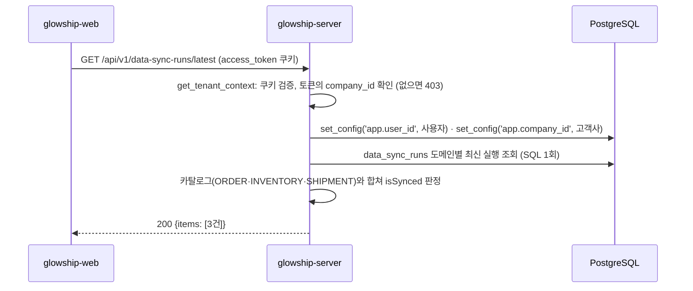

# 외부 시스템 최신 동기화 상태 조회

고객사 사용자가 "연동 데이터 조회" 화면에서 보는 외부 시스템(ERP·WMS·TMS)별 동기화 상태 API가 **현재 어떻게 동작하는지** 설명합니다.
이 API는 이 저장소의 첫 번째 Client(고객사 사용자)용 조회 API이며, 이후 주문·선적·재고 조회 API가 같은 고객사 범위 의존성(4절)을 재사용합니다.
"동기화"·"다시 수집" 버튼이 호출할 수집 실행 API는 아직 없습니다(7절).

## 1. 전체 흐름



- 고객사 범위는 요청 본문이 아니라 **토큰의 `company_id`** 입니다. OWNER·ADMIN은 소속 고객사가 없어 403입니다.
- RLS 컨텍스트는 첫 DB 조회 전에 설정합니다. `data_sync_runs`는 고객사 범위 테이블이라 운영(앱 DB 역할)에서는 컨텍스트 없이 조회하면 행이 보이지 않습니다.
- 응답은 항상 세 항목입니다. 수집 이력이 없는 시스템도 빠지지 않습니다.

## 2. 조회 API

`GET /api/v1/data-sync-runs/latest` — `app/modules/data_sync/presentation/data_sync_run_api_router.py`

### 권한

`access_token` 쿠키가 유효하고 토큰에 `company_id`가 있어야 합니다(`CLIENT_MEMBER`·`CLIENT_LEAD`). 요청 본문·경로 변수·쿼리는 없습니다.

### 성공 응답

```http
HTTP/1.1 200 OK
```

```json
{
  "items": [
    {
      "sourceDomain": "ORDER",
      "systemName": "ERP",
      "displayName": "주문 데이터",
      "isSynced": true,
      "lastSyncedAt": "2026-11-02T10:55:00Z",
      "updateIntervalSeconds": 600
    },
    {
      "sourceDomain": "INVENTORY",
      "systemName": "WMS",
      "displayName": "재고 데이터",
      "isSynced": false,
      "lastSyncedAt": "2026-11-02T10:40:00Z",
      "updateIntervalSeconds": 600
    },
    {
      "sourceDomain": "SHIPMENT",
      "systemName": "TMS",
      "displayName": "선적 데이터",
      "isSynced": false,
      "lastSyncedAt": null,
      "updateIntervalSeconds": 600
    }
  ]
}
```

토큰을 재발급하지 않으므로 `Set-Cookie`는 없습니다. JSON 필드는 camelCase입니다(`CamelModel`).

| 필드 | 타입 | 출처 | 설명 |
| --- | --- | --- | --- |
| `sourceDomain` | `ORDER` · `INVENTORY` · `SHIPMENT` | 카탈로그 | 카드를 구분하는 키. `data_sync_runs.source_domain`과 같은 코드값 |
| `systemName` | `ERP` · `WMS` · `TMS` | 카탈로그 | 외부 시스템 종류. 도메인별 고정 매핑(ORDER→ERP, INVENTORY→WMS, SHIPMENT→TMS) |
| `displayName` | 문자열 | 카탈로그 | 카드 제목 |
| `isSynced` | 불리언 | 서버 판정 | 동기화된 상태인지. 판정 규칙은 3절 |
| `lastSyncedAt` | UTC ISO 8601 · `null` | 마지막 성공 실행의 `finished_at` | 데이터가 실제로 반영된 마지막 시각. 최근 실행이 실패해도 그 전 성공 시각이 유지됨. 성공한 적이 없으면 `null` |
| `updateIntervalSeconds` | 정수 | 카탈로그 | 자동 수집 주기. 현재 600 |

시각은 UTC이며 KST 표시는 프론트가 합니다.

### 프론트의 해석

| `isSynced` | `lastSyncedAt` | 화면 |
| --- | --- | --- |
| `true` | 시각 | 정상 배지, "동기화" 버튼 |
| `false` | 시각 | 수집 오류 배지(마지막 수집 실패 또는 수집 멈춤), "다시 수집" 버튼 |
| `false` | `null` | 미연동 (성공한 수집이 없음) |

### 실패 응답

모든 실패는 공통 에러 형식 `{"code", "message", "request_id"}`로 응답합니다.

| 상태 | code | 상황 |
| --- | --- | --- |
| 401 | `UNAUTHENTICATED` | 쿠키 없음·만료·위조 |
| 403 | `FORBIDDEN` | 토큰에 `company_id`가 없음 (OWNER·ADMIN) |
| 405 | `METHOD_NOT_ALLOWED` | GET 외 메서드 |
| 500 | `INTERNAL_SERVER_ERROR` | DB 장애 등 처리되지 않은 예외 |

요청 입력이 없어 422는 발생하지 않습니다. GET은 출처 검사(`OriginCheckMiddleware`) 대상이 아니라 `INVALID_ORIGIN`도 없습니다. 이력이 없어도 항상 200이므로 404는 없습니다.

## 3. `isSynced` 판정 규칙

`DataSyncStatusService._is_synced` — `app/modules/data_sync/application/data_sync_status_service.py`

다음 두 조건을 **모두** 만족할 때만 `true`입니다.

| # | 조건 | 기준 실행 | 이유 |
| --- | --- | --- | --- |
| 1 | 상태가 `SUCCEEDED` 또는 `PARTIAL_SUCCESS` | 마지막으로 **끝난** 실행 (`RUNNING` 제외) | 진행 중 실행은 결과를 모르므로 직전에 끝난 실행으로 판정. 수집 중이라는 이유로 배지가 "수집 오류"로 바뀌지 않게 함 |
| 2 | 현재 시각 − `started_at` ≤ `updateIntervalSeconds × SYNC_STALE_MULTIPLIER` | 가장 최근 실행 (`RUNNING` 포함) | 수집기가 멈춰 새 실행이 기록되지 않는 경우를 잡음. 배수가 0이면 이 조건을 검사하지 않음 |

수집 이력이 없으면 `false`입니다. `PARTIAL_SUCCESS`(일부 레코드 거절)는 데이터가 반영되었으므로 `true`로 봅니다. 거절 레코드는 `data_validation_issues`가 따로 추적합니다.

### 세 가지 기준 실행

도메인마다 세 실행을 다른 용도로 씁니다. 리포지토리가 SQL 한 번(`DISTINCT ON` CTE 세 개)으로 도메인별 한 행에 모읍니다.

| CTE | 조건 | 쓰는 값 | 용도 |
| --- | --- | --- | --- |
| `latest` | 없음 | `started_at` | 조건 2 (수집 멈춤) |
| `completed` | `status <> 'RUNNING'` | `status` | 조건 1 |
| `applied` | `status IN ('SUCCEEDED','PARTIAL_SUCCESS')`, `applied_seq` 최대 | `finished_at` | `lastSyncedAt` |

예: 10:40 성공 → 10:50 실패 → 10:55 진행 중이면 `completed`는 실패(10:50), `applied`는 성공(10:40), `latest`는 10:55입니다. 결과는 `isSynced: false`, `lastSyncedAt: 10:41`(10:40 실행의 종료 시각)입니다.

### 설정

| 변수 | 기본값 | 설명 |
| --- | --- | --- |
| `SYNC_STALE_MULTIPLIER` | `2` | 수집 멈춤 판정 배수. `0`이면 조건 2를 끔. 합성데이터(2025년 이력)로 화면을 확인할 때는 `0`으로 두어야 `isSynced: true`가 보임 |

## 4. 고객사 범위 의존성

`get_tenant_context` — `app/core/security/tenant.py`

```python
from app.core.security.tenant import TenantContext, get_tenant_context


@router.get("")
async def list_orders(
    tenant: TenantContext = Depends(get_tenant_context),
): ...  # tenant.user_id / tenant.company_id
```

| 단계 | 동작 |
| --- | --- |
| 1 | `get_current_user`로 쿠키 검증 (실패 시 401) |
| 2 | 토큰의 `company_id`가 `None`이면 403 `FORBIDDEN` |
| 3 | `set_rls_context(db, user_id, company_id)`로 같은 트랜잭션에 RLS 컨텍스트 설정 |
| 4 | `TenantContext(user_id, company_id)` 반환 |

- `get_db`는 요청당 한 세션이므로(FastAPI 의존성 캐시) 여기서 설정한 컨텍스트가 뒤따르는 리포지토리 조회에 그대로 적용됩니다.
- `docs/admin/client-account.md` 4절과 같은 `set_rls_context`를 쓰며, 그 문서 7절이 비워 두었던 "Client API용 컨텍스트 의존성"이 이것입니다.
- 고객사가 `INACTIVE`인지는 검사하지 않습니다. 운영에서는 RLS 정책(`app_context_allowed`)이 비활성 고객사의 행을 숨기므로 세 항목 모두 미연동으로 보입니다. 비활성 고객사 사용자의 로그인 차단은 별도 과제입니다.

## 5. 카탈로그

`app/modules/data_sync/application/data_source_catalog.py`

DB에 연동 설정 테이블이 없어 카드 목록과 표시 정보를 서버 상수로 둡니다.

| `sourceDomain` | `systemName` | `displayName` | 주기 |
| --- | --- | --- | --- |
| `ORDER` | `ERP` | 주문 데이터 | 600초 |
| `INVENTORY` | `WMS` | 재고 데이터 | 600초 |
| `SHIPMENT` | `TMS` | 선적 데이터 | 600초 |

- 배열 순서가 곧 응답 순서(카드 순서)입니다.
- `PRODUCT`·`WAREHOUSE`(마스터 데이터)는 화면 범위 밖이라 넣지 않습니다.
- 고객사별 연동 설정(시스템 이름·주기·사용 여부)이 필요해지면 `data_source_connections` 같은 테이블로 옮깁니다(7절).

## 6. 테스트

DB 없이 실행됩니다. 이 PR의 테스트 21건, 전체 113건.

| 파일 | 내용 |
| --- | --- |
| `tests/core/test_tenant.py` | `company_id` 없음 → 403이고 DB 접근 없음. 있음 → `set_config` SQL 실행과 `TenantContext` 반환 |
| `tests/modules/data_sync/test_data_sync_run_repository.py` | SQL에 `DISTINCT ON` 세 개·조건·정렬이 있는지, 파라미터, 행 → `LatestRunSummary` 매핑, 이력 없는 도메인 제외 |
| `tests/modules/data_sync/test_data_sync_status_service.py` | 세 항목 순서·카탈로그 값, 이력 없음, 성공, 부분 성공, 실패(이전 성공 시각 유지), 진행 중(직전 완료 기준), 끝난 실행 없음, 멈춤 경계(배수와 같으면 `true`, 1초 초과면 `false`), 배수 0 |
| `tests/modules/data_sync/test_data_sync_run_api.py` | 쿠키 없음 401, OWNER·ADMIN 403, CLIENT_MEMBER·CLIENT_LEAD 200과 camelCase·세 항목·`Set-Cookie` 없음, 토큰의 고객사로 RLS SQL 실행과 서비스 전달. `get_db`를 가짜 세션으로 바꿔 실제 `get_tenant_context`를 통과시킴 |

리포지토리 SQL은 로컬 DB에서 트랜잭션 안에 고객사 1건·실행 4건(성공→실패→진행 중, 부분 성공)을 넣고 실행해 3절의 예와 같은 결과가 나오는 것을 확인한 뒤 롤백했습니다(자동화되어 있지 않음).

## 7. 아직 없는 것

| 기능 | 비워 둔 자리 |
| --- | --- |
| 수집 실행 ("동기화"·"다시 수집" 버튼) | `POST /api/v1/data-sync-runs` 등. 수집 워커가 필요하며, 중복 실행 방지는 L1 고객사 잠금(`app/core/locks.py`)으로 |
| 수집 중 표시 | 응답에 수집 중 상태가 없음. 필요하면 `lastRunStatus`(DB 상태값) 필드를 추가. 기존 필드는 바뀌지 않음 |
| 부분 성공 표시 | `rejectedRecordCount` 필드를 추가하면 "일부 거절" 배지 가능 |
| 고객사별 연동 설정 | `data_source_connections` 테이블(시스템 이름·주기·사용 여부). 마이그레이션·RLS 정책·합성데이터 적재 예외가 필요 |
| ADMIN·OWNER의 고객사 선택 | 명세 D7 `X-Company-Id`. `get_tenant_context`에서 헤더를 읽어 배정을 검사하는 방식으로 확장 |
| `PRODUCT`·`WAREHOUSE` 카드 | 카탈로그에 항목만 추가하면 됨 |

## 8. 관련 파일

| 파일 | 역할 |
| --- | --- |
| `app/modules/data_sync/presentation/data_sync_run_api_router.py` | `GET /api/v1/data-sync-runs/latest` 엔드포인트 |
| `app/modules/data_sync/presentation/data_sync_run_schemas.py` | 응답 스키마 (camelCase) |
| `app/modules/data_sync/application/data_sync_status_service.py` | `isSynced` 판정, 카탈로그와 조회 결과 결합 |
| `app/modules/data_sync/application/data_source_catalog.py` | 카드 도메인·외부 시스템·주기 상수, `ExternalSystem` |
| `app/modules/data_sync/infrastructure/repository/data_sync_run_repository.py` | 도메인별 최신 실행 조회 SQL, `LatestRunSummary` |
| `app/modules/data_sync/infrastructure/data_sync_enums.py` | `SourceDomain`, `DataSyncRunStatus`, `APPLIED_STATUSES` |
| `app/modules/data_sync/dependencies.py` | `get_data_sync_status_service` 조립 |
| `app/core/security/tenant.py` | `TenantContext`, `get_tenant_context` |
| `app/core/rls_context.py` | `set_rls_context` |
| `app/core/config.py` | `SYNC_STALE_MULTIPLIER` |
