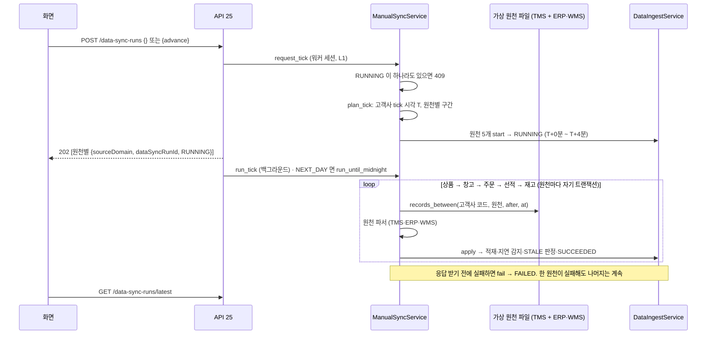

# 수동 동기화 (API 25 `POST /data-sync-runs`)

연동 데이터 화면의 동기화 버튼이 부르는 API 입니다(API 명세 v6.2 4.3·D16, GLOW-13·49). 화면은 카드 하나에 원천 시스템별 칸(ERP 주문·상품, WMS 재고·창고, TMS 선적)과 버튼 하나입니다. **버튼 한 번에 다섯 원천을 함께 수집합니다**(2026-11-09 결정). 원천 응답은 가상 원천 파일(가상 TMS + 가상 ERP·WMS)에서 읽습니다.

## 1. 요청·응답

| 항목 | 내용 |
| --- | --- |
| 권한 | Client 팀원·팀장(`CLIENT_MEMBER`·`CLIENT_LEAD`, 명세 6절). `access_token` 쿠키의 `company_id`가 고객사 범위 |
| 요청 | 본문 선택. `{}` 또는 본문 없음 = 10분 한 번. `{ "advance": "NEXT_DAY" }` = 다음 날로 |
| `sourceSystem`·`sourceDomain` | 선택. 이전 카드별 버튼의 요청 모양(`{ "sourceSystem": "ERP" }`, `{ "sourceDomain": "SHIPMENT" }`)도 받고 동작은 같은 전체 수집입니다. 둘을 함께 보내면 422 |
| `advance` | 생략하면 `TICK`(가상 10분 한 번). `NEXT_DAY`는 다음 자정 tick 까지 이어서 수집합니다(데모의 "다음 날로", 가상 시각일 때만) |
| 응답 202 | 원천별 배열 5건, 상품 → 창고 → 주문 → 선적 → 재고 순서: `[{ "sourceDomain": "PRODUCT", "dataSyncRunId": "…", "status": "RUNNING" }, …]`. 적용은 응답 뒤 백그라운드에서 하고, 결과는 `GET /data-sync-runs/latest`를 다시 조회해 봅니다 |
| 409 `SYNC_IN_PROGRESS` | 그 고객사에 실행 중(`RUNNING`)인 수집이 하나라도 있음. 아무것도 시작하지 않습니다. 다만 **실제 시각으로 10분 넘게** `RUNNING`인 수집은 죽은 작업(서버 재시작·배포 등)으로 보고 요청 때 먼저 `FAILED`로 닫은 뒤 진행합니다(이슈 #94, 아래 "남은 RUNNING 정리") |
| 422 `VALIDATION_ERROR` | 형식 오류(값이 목록에 없음, `sourceSystem`·`sourceDomain`을 함께 보냄), 또는 가상 시각이 아닌데 `advance: "NEXT_DAY"` |

- 화면은 주기적으로 다시 조회하지 않습니다. 누른 뒤에만 `GET /data-sync-runs/latest`를 다시 부릅니다(서버 스케줄러도 없음, 2026-11-09 결정).
- 수집 현황의 `syncIntervalMinutes`는 항상 10 입니다(화면 문구 "10분마다 자동 수집"). 서버에 10분마다 도는 수집기는 없고, 데모에서는 동기화 버튼 한 번이 그 10분 한 번을 대신합니다.

## 2. 흐름



- 원천마다 트랜잭션이 따로라서 한 원천이 실패해도 나머지는 적용됩니다. 실패한 원천은 다음 tick 의 구간이 넓어져 빠진 응답을 그때 받습니다(3절).
- 파일을 읽지 못하면 그 tick 의 다섯 수집을 모두 `FAILED`로 닫습니다(`RUNNING`이 남으면 다음 수집이 막힘).

## 3. 시각 (가상 시각, 2026-11-04·11-09 결정)

- 데이터는 2026-06-30 까지, 마지막 수집은 07-01 이라 데모의 "지금"은 7월 초입니다. 서버의 지금(11월)으로 수집하면 대시보드 기준 시각(C22)이 11월로 옮겨가 화면이 빕니다.
- **고객사 시계 하나:** 고객사마다 10분 격자 tick 이 하나 있습니다(`application/virtual_clock.py`).
  - 다음 tick `T` = (고객사 마지막 적재 수집 시작이 속한 10분 칸) + 10분. 수집이 없거나 그보다 `VIRTUAL_CLOCK_START`(기본 `2026-07-02T00:00:00Z`)가 늦으면 시작값의 칸입니다.
  - 원천 수집 시각 = `T` + 원천 자리(PRODUCT 0분·WAREHOUSE 1분·ORDER 2분·SHIPMENT 3분·INVENTORY 4분, overlay 와 같음). 완료 시각은 시작 + 30초입니다.
  - 원천 구간 = (그 원천이 지난번 적재된 칸 + 자리, 이번 수집 시각]. 구간 시작을 기록된 시작이 아니라 격자로 잡아 재시도·확정으로 시작 초가 밀려도 틈·겹침이 없습니다(PR #52 리뷰와 같은 원리). 지난 tick 에서 그 원천만 실패했으면 구간이 그만큼 넓어집니다.
  - 고객사 시계가 하나라서 누가 언제 눌러도 같은 순서로 나아갑니다. 시작 순서 = 적용 순번이고 시작 시각이 겹치지 않습니다(이슈 #39 규칙).
- tick 은 고객사 잠금(L1) 안에서 정하고 같은 트랜잭션에서 `RUNNING`을 커밋합니다. 버튼을 빠르게 두 번 누르면 두 번째는 409 이거나(첫 tick 이 진행 중) 다음 tick 입니다. 같은 tick 을 두 번 받지 않습니다.
- **다음 날로(`NEXT_DAY`):** 첫 tick 을 요청 안에서 시작하고, 백그라운드에서 다음 자정 tick(예: 07-03 00:10 → 07-04 00:00)까지 tick 을 이어서 적용합니다. 하루 약 144 tick, 로컬에서 30~45초 걸렸습니다. 한 tick 의 다섯 원천이 모두 실패하면(가상 원천 파일 경로가 틀리거나 파일이 깨짐 등) 거기서 멈춥니다. 다음 tick 시각은 마지막 적재 수집 기준이라, 멈추지 않으면 같은 tick 을 끝없이 다시 시작하기 때문입니다(PR #91 리뷰). 빠진 구간은 원인을 고친 뒤 다음 누름이 다시 받습니다.
- `VIRTUAL_CLOCK_START`를 비우면 서버 시각입니다(실제 원천을 붙일 때만). tick = 지금, 원천마다 1초씩 띄우고 구간 시작은 그 원천의 지난 적재 수집 시작입니다. `NEXT_DAY`는 422 입니다.
- **운영 배포 체크:** 실제 원천을 붙이는 환경에서는 `VIRTUAL_CLOCK_START=`로 비웁니다. 비우지 않으면 수집 시각이 7월 초 가상 시각으로 나아가고, 수집기가 멈춰도 `isSynced: true`로 보입니다.

## 4. 가상 원천 파일

| 설정 | 원천 | 비우면 |
| --- | --- | --- |
| `VIRTUAL_TMS_SCENARIO_PATH` | 선적(SHIPMENT) | 선적 0건 수집 |
| `VIRTUAL_ERP_WMS_SCENARIO_PATH` | 주문(ORDER)·재고(INVENTORY) | 주문·재고 0건 수집 |

- 두 파일을 합쳐 읽습니다(`infrastructure/virtual_sources.py`). 요청마다 다시 읽으므로 파일을 고쳐도 재시작이 필요 없습니다. 파일을 읽지 못하거나 모양이 틀리면 그 tick 의 수집이 `FAILED`이고 서버 로그에 원인이 남습니다.
- 상품·창고(PRODUCT·WAREHOUSE)는 지금 가상 응답이 없어 매 tick 0건 `SUCCEEDED`입니다(마스터 변경 없음).
- 파일 모양: `{"responses": [{"fetched_at": "…Z", "_demo_company": "A_BEAUTY", "source_domain": "ORDER", "data": [...]}, ...]}`
  - `source_domain`이 없으면 SHIPMENT 입니다(가상 TMS 파일, census `source_samples/shipments_api.json`과 같은 모양).
  - `_demo_company`는 고객사 코드(`companies.company_code`)입니다.
  - `data` 레코드는 원천 파서가 읽는 모양입니다. SHIPMENT 는 TMS 응답(`tms_parser.py`), ORDER·INVENTORY 는 수집 레코드와 같은 snake_case(`erp_wms_parser.py`)입니다. 주문 `ordered_at`처럼 시각은 시간대가 있어야 합니다.

```json
{
  "responses": [
    {
      "fetched_at": "2026-07-03T08:13:00Z",
      "_demo_company": "A_BEAUTY",
      "source_domain": "ORDER",
      "data": [
        {
          "order_code": "A-ORD-20260703-0042",
          "sales_channel": "SEPHORA",
          "customer_region": "WEST",
          "warehouse_code": "WH-WEST",
          "ordered_at": "2026-07-03T08:13:00Z",
          "promised_delivery_at": "2026-07-10T23:59:59Z",
          "status": "OPEN",
          "lines": [{ "line_no": 1, "sku_code": "SKU-001", "ordered_quantity": 2, "shipped_quantity": 0, "line_status": "ACTIVE" }]
        }
      ]
    }
  ]
}
```

- 이번 구간(after < `fetched_at` ≤ at)의 응답을 관측 시각 순서대로 모으고, 같은 키는 마지막 관측 값 하나만 씁니다. 키: 선적 `shipmentNo`, 주문 `order_code`, 재고 (`inventory_date`, `warehouse_code`, `sku_code`).
- 데모 파일: 가상 TMS `설계/GLOW-89_가상TMS_시나리오.json`(지연 3건, `fetched_at` 07-03 00:00), 가상 ERP·WMS `설계/GLOW-13_가상ERP_WMS_0702-0712_A_BEAUTY.json`(census `tools/synth2026/extend_days.py`, A_BEAUTY 07-02~07-12: 새 주문은 접수 시각에, 주문 상태·재고·입고는 다음 자정에 관측). 데이터 파일은 저장소에 넣지 않습니다.
- 창고·SKU 는 원천 매핑 코드(`external_entity_mappings`, `MAPPED`)입니다. 새 선적은 상세 SKU 의 HS10 이 하나여야 합니다(`ingest.md` 4절).

## 5. 데모에서 쓰는 법 (2026-11-09 결정)

- 시드(PR #80)는 07-03 00:03 선적 수집으로 끝나고, 데모의 첫 누름은 tick **07-03 00:10** 입니다.
- 시드는 주문·재고를 07-02 00:02·00:04 까지만 넣었으므로, 첫 누름의 주문·재고 구간이 07-02 하루치를 한꺼번에 받습니다(구간에 따른 일괄 반영). 로컬 확인: 주문 527건·재고 66건. 이 변경이 판단 대기 실행의 의존 범위에 들어가 그 실행들이 `STALE`이 되고, 최종 선택은 `ANALYSIS_STALE`(409)로 거부됩니다. 이미 최종 선택한 실행(`FINALIZED`)은 바뀌지 않습니다(`stale_service.py` 대상 상태).
- 그래서 데모는 한 실행을 먼저 최종 선택한 뒤 버튼을 **한 번** 누르고, 남은 실행의 STALE·선택 차단을 보여 줍니다. 재분석 버튼과 "다음 날로"는 누르지 않습니다(재분석으로 만든 실행을 시작하는 연결이 이슈 #51 로 남아 있음). 진행 순서는 데모 대본에 둡니다.

## 5-1. 남은 RUNNING 정리 (이슈 #94, 2026-11-10 결정)

- 수동 동기화는 그 고객사에 `RUNNING`이 하나라도 있으면 409 라서, 작업이 죽어 남은 `RUNNING`(서버 재시작, `NEXT_DAY` 백그라운드 도중 배포 등)이 버튼 전체를 막습니다. develop 에 올릴 때마다 dev 서버가 다시 배포되므로(PR #92) 시연 중에도 생길 수 있습니다.
- 그래서 `request_tick`이 고객사 잠금(L1)을 잡은 뒤, **실제 시각으로 10분(`STALE_RUNNING_AFTER`) 넘게** `RUNNING`인 수집을 먼저 `FAILED`로 닫고 경고 로그를 남긴 뒤 진행합니다. 10분이 안 된 것이 있으면 지금처럼 409 입니다.
  - "실제 시각"은 실행 ID 에서 읽습니다. 실행 ID 는 수집을 시작할 때(`start_run`) 만드는 UUIDv7 이라 앞 48비트가 실제 생성 시각(ms)입니다(`run_created_at`). 데모의 `started_at`은 가상 시각(7월)이라 쓰지 않습니다.
  - 10분인 이유: `RUNNING` 하나는 tick 하나(로컬 약 0.3초) 동안만 삽니다. 다음 날로도 tick 마다 `request_tick`으로 새 `RUNNING`을 만들므로(다음 날로 전체 30~45초와 비교할 값이 아님) 정상 작업을 닫지 않습니다(이슈 #113).
  - 닫을 때 완료 시각은 완료 > 시작 규칙(이슈 #39 규칙 3)대로 가상 시각이면 시작 + 30초, 실제 시각이면 지금입니다.
- **fencing:** 닫힌 실행의 작업이 실제로는 느리게 살아 있다가 나중에 적용하려 해도 아무것도 들어가지 않습니다. 적용(`apply`)은 L1 안 한 트랜잭션이고, 마지막 완료 기록(`complete_run`)이 `RUNNING`인 실행만 바꾸므로(`_finish`, 아니면 `LookupError`) 통째로 되돌아갑니다. 정리도 L1 안이라 둘이 겹치지 않습니다.
- 10분이 안 된 `RUNNING`을 바로 풀어야 하면 `ingest.md` 7절 수동 복구 SQL 을 씁니다.
- 정리는 `request_tick` 경로(화면 동기화 버튼·다음 날로)만 합니다. 원천 하나만 받는 `request`(SHIPMENT)는 데모 시드(`scripts/seed_demo_runs.py`)만 부르고 HTTP 에서 부르는 곳이 없어 정리를 거치지 않습니다(이슈 #113).

## 6. 세션·이전 경로

- 수집은 워커 역할 전용 세션(`open_worker_session`, `ingest.md` "워커 역할 연결")에서 돕니다. 요청 세션(`get_db`)과 따로이며 수집 서비스가 직접 커밋합니다. 요청 안의 시작과 백그라운드의 적용은 서로 다른 세션입니다.
- `ManualSyncService.request`·`run`(선적 하나를 하루 단위로 수집하는 이전 경로)은 API 가 더 쓰지 않습니다. 데모 시드(`scripts/seed_demo_runs.py`)가 아직 써서 남겨 두고, 시드를 tick 으로 바꿀 때 뺍니다.

## 7. 테스트

| 파일 | 확인하는 것 |
| --- | --- |
| `test_manual_sync_api.py` | 본문 없음·`{}`·`advance`만·이전 요청 모양 모두 202·원천별 배열 5건·tick 백그라운드 등록, `NEXT_DAY`는 다음 자정까지 백그라운드, 가상 시각이 아니면 `NEXT_DAY` 422, 401, ADMIN·OWNER 403, 형식 오류 422(둘을 함께 보냄 포함), 409 면 백그라운드 없음 |
| `test_sync_tick.py` | 10분 칸 내림, 다음 tick(시작값·확정 DB·보완 하루 다음·자정 넘김), 원천 구간(격자 + 자리, 실패 뒤 넓어짐, 처음은 처음부터), 원천 순서, 다음 자정, 다음 날로가 자정 tick 까지, 원천이 모두 실패한 tick 에서 멈춤 |
| `test_sync_tick_sql.py` | 확정 DB 에서 tick 두 번 = 07-02 00:00·00:10, 원천 5개가 0~4분에 시작·모두 `SUCCEEDED`·시작 순서 = 적용 순번, 00:05 주문은 둘째 tick 에 들어옴, `RUNNING`이 있으면 409·아무것도 시작 안 함, 시작 도중 오류면 이미 시작한 원천 `FAILED`, 실제로 10분 넘은 `RUNNING`은 닫고 진행·1분 된 것은 409, 닫힌 실행의 늦은 적용은 아무것도 넣지 않음(fencing), UUIDv7 실제 생성 시각 읽기 |
| `test_virtual_sources.py` | 고객사·원천·구간 거르기, 같은 키는 마지막 관측, `source_domain` 없으면 SHIPMENT, 파일 합쳐 읽기, 잘못된 파일은 설정 오류, ERP·WMS 파서와 거부 키 |
| `test_manual_sync_sql.py` | 이전 경로(시드가 씀): 선적 하루 단위 수집 |
