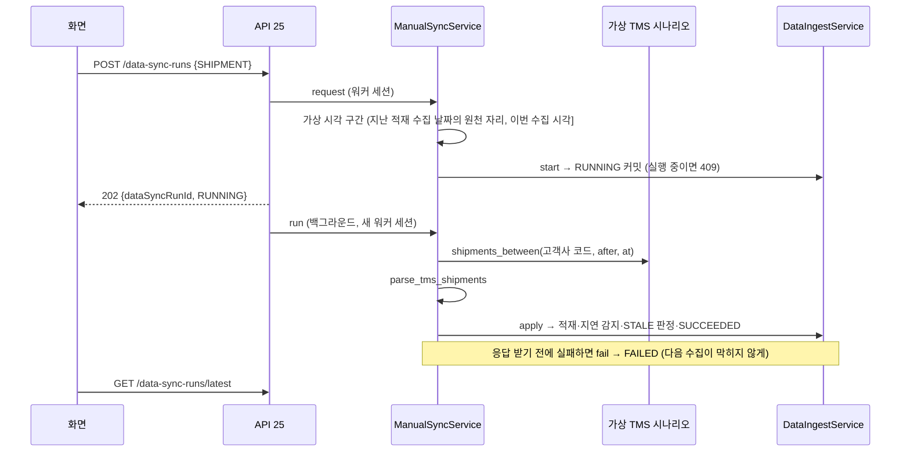

# 수동 수집 (API 25 `POST /data-sync-runs`)

화면의 "동기화"·"다시 수집" 버튼이 부르는 API 입니다(API 명세 v6.2 4.3·D16, GLOW-13·49). 지금은 선적(`SHIPMENT`)만, 가상 TMS 응답으로 수집합니다.

## 1. 요청·응답

| 항목 | 내용 |
| --- | --- |
| 권한 | Client 팀원·팀장(`CLIENT_MEMBER`·`CLIENT_LEAD`, 명세 6절). `access_token` 쿠키의 `company_id`가 고객사 범위 |
| 요청 | `{ "sourceDomain": "SHIPMENT" }` |
| 응답 202 | `{ "dataSyncRunId": "…", "status": "RUNNING" }`. 적용은 응답 뒤 백그라운드에서 하고, 결과는 `GET /data-sync-runs/latest`를 다시 조회해 봅니다 |
| 409 `SYNC_IN_PROGRESS` | 같은 원천에 실행 중인 수집이 있음 |
| 422 `VALIDATION_ERROR` | 원천 유형 형식 오류, 또는 `SHIPMENT` 외 원천(아직 원천이 없음, 2026-11-05 결정) |

## 2. 흐름



## 3. 시각 (가상 시각, 2026-11-04 결정)

- 데이터는 2026-06-30 까지, 마지막 수집은 07-01 이라 데모의 "지금"은 7월 초입니다. 서버의 지금(11월)으로 수집하면 대시보드 기준 시각(C22)이 11월로 옮겨가 화면이 빕니다.
- 수집 시각 = 그 원천의 마지막 적재 수집(`applied_seq` 최대) 시작 날짜 + 1일의 **원천 자리**(overlay 와 같게 원천마다 1분: SHIPMENT 00:03, 이슈 #39). 처음은 `VIRTUAL_CLOCK_START`(기본 `2026-07-02T00:00:00Z`) 날짜의 원천 자리라 첫 수동 수집은 `2026-07-02T00:03:00Z`입니다. 누를 때마다 하루씩 나아갑니다. `FAILED` 수집은 적재가 아니라서 다시 누르면 같은 날을 다시 시도하고, 시작 초가 겹치지 않게 1초 뒤(`00:03:01`)에 시작합니다.
- 수집 시작 시각과 일정 스냅샷 관측 시각이 이 값이고, 완료 시각은 시작 + 30초입니다(`application/virtual_clock.py`). 시작 시각은 적용 때 확정합니다(`ingest.md` 1절 수집 시각 규칙 5).
- 수집 구간은 고객사 잠금(L1) 안에서 읽고 같은 트랜잭션에서 `RUNNING`을 커밋합니다(PR #40 리뷰). 버튼을 빠르게 두 번 누르면 두 번째는 409이거나(첫 수집이 진행 중) 다음 날 구간입니다. 같은 날을 두 번 받지 않습니다.
- `VIRTUAL_CLOCK_START`를 비우면 서버 시각입니다(실제 원천을 붙일 때만).
- 가상 시각이면 수집 현황 `isSynced`는 수집 멈춤(주기 × 배수)을 보지 않고 마지막 수집 결과만 봅니다. 선적만 하루씩 나아가도 나머지 원천 카드가 "수집 오류"로 바뀌지 않습니다(`docs/data-sync/latest-sync-status.md` 3절).
- **운영 배포 체크:** 실제 원천을 붙이는 환경에서는 `VIRTUAL_CLOCK_START=`로 비웁니다. 비우지 않으면 수집 시각이 7월 초 가상 시각으로 나아가고, 수집기가 멈춰도 `isSynced: true`로 보입니다.

## 4. 가상 TMS 시나리오 파일

- 설정 `VIRTUAL_TMS_SCENARIO_PATH`. 비우면 원천 응답이 없는 것으로 보고 0건 `SUCCEEDED` 수집을 남깁니다. 요청마다 다시 읽으므로 파일을 고쳐도 재시작이 필요 없습니다.
- 파일을 읽지 못하거나 모양이 틀리면 그 수집은 `FAILED`이고 서버 로그에 원인이 남습니다.
- 모양은 census `source_samples/shipments_api.json`과 같습니다. 응답 하나는 그 시각에 TMS 가 보낸 선적들입니다(바뀐 선적만 와도 됨). `_demo_company`는 고객사 코드(`companies.company_code`)입니다.

```json
{
  "interface": "GET /v1/shipments",
  "responses": [
    {
      "fetched_at": "2026-07-02T00:00:00Z",
      "_demo_company": "A_BEAUTY",
      "data": [
        {
          "shipmentNo": "…",
          "mode": "OCEAN",
          "destWh": "TMS 창고 코드",
          "plannedKrRelease": "2026-06-25",
          "stage": "AT_SEA",
          "etaPort": "2026-07-20",
          "eta3pl": "2026-07-28",
          "actual3pl": null,
          "items": [{ "lineNo": 1, "sku": "TMS-SKU-001", "qty": 240 }]
        }
      ]
    }
  ]
}
```

- 이번 수집은 (지난 적재 수집 날짜의 원천 자리, 이번 수집 시각] 의 응답을 모으고, 같은 선적은 마지막 관측 값만 씁니다(`infrastructure/virtual_tms.py`). 구간 시작은 기록된 시작 시각이 아니라 그날 자리(SHIPMENT 00:03)라, 재시도(00:03:01)·적용 때 확정으로 시작이 밀려도 지난 구간의 끝과 이어집니다(PR #52 리뷰). 실제 시각(`VIRTUAL_CLOCK_START` 비움)은 지난 적재 수집 시작 그대로이고, 시작이 밀리면 같은 틈이 생깁니다(운영 미사용 경로, 후속).
- 창고·SKU 는 TMS 매핑 코드(`external_entity_mappings`, `MAPPED`)입니다. 새 선적은 상세 SKU 의 HS10 이 하나여야 합니다(`ingest.md` 4절).
- 새 선적의 첫 관측이 이미 지연(예상 3PL 입고일 > 서버가 정한 계획 3PL 입고일)이면 에피소드 1번이 열립니다(앞선 SHIPMENT 수집이 있어 초기 적재가 아님). 판단 API 18~20 은 이 열린 지연으로 시연합니다.
- 시나리오 내용(어떤 선적·지연을 넣을지)은 데이터 설계 몫이며 저장소에 넣지 않았습니다.

## 5. 세션

수집은 워커 역할 전용 세션(`open_worker_session`, `ingest.md` "워커 역할 연결")에서 돕니다. 요청 세션(`get_db`)과 따로이며 수집 서비스가 직접 커밋합니다. 요청 안의 시작과 백그라운드의 적용은 서로 다른 세션입니다.

## 6. 테스트

| 파일 | 확인하는 것 |
| --- | --- |
| `test_manual_sync_api.py` | 팀원·팀장 202·`RUNNING`·백그라운드 등록, 401, ADMIN·OWNER 403, 형식 오류 422, 409·422 전달 시 백그라운드 없음 |
| `test_manual_sync_sql.py` | 확정 DB 첫 수동 수집 = 07-02 00:03:00(완료 00:03:30), 새 지연 선적 적재 → 열린 에피소드 1번, 다음은 07-03 00:03·같은 응답 다시 안 받음, `SHIPMENT` 외 거부, 실행 중 409, 구간을 L1 안에서 읽고 되돌리지 않음, 시나리오 없음 → 0건 성공, 시나리오 실패 → `FAILED`·로그·같은 날 재시도(00:03:01), 재시도로 밀린 시작 뒤에도 다음 구간이 그날 자리부터라 00:03:01 응답이 빠지지 않음 |
