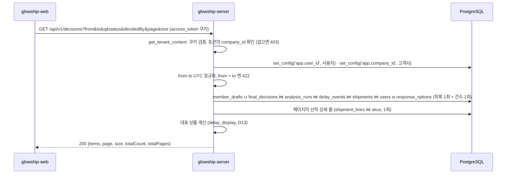

# 판단 이력 목록 조회 (의사결정 이력)

의사결정 이력 화면(SCR-004, 명세 v6.2 3절의 "승인 및 실행 이력 조회", 4.7절 "판단 이력") 위쪽 목록을 채우는 API가 **현재 어떻게 동작하는지** 설명합니다.
팀원의 의견·선택 초안(`member_drafts`)과 팀장의 최종 선택(`final_decisions`)을 한 목록으로 합쳐 최신순으로 돌려줍니다.
화면 아래쪽의 선택 상세·당시 분석 요약 패널과 선택자 드롭다운 목록(`GET /members`)은 이 API 몫이 아니며, 6절에 그 자리를 적었습니다.

## 1. 전체 흐름



- 고객사 범위는 요청 본문이 아니라 **토큰의 `company_id`** 입니다. OWNER·ADMIN은 소속 고객사가 없어 403입니다.
- 두 표는 같은 열 모양으로 세워(`UNION ALL`) 한 번에 정렬·페이지 처리합니다. 초안의 `decidedAt`은 작성 시각, 최종 선택은 선택 시각입니다.
- `status`는 저장값이 아니라 조회 때 계산합니다(3절). 필터와 건수가 같은 식을 보도록 SQL 안에서 계산합니다.

## 2. 조회 API

`GET /api/v1/decisions` — `app/modules/decision/presentation/decision_api_router.py`

### 권한

`access_token` 쿠키가 유효하고 토큰에 `company_id`가 있어야 합니다(`CLIENT_MEMBER`·`CLIENT_LEAD`).

### 쿼리 파라미터

| 파라미터 | 값 | 설명 |
| --- | --- | --- |
| `from` · `to` | ISO 8601 UTC 시각 | 판단 시각(`decidedAt`) 기준, `[from, to)`로 `to` 미포함(명세 C18). 시간대 없는 값·날짜만·Unix 초 같은 숫자·`from > to`는 422, `from = to`는 0건(C20). 화면의 KST 날짜 범위 "10.01 – 10.21"은 `from=2026-09-30T15:00:00Z`·`to=2026-10-21T15:00:00Z` |
| `q` | 100자 이하 | 선적 코드, 또는 그 선적에 실린 SKU 코드·상품명 부분 일치(대소문자 무시). 지연 목록 `q`와 같은 범위. `%`·`_`·`\`는 글자 그대로 찾음 |
| `decisionType` | `DRAFT` · `FINAL` | 초안 / 최종 선택. 화면 컨트롤은 없고 `status`가 같은 구분을 함 |
| `status` | `DRAFT` · `FINAL` · `NEEDS_REANALYSIS` | 3절의 계산값 |
| `decidedBy` | 사용자 UUID | 작성자·선택자. 같은 고객사 사용자가 아니면 0건(오류 아님) |
| `runId` | 실행 UUID | 그 실행의 초안·최종 선택만. 지연 대응 센터에서 링크로 진입할 때 사용 |
| `page` · `size` | 1부터 / 1~100 | 기본 1 / 20. 화면은 10행씩이라 `size=10` |

정렬은 `decidedAt` 최신순, 같으면 `decisionId` 오름차순입니다(명세 4.7). 두 표의 ID는 UUIDv7이라 서로 겹치지 않습니다.

### 성공 응답

```http
HTTP/1.1 200 OK
```

```json
{
  "items": [
    {
      "decisionType": "DRAFT",
      "decisionId": "f78a464b-1e31-519c-9e12-c7fcc6228488",
      "decidedAt": "2026-01-01T02:00:00Z",
      "shipment": { "shipmentId": "7e97a4e4-…", "shipmentCode": "OCN-20251215" },
      "representativeSku": { "skuId": "f72519b3-…", "skuCode": "SKU-002", "productName": "A Glow Hydra Serum 30ml" },
      "responseOption": { "responseOptionId": "2eebe6ce-…", "optionType": "KR_AIR_REPLENISH" },
      "decidedBy": { "userId": "08a44178-…", "displayName": "A Beauty Company Member 1", "roleCode": "CLIENT_MEMBER" },
      "status": "NEEDS_REANALYSIS",
      "run": { "runId": "536fde84-…", "runCode": "AN-260101-003", "status": "STALE", "resultClass": "FORECAST_ONLY_READY", "failureCode": null },
      "delayEventId": "1194d03c-…"
    }
  ],
  "page": 1,
  "size": 10,
  "totalCount": 4,
  "totalPages": 1
}
```

| 필드 | 출처 | 설명 |
| --- | --- | --- |
| `decisionType` | 어느 표에서 왔는지 | `DRAFT`(`member_drafts`) · `FINAL`(`final_decisions`) |
| `decisionId` | `member_draft_id` / `final_decision_id` | 정렬 동점 규칙에 씀 |
| `decidedAt` | `member_drafts.created_at` / `final_decisions.decided_at` | 초안은 작성 시각, 최종 선택은 선택 시각. UTC |
| `shipment` | 실행 → 지연 → `shipments` | 공통 요약 객체 |
| `representativeSku` | `shipment_lines` → `skus` | 수량이 가장 많은 SKU, 같으면 줄 번호가 작은 SKU(D13, 지연·선적 목록과 같은 함수). 상세가 없으면 `null` |
| `responseOption` | `response_options` | 고른 대응안. 의견만 쓴 초안이면 `null`(`member_drafts_ck1`). 최종 선택은 항상 있음 |
| `decidedBy` | `users` | 사용자 요약 `{userId, displayName, roleCode}`. 초안은 작성자(팀원), 최종은 선택자(팀장) |
| `status` | 계산 | 3절 |
| `run` | `analysis_runs` | 실행 요약 `{runId, runCode, status, resultClass, failureCode}`. `runCode`가 화면 "실행 ID" 열(초안 행에도 표시, 명세 U6) |
| `delayEventId` | `analysis_runs.delay_event_id` | 지연 대응 센터로 이동할 때 사용 |

코드값의 화면 표시명은 명세 2절과 라벨 사전 `labels/ko-v1`을 따릅니다. 대응안은 "현재 계획 유지·출항 전 항공 전환·한국 창고 항공 보충·다른 권역 창고 출고", 상태는 "초안·최종 선택·재분석 필요"입니다.

### 실패 응답

| 상태 | code | 상황 |
| --- | --- | --- |
| 401 | `UNAUTHENTICATED` | 쿠키 없음·만료·위조 |
| 403 | `FORBIDDEN` | OWNER·ADMIN 토큰(고객사 범위 없음) |
| 422 | `VALIDATION_ERROR` | `from`·`to` 형식 오류·`from > to`, `decisionType`·`status` 허용값 밖, `decidedBy`·`runId` UUID 형식, `page < 1`, `size` 범위 밖, `q` 101자 이상 |

## 3. `status` 계산

| `status` | 조건 | 뜻 |
| --- | --- | --- |
| `FINAL` | `decisionType = FINAL` | 팀장이 확정한 선택. 최종 선택된 실행은 뒤에 데이터가 바뀌어도 `STALE`이 되지 않으므로(DDL `analysis_runs_ck25`) 항상 유효 |
| `DRAFT` | 초안이고 실행이 `STALE`이 아님 | 아직 참고할 수 있는 초안 |
| `NEEDS_REANALYSIS` | 초안이고 실행이 `STALE` | 자료가 바뀌어 근거가 낡은 초안. 재분석 뒤 새 실행에 다시 쓴 초안은 새 행으로 쌓임 |

SQL의 `CASE` 한 식으로 계산합니다(`decision_repository.py`의 `joined` CTE). 2026 H1 데이터(고객사 A)에는 세 값이 모두 있습니다: E1 v1 초안이 `NEEDS_REANALYSIS`, E1 v2 초안이 `DRAFT`, E1 v2·E4 v1 최종 선택이 `FINAL`.

## 4. 명세와 다른 점·넣지 않은 것

- **`run.failureCode`를 넣었습니다.** 명세 4.7은 `run`을 4개 필드로 적었지만, 응답 본문 규칙 5.2의 실행 요약은 C27(2026-11-04)로 `failureCode`가 들어갔고 요약 객체는 어느 API에서든 같은 모양을 씁니다. 그래서 `run`은 #31이 `failureCode`를 더한 공통 `RunSummary`를 그대로 씁니다. 4.7 문구 갱신은 설계 담당에게 요청했습니다.
- **선택 이유·의견 본문(`reasonText`·`opinionText`)은 넣지 않습니다.** 화면은 이유·의견을 아래 선택 상세 패널에서 보여 주고, 그 패널은 행을 눌렀을 때 `GET /analysis-runs/{runId}`(명세 4.5의 `drafts[]`·`finalDecision`)로 채웁니다.
- **당시 분석 수치·AI 설명**도 상세 API 몫입니다.
- `decidedBy`·`runId`가 다른 고객사의 것이면 조인 조건 때문에 0건입니다. 존재 여부를 노출하지 않는 고객사 범위 원칙(명세 2절)을 따릅니다.

## 5. SQL

`app/modules/decision/infrastructure/repository/decision_repository.py`

- `decisions` CTE: 두 표를 `(decision_type, decision_id, decided_at, company_id, analysis_run_id, user_id, response_option_id)`로 세운 `UNION ALL`. 각 표에 `company_id` 조건.
- `joined` CTE: `analysis_runs`(실행 요약·`status` 계산) → `delay_events` → `shipments`, `users`, `LEFT JOIN response_options`. 기간·유형·선택자·실행·검색어 필터.
- `filtered` CTE: 계산된 `status` 필터. 목록은 `ORDER BY decided_at DESC, decision_id` + `OFFSET`·`LIMIT`, 건수는 같은 CTE의 `COUNT(*)`.
- 상세 줄은 페이지의 선적 ID 배열(중복 제거)로 `shipment_lines ⋈ skus` 1회. 요청당 SQL 3회(RLS 컨텍스트 제외).
- 모든 조인에 `company_id`를 명시합니다. 로컬 DB는 슈퍼유저라 RLS를 우회하기 때문입니다(ERD 설명 4.6).

## 6. 테스트

`tests/modules/decision/`

| 파일 | 내용 |
| --- | --- |
| `test_decision_api.py` | 라우터. 쿠키 없음 401, OWNER·ADMIN 403, 형식 오류 10종 422, 서비스의 기간 오류 422, 필터·페이지 전달, 생략 시 기본값, 응답 키 10개와 요약 객체 모양, `null` 직렬화, RLS 컨텍스트 설정. DB 없이 실행 |
| `test_decision_list_service.py` | 서비스. 필터 전달·공백 검색어, UTC 정규화, `from > to` 422·`from = to` 통과, 대표 상품 규칙(수량 최대·동률·상세 없음), 대응안 없는 초안, 같은 선적 여러 행. DB 없이 실행 |
| `test_decision_repository_sql_smoke.py` | 실제 DB 읽기 전용. 빈 고객사 0건, 모든 필터로 SQL 실행, 두 표 합과 정렬, 상태·유형·선택자·실행 필터 건수 대조, 검색어(선적 코드·SKU), 기간 끝 미포함, 상세 줄 수. DB 없으면 건너뜀 |

로컬 DB(2026 H1 적재, 고객사 A) 실측: 전체 4건, `status=NEEDS_REANALYSIS` 1·`FINAL` 2, `decisionType=DRAFT` 2, 팀장 `decidedBy` 2, `q=OCN-20251215` 3, `runId=E1 v2` 2, `from = to` 0, 고객사 B 0. 01-01 02:00Z 동점 두 건은 최종 선택(`399e…`)이 초안(`f78a…`)보다 앞입니다.

## 7. 아직 없는 것

| 기능 | 비워 둔 자리 |
| --- | --- |
| 선택자 드롭다운 목록 `GET /members`(API 24) | user 모듈. 최종 선택자는 팀장이므로 팀원·팀장 모두 돌려주어야 함. 그 전에는 응답의 `decidedBy.userId`로 목록을 만들 수 있음 |
| 선택 상세·당시 분석 요약 패널 | `GET /analysis-runs/{runId}`(API 17). 선택 이유·팀원 의견·기준 데이터 시각·부족 수량·위험 주문 수 |
| 초안·최종 선택 저장 | `POST /analysis-runs/{runId}/drafts`(API 18)·`/final-decision`(API 19). 이 목록은 그 결과를 읽기만 함 |
| 지연 목록 `currentRun.runCode` | 0006 열은 있으나 지연 목록은 아직 `null`로 보냄. 이 작업 범위 밖 |

## 8. 관련 파일

| 파일 | 역할 |
| --- | --- |
| `app/modules/decision/presentation/decision_api_router.py` | `GET /api/v1/decisions` 엔드포인트 |
| `app/modules/decision/presentation/decision_schemas.py` | `DecisionType`·`DecisionStatus`, `DecisionListItemResponse`, `DecisionListResponse` |
| `app/modules/decision/application/decision_list_service.py` | `DecisionListService`, 기간 검사, 대표 상품 계산 |
| `app/modules/decision/application/exception/decision_exceptions.py` | `INVALID_DECIDED_PERIOD`(422 `VALIDATION_ERROR`) |
| `app/modules/decision/infrastructure/repository/decision_repository.py` | UNION·조인·`status` CASE SQL, 상세 줄 조회 |
| `app/modules/decision/dependencies.py` | 리포지토리·서비스 조립 |
| `app/core/summary_schemas.py` | `UserSummary`·`ResponseOptionSummary`(신설, 응답 본문 규칙 5.2) |
| `app/modules/delay_analysis/application/delay_display.py` | 대표 상품 계산 `pick_representative_line` |
| `app/core/security/tenant.py` | `get_tenant_context` |
