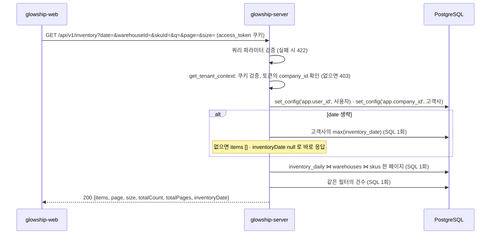

# 재고 목록 조회

고객사 사용자가 "연동 데이터 조회" 화면(SCR-005)의 **재고 탭**에서 보는 재고 목록 API가 **현재 어떻게 동작하는지** 설명합니다.
응답 모양은 API 명세 v6.2 4.3 `GET /inventory`와 응답 본문 규칙(`api_response_body_rule_glowship.md`) 5.2(요약 객체)·6절(목록·형제 필드)을 따릅니다. 두 문서는 `glowship-plan` 저장소에 있습니다.
상단 카드와 탭 배지(원천별 `openIssueCount`)는 [동기화 상태 API](../data-sync/latest-sync-status.md), 하단 오류 배너는 `GET /validation-issues`(미구현) 몫입니다.

> 명세 4.3에 없는 `q`(SKU 코드·상품명)를 2절 공통 규칙("목록은 `q`, `page`, `size`를 받는다")에 따라 추가했습니다. 설계 담당 확인 뒤 명세 4.3에 반영을 요청합니다.

## 1. 전체 흐름



- 고객사 범위는 **토큰의 `company_id`** 입니다. OWNER·ADMIN은 소속 고객사가 없어 403입니다.
- `inventory_daily`·`warehouses`·`skus`는 고객사 범위 테이블이라 RLS 컨텍스트를 먼저 설정합니다. 로컬 개발 DB는 슈퍼유저라 RLS를 우회하므로 SQL마다 `company_id` 조건을 직접 겁니다(ERD 설명 4.6).
- 한 페이지에 SQL은 최대 3회(최신 일자·목록·건수)입니다. 최신 일자는 색인 `inventory_daily_uk2 (company_id, inventory_date, …)`를 거꾸로 읽어 0.1ms 안에 끝납니다.

## 2. 조회 API

`GET /api/v1/inventory` — `app/modules/inventory/presentation/inventory_api_router.py`

### 권한

`access_token` 쿠키가 유효하고 토큰에 `company_id`가 있어야 합니다(`CLIENT_MEMBER`·`CLIENT_LEAD`).

### 쿼리 파라미터

| 이름 | 타입 | 기본값 | 설명 |
| --- | --- | --- | --- |
| `date` | `YYYY-MM-DD` | 고객사의 최신 적재 일자 | 재고 기준 일자. **하루치 스냅샷을 고르는 날짜**라 기간 필터 규칙(명세 C18, UTC 시각)의 대상이 아닙니다. 형식이 틀리면 422 |
| `warehouseId` | UUID | 없음 | 창고 |
| `skuId` | UUID | 없음 | 상품 |
| `q` | 문자열, 최대 100자 | 없음 | SKU 코드 또는 상품명 부분 일치. 대소문자 무시. `%`·`_`는 글자 그대로 찾음. 양끝 공백은 지우고, 비면 없는 것으로 봄 |
| `page` | 정수 ≥ 1 | `1` | 페이지 번호 (`app/core/pagination.py` `PageParams`) |
| `size` | 정수 1~100 | `20` | 페이지 크기 |

- `date`를 생략하면 **오늘이 아니라 그 고객사의 `max(inventory_date)`**를 씁니다. 합성 데이터는 2026-06-30에서 끝나므로 오늘 날짜로 조회하면 0건입니다.
- 정렬은 창고 코드 → SKU 코드 오름차순, 같으면 `skuId`입니다(명세 4.3). 한 일자 안에서 창고·SKU 조합은 하나(ERD `uk2`)라 페이지를 넘겨도 행이 중복·누락되지 않습니다.
- 고객사 A 기준 한 일자에 66행(창고 3 × SKU 30 중 적재분)이라 `size=100`이면 한 페이지에 다 들어옵니다.

### 성공 응답

```http
HTTP/1.1 200 OK
```

```json
{
  "items": [
    {
      "inventoryDate": "2026-06-30",
      "warehouse": {
        "warehouseId": "02c90be1-ce21-588a-9586-ff76d5176c78",
        "warehouseCode": "WH-EAST",
        "regionCode": "EAST"
      },
      "sku": {
        "skuId": "f4a3001a-c9d6-5e07-b641-066f2a70f810",
        "skuCode": "SKU-001",
        "productName": "A Glow Hydra Toner Pad 60ea"
      },
      "onHandQuantity": 897,
      "reservedQuantity": 24,
      "availableQuantity": 873,
      "outboundQuantity": 24,
      "dataSyncRunId": "ee87fba3-cc6f-5fb8-a9d5-2cce2a285d86"
    }
  ],
  "page": 1,
  "size": 20,
  "totalCount": 66,
  "totalPages": 4,
  "inventoryDate": "2026-06-30"
}
```

| 필드 | 설명 |
| --- | --- |
| `inventoryDate` (최상위) | 이번 응답의 기준 일자. `items` 옆 형제 필드(응답 규칙 6.2). 적재된 재고가 없는 고객사면 `null`이고 `items`는 `[]` |
| `items[].inventoryDate` | 행의 기준 일자. 최상위 값과 같음 |
| `warehouse` | 창고 요약 객체. `regionCode` 표시명은 명세 2절(`WEST` 서부(LA)·`EAST` 동부(NJ)·`KR` 한국) |
| `sku` | 상품 요약 객체 |
| `onHandQuantity` | 보유. **항상 `reservedQuantity + availableQuantity`**(ERD `ck5`) |
| `reservedQuantity` | 예약. **다음 날 출고 대기분이 이미 들어 있으므로 화면·서버 모두 미출고 주문 수량을 다시 차감하지 않습니다**(BR-003) |
| `availableQuantity` | 가용 |
| `outboundQuantity` | 당일 출고 |
| `dataSyncRunId` | 이 행을 적재한 수집 실행 ID. 화면 열에는 올리지 않음 |

### 프론트의 해석

- 화면 상단에 "기준일 2026-06-30"처럼 최상위 `inventoryDate`를 표시하고, 날짜 선택기로 `date`를 바꿔 다른 일자를 조회합니다.
- 목록 열은 창고·SKU 코드·상품명·보유·예약·가용·당일 출고를 권합니다. 보유 = 예약 + 가용이므로 화면에서 다시 계산하지 않습니다.
- 명세 2절에 없는 새 코드값은 없습니다.

### 실패 응답

| 상태 | `code` | 상황 |
| --- | --- | --- |
| `401` | `UNAUTHENTICATED` | 쿠키 없음·만료 |
| `403` | `FORBIDDEN` | 토큰에 `company_id` 없음(OWNER·ADMIN) |
| `422` | `VALIDATION_ERROR` | `date` 형식 오류, UUID 형식 오류, `page < 1`, `size` 범위 밖, `q` 길이 초과 |

응답 규칙 6.1은 범위 오류를 400으로 적지만 "현재 구현은 422"라 다른 목록 API와 같이 422입니다.

## 3. 상품 탭과 다른 점

- 행별 검증 상태·"오류만 보기"가 없습니다. 검증 오류로 거부된 레코드는 `inventory_daily`에 적재되지 않아 행에 붙일 수 없습니다. 오류는 탭 배지와 `GET /validation-issues?domain=INVENTORY`가 담당합니다.
- 대시보드의 거점별 재고 현황(`GET /inventory-status`, 명세 4.4·D9)은 판매량·안전재고를 계산하는 다른 API입니다. 이 목록은 적재된 수량을 그대로 보여줄 뿐입니다.

## 4. SQL

`app/modules/inventory/infrastructure/repository/inventory_repository.py`

- 최신 일자: `SELECT max(inventory_date) FROM inventory_daily WHERE company_id = :company_id`. 색인 `uk2` 역방향 스캔.
- 목록·건수가 같은 `filtered` CTE를 씁니다. `inventory_date = :inventory_date`는 필수 조건이고, 나머지 필터는 값이 `NULL`이면 통과합니다(`CAST(:x AS …) IS NULL OR …`).
- `q`는 `sku_code ILIKE OR product_name ILIKE`이고 패턴의 `\`·`%`·`_`는 이스케이프합니다.

로컬 DB(고객사 A, 36,036행) 실측: 최신 일자 0.1ms, 한 일자 목록 1페이지 약 3ms(첫 호출 28ms는 연결 포함). 기존 색인으로 충분해 색인 추가는 없습니다.

## 5. 테스트

`tests/modules/inventory/`

| 파일 | 내용 |
| --- | --- |
| `test_inventory_api.py` | 401·403, 형식 오류 8종 422, camelCase 응답 모양과 형제 필드 `inventoryDate`, 빈 고객사 `null`, 기본값·파라미터 전달, RLS 컨텍스트 |
| `test_inventory_list_service.py` | `date` 생략 시 최신 일자, 최신 일자 없으면 조회 없이 빈 결과, `date` 지정 시 최신 일자 조회 안 함, 검색어 공백, 행 변환 |
| `test_inventory_repository.py` | 가짜 세션으로 최신 일자·목록·건수 SQL과 파라미터, 행 변환, 건수 `None → 0` |
| `test_inventory_repository_sql_smoke.py` | 실제 DB(읽기 전용): 최신 일자 = `max`, 정렬·조합 유일, `onHand = reserved + available`, 창고·SKU·검색어 필터, 없는 일자 0건 |

## 6. 아직 없는 것

- `GET /validation-issues`(하단 오류 배너)
- 명세 4.3 `GET /inventory`에 `q` 반영(설계 담당 확인 뒤)

## 7. 관련 파일

| 역할 | 파일 |
| --- | --- |
| 라우터 | `app/modules/inventory/presentation/inventory_api_router.py` |
| 응답 스키마 | `app/modules/inventory/presentation/inventory_schemas.py` |
| 서비스 | `app/modules/inventory/application/inventory_list_service.py` |
| 리포지토리 | `app/modules/inventory/infrastructure/repository/inventory_repository.py` |
| 의존성 | `app/modules/inventory/dependencies.py` |
| ORM | `app/modules/inventory/infrastructure/inventory_daily.py` |
| 공통 | `app/core/pagination.py`, `app/core/summary_schemas.py`, `app/core/security/tenant.py` |
