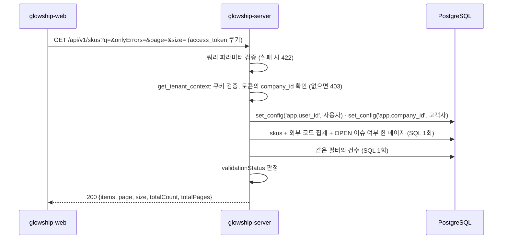

# 상품 목록 조회

고객사 사용자가 "연동 데이터 조회" 화면의 **상품 탭**에서 보는 상품(SKU) 목록 API가 **현재 어떻게 동작하는지** 설명합니다.
응답 모양은 API 명세 v6.2 4.3 `GET /skus`와 응답 본문 규칙 6절(목록)을 따릅니다.
상단 카드와 탭 배지(원천별 `openIssueCount`)는 [동기화 상태 API](../data-sync/latest-sync-status.md), 하단 오류 배너는 `GET /validation-issues`(미구현) 몫입니다.

## 1. 전체 흐름



- 고객사 범위는 **토큰의 `company_id`** 입니다. OWNER·ADMIN은 소속 고객사가 없어 403입니다.
- `skus`·`external_entity_mappings`·`data_validation_issues`는 고객사 범위 테이블이라 RLS 컨텍스트를 먼저 설정합니다.

## 2. 조회 API

`GET /api/v1/skus` — `app/modules/master_data/presentation/sku_api_router.py`

### 권한

`access_token` 쿠키가 유효하고 토큰에 `company_id`가 있어야 합니다(`CLIENT_MEMBER`·`CLIENT_LEAD`).

### 쿼리 파라미터

| 이름 | 타입 | 기본값 | 설명 |
| --- | --- | --- | --- |
| `q` | 문자열, 최대 100자 | 없음 | 상품명 또는 ERP 코드 부분 일치. 대소문자 무시. `%`·`_`는 글자 그대로 찾음. 양끝 공백은 지우고, 비면 없는 것으로 봄 |
| `onlyErrors` | 불리언 | `false` | `validationStatus`가 `OK`가 아닌 상품만 |
| `page` | 정수 ≥ 1 | `1` | 페이지 번호 (`app/core/pagination.py` `PageParams`) |
| `size` | 정수 1~100 | `20` | 페이지 크기 |

정렬은 `skuCode` 오름차순, 같으면 `skuId`입니다(명세 4.3).

### 성공 응답

```http
HTTP/1.1 200 OK
```

```json
{
  "items": [
    {
      "skuId": "0199a1b2-…",
      "skuCode": "SKU-201",
      "productName": "B Bloom Hydra Toner Pad 60ea",
      "brandName": "B Bloom",
      "category": "SKINCARE",
      "subcategory": "Toner Pad",
      "popularityTier": "HIT",
      "isEmergencyAirEligible": true,
      "unitCode": "EA",
      "unitsPerCase": 24,
      "status": "ACTIVE",
      "externalCodes": [
        { "sourceDomain": "INVENTORY", "externalCode": "WMS-SKU-201", "mappingStatus": "MAPPED" },
        { "sourceDomain": "SHIPMENT", "externalCode": "TMS-SKU-201", "mappingStatus": "MAPPED" }
      ],
      "validationStatus": "ISSUE_OPEN"
    }
  ],
  "page": 1,
  "size": 20,
  "totalCount": 20,
  "totalPages": 1
}
```

| 필드 | 출처 | 설명 |
| --- | --- | --- |
| `skuId` … `status` | `skus` | `skuCode`가 화면의 "ERP 코드". ERP가 상품 마스터의 원천이라 매핑 없이 그대로 씀 |
| `popularityTier` | `skus.popularity_tier` | `HIT`·`REGULAR`·`LONG_TAIL`. 화면의 "히트 상품"은 `HIT` |
| `status` | `skus.status` | `ACTIVE`·`INACTIVE`. INACTIVE도 목록에 포함 |
| `externalCodes[]` | `external_entity_mappings` (`entity_type = 'SKU'`) | 원천별 외부 코드. `sourceDomain`·`externalCode` 순. 매핑이 없으면 `[]`. 창고별 SKU 코드는 제공하지 않음(명세 D15·U8) |
| `validationStatus` | 서버 판정 | `OK`·`CODE_MISSING`·`ISSUE_OPEN`. 규칙은 3절 |
| `page`·`size`·`totalCount`·`totalPages` | `Page[T]` | `totalCount`는 `q`·`onlyErrors`를 적용한 전체 건수. 범위 밖 페이지는 `items: []`에 실제 `totalCount` |

### 프론트의 해석

| 화면 | 값 |
| --- | --- |
| 상품 / ERP 코드 / 히트 상품 | `productName` / `skuCode` / `popularityTier == "HIT"` |
| 원천별 외부 코드 열 (목업의 "LA / NJ 창고 코드" 열을 대체, 명세 U8) | `externalCodes[]` |
| 검증 상태 배지 | `validationStatus`. 표시명은 화면이 정함(서버는 코드값만) |
| 오류만 보기 | `onlyErrors=true` |
| 탭 옆 오류 건수 | 이 API가 아니라 `GET /data-sync-runs/latest`의 `PRODUCT` 항목 `openIssueCount` |
| 하단 배너의 메시지·영향 | `GET /validation-issues`(미구현) |

### 실패 응답

| 상태 | code | 상황 |
| --- | --- | --- |
| 401 | `UNAUTHENTICATED` | 쿠키 없음·만료·위조 |
| 403 | `FORBIDDEN` | 토큰에 `company_id`가 없음 (OWNER·ADMIN) |
| 422 | `VALIDATION_ERROR` | `page < 1`, `size`가 1~100 밖, `q`가 100자 초과, `onlyErrors`가 불리언이 아님 |
| 500 | `INTERNAL_SERVER_ERROR` | DB 장애 등 |

명세 5절의 400(D3)·`UNAUTHORIZED`·`ROLE_NOT_ALLOWED`·`requestId`는 core 공통 변경이라 별도 작업입니다.

## 3. `validationStatus` 판정 규칙

`SkuListService._validation_status` — `app/modules/master_data/application/sku_list_service.py`

| 순서 | 상태 | 조건 |
| --- | --- | --- |
| 1 | `CODE_MISSING` | 이 SKU의 매핑(`entity_type = 'SKU'`) 중 `mapping_status <> 'MAPPED'`가 하나라도 있음 |
| 2 | `ISSUE_OPEN` | 이 SKU 코드로 열린 검증 오류가 있음 (아래) |
| 3 | `OK` | 그 밖 |

둘 다 해당하면 `CODE_MISSING`입니다(명세의 나열 순서).

### 이슈 ↔ 상품 연결

`data_validation_issues`에는 상품을 가리키는 `sku_id`가 없습니다. 상품 코드는 `source_record_key` 문자열 안에만 있습니다.
그래서 당분간 다음 규칙으로 잇습니다.

| 조건 | 값 |
| --- | --- |
| `status` | `OPEN` |
| `source_entity_type` | `INVENTORY` |
| 상품 코드 | `split_part(source_record_key, '\|', 2)` — 키 형식 `창고코드\|상품코드\|날짜`의 둘째 토막 |

ORDER·SHIPMENT 이슈는 주문·선적 탭의 몫이라 상품에 붙이지 않습니다. 주문 이슈의 키는 주문 번호라 상품 코드가 들어 있지도 않습니다.

> 키 파싱은 합성데이터의 형식에 의존하는 임시 방식입니다. 수집기(GLOW-13)가 이슈를 기록할 때 `sku_id`·`warehouse_id`를
> 채우도록 컬럼을 추가하는 것이 정식 방법이며, 그때 이 파싱을 조인으로 바꿉니다. SQL의 해당 줄에 주석을 남겨 두었습니다.

## 4. SQL

`SkuRepository` — `app/modules/master_data/infrastructure/repository/sku_repository.py`

| CTE | 내용 | 쓰는 값 |
| --- | --- | --- |
| `external_codes` | `external_entity_mappings`를 SKU별로 `jsonb_agg` (원천·코드 순) | `externalCodes[]`, `has_unmapped` |
| `open_issue_skus` | OPEN·INVENTORY 이슈의 키 둘째 토막 (`DISTINCT`) | `has_open_issue` |
| `filtered` | `skus` ⋈ 위 두 CTE, `q`·`onlyErrors` 필터 | 목록·건수 공통 |

목록은 `ORDER BY sku_code, sku_id OFFSET LIMIT`, 건수는 같은 `filtered`의 `COUNT(*)`입니다. 범위 밖 페이지에서도 `totalCount`가 실제 값이 되도록 두 문장으로 나눕니다.
`text()` + `bindparam`으로 쓰고 `company_id` 조건을 명시해 로컬(superuser)에서도 운영(RLS)과 같은 결과가 나오게 합니다.

## 5. 테스트

단위 테스트는 DB 없이, 스모크 테스트는 실제 DB(읽기 전용, 롤백)로 돌며 DB가 없으면 건너뜁니다. 이 작업의 테스트 29건, 전체 205건.

| 파일 | 내용 |
| --- | --- |
| `tests/modules/master_data/test_sku_repository.py` | 두 문장 실행과 파라미터, SQL 조건(`entity_type = 'SKU'`, `jsonb_agg` 순서, `BOOL_OR`, `split_part`, OPEN·INVENTORY, 정렬 동점), 행 → `SkuListRow`, 문자열 JSON, 건수 None, LIKE 이스케이프 |
| `tests/modules/master_data/test_sku_repository_sql_smoke.py` | 빈 고객사 0건, 정렬·건수·범위 밖 페이지·`onlyErrors`·외부 코드 순서, 검색 부분 일치, 합성데이터 B사 SKU-201 = 재고 이슈 열림 |
| `tests/modules/master_data/test_sku_list_service.py` | page → offset, 기본 페이지, 검색어 공백 처리, 건수 전달, 필드 옮김, `CODE_MISSING` > `ISSUE_OPEN` > `OK` |
| `tests/modules/master_data/test_sku_api.py` | 401, OWNER·ADMIN 403, 파라미터 422 5종, CLIENT 200과 camelCase·공통 목록 모양, 기본값·파라미터 전달, RLS SQL 실행 |

로컬 DB의 합성데이터(glowship_synthetic_2025_v5, `skus`·`data_validation_issues` 등 일부 테이블)로 스모크 테스트를 실행해 B사 SKU-201이 `ISSUE_OPEN`으로 나오는 것을 확인했습니다.

## 6. 아직 없는 것

| 기능 | 비워 둔 자리 |
| --- | --- |
| 이슈 ↔ 상품 정식 연결 | `data_validation_issues`에 `sku_id`·`warehouse_id` 추가(마이그레이션·수집기·합성데이터). 리포지토리의 `split_part`를 조인으로 교체 |
| 검증 이슈 목록·하단 배너 | 명세 4.3 `GET /validation-issues` (`affectedDelayEvents[]`) |
| 창고 목록 | 명세 4.3 `GET /warehouses`. `ExternalCodeResponse`를 그대로 재사용 |
| 상품 상태 필터·정렬 선택 | 현재 INACTIVE 포함, `skuCode` 정렬 고정 |

## 7. 관련 파일

| 파일 | 역할 |
| --- | --- |
| `app/modules/master_data/presentation/sku_api_router.py` | `GET /api/v1/skus`, 쿼리 파라미터 |
| `app/modules/master_data/presentation/sku_schemas.py` | `ExternalCodeResponse`, `SkuListItemResponse`, `SkuListResponse(Page)` |
| `app/modules/master_data/application/sku_list_service.py` | `validationStatus` 판정, 검색어 정리, 행 → 항목 |
| `app/modules/master_data/infrastructure/repository/sku_repository.py` | 목록·건수 SQL, `SkuListRow`, `ExternalCodeRow`, LIKE 이스케이프 |
| `app/modules/master_data/infrastructure/master_data_enums.py` | `PopularityTier`, `SkuStatus`, `MappingStatus` |
| `app/modules/master_data/dependencies.py` | `get_sku_list_service` 조립 |
| `app/core/pagination.py` | `PageParams`, `Page[T]` |
| `app/core/security/tenant.py` | `TenantContext`, `get_tenant_context` |
