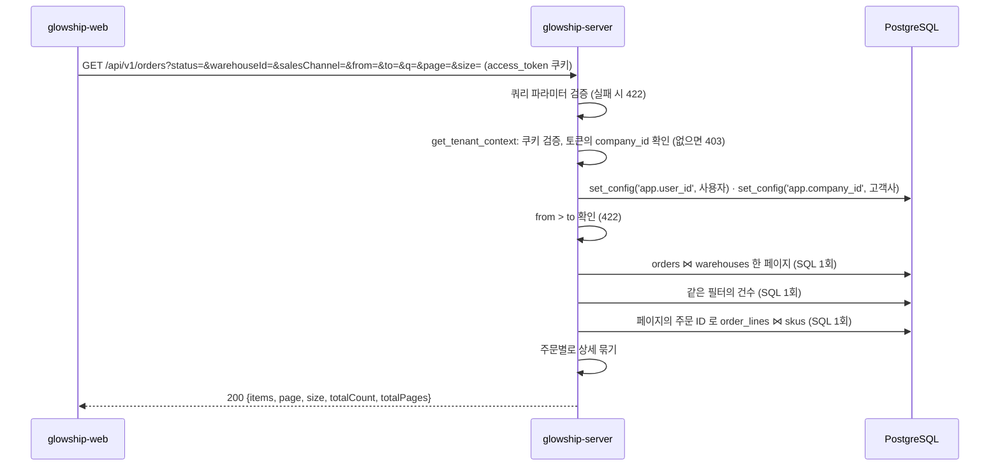

# 주문 목록 조회

고객사 사용자가 "연동 데이터 조회" 화면(SCR-005)의 **주문 탭**에서 보는 주문 목록 API가 **현재 어떻게 동작하는지** 설명합니다.
응답 모양은 API 명세 v6.2 4.3 `GET /orders`와 응답 본문 규칙(`api_response_body_rule_glowship.md`) 5.2(요약 객체)·6절(목록)을 따릅니다. 두 문서는 `glowship-plan` 저장소에 있습니다.
상단 카드와 탭 배지(원천별 `openIssueCount`)는 [동기화 상태 API](../data-sync/latest-sync-status.md), 하단 오류 배너는 `GET /validation-issues`(미구현) 몫입니다.

> 2026-11-03 명세 변경 반영: 기간 필터 `from`·`to`는 **ISO 8601 UTC 시각**이고 범위는 **`[from, to)`**(`to` 미포함)입니다. KST → UTC 변환은 프론트가 합니다(예: KST 6/30 하루 → `from=2026-06-29T15:00:00Z&to=2026-06-30T15:00:00Z`).

## 1. 전체 흐름



- 고객사 범위는 **토큰의 `company_id`** 입니다. OWNER·ADMIN은 소속 고객사가 없어 403입니다.
- `orders`·`order_lines`·`warehouses`·`skus`는 고객사 범위 테이블이라 RLS 컨텍스트를 먼저 설정합니다. 로컬 개발 DB는 슈퍼유저라 RLS를 우회하므로 SQL마다 `company_id` 조건을 직접 겁니다(ERD 설명 4.6).
- 한 페이지에 SQL은 3회(목록·건수·상세)입니다. 상세는 주문 ID 배열로 한 번에 읽어 N+1이 없습니다.

## 2. 조회 API

`GET /api/v1/orders` — `app/modules/order/presentation/order_api_router.py`

### 권한

`access_token` 쿠키가 유효하고 토큰에 `company_id`가 있어야 합니다(`CLIENT_MEMBER`·`CLIENT_LEAD`).

### 쿼리 파라미터

| 이름 | 타입 | 기본값 | 설명 |
| --- | --- | --- | --- |
| `status` | `OPEN`·`PARTIALLY_SHIPPED`·`SHIPPED`·`DELIVERED`·`CANCELLED`·`REMOVED_AT_SOURCE` | 없음 | 주문 상태 |
| `warehouseId` | UUID | 없음 | 출고 창고 |
| `salesChannel` | `AMAZON`·`SEPHORA` | 없음 | 판매 채널 |
| `from` | ISO 8601 UTC 시각 | 없음 | 주문 일시(`orderedAt`) 시작, **포함** |
| `to` | ISO 8601 UTC 시각 | 없음 | 주문 일시 끝, **미포함**. `from > to`면 422. 같으면 0건 |
| `q` | 문자열, 최대 100자 | 없음 | 주문 번호 또는 주문 상품의 SKU 코드·상품명 부분 일치. 대소문자 무시. `%`·`_`는 글자 그대로 찾음. 양끝 공백은 지우고, 비면 없는 것으로 봄 |
| `page` | 정수 ≥ 1 | `1` | 페이지 번호 (`app/core/pagination.py` `PageParams`) |
| `size` | 정수 1~100 | `20` | 페이지 크기 |

- `from`·`to`에 시간대 표시가 없으면 UTC로 보고, 다른 시간대(`+09:00` 등)면 UTC로 맞춰 비교합니다.
- 정렬은 `orderedAt` 최신순, 같으면 `orderId`입니다(명세 4.3). 페이지를 넘겨도 행이 중복·누락되지 않습니다.
- 서버는 기본 기간을 강제하지 않습니다. 고객사 한 곳의 주문이 10만 건을 넘으므로 화면은 기본 기간을 넣어 조회하는 것을 권합니다.

### 성공 응답

```http
HTTP/1.1 200 OK
```

```json
{
  "items": [
    {
      "orderId": "820c3f20-df7f-561e-b6e4-112bd24e8a16",
      "orderCode": "A-ORD-20260630-0177",
      "salesChannel": "AMAZON",
      "customerRegion": "EAST",
      "warehouse": {
        "warehouseId": "02c90be1-ce21-588a-9586-ff76d5176c78",
        "warehouseCode": "WH-EAST",
        "regionCode": "EAST"
      },
      "orderedAt": "2026-06-30T23:31:48Z",
      "promisedDeliveryAt": "2026-07-03T23:59:59Z",
      "status": "OPEN",
      "lines": [
        {
          "lineNo": 1,
          "sku": {
            "skuId": "834d3409-102e-5304-ae32-6ab4607a5d82",
            "skuCode": "SKU-003",
            "productName": "A Glow Hydra Cream 50ml"
          },
          "orderedQuantity": 1,
          "shippedQuantity": 0,
          "lineStatus": "ACTIVE"
        }
      ]
    }
  ],
  "page": 1,
  "size": 20,
  "totalCount": 106983,
  "totalPages": 5350
}
```

| 필드 | 설명 |
| --- | --- |
| `orderId`, `orderCode` | 주문 ID와 화면의 주문 번호 |
| `salesChannel` | `AMAZON`·`SEPHORA` |
| `customerRegion` | `WEST`·`EAST` |
| `warehouse` | 출고 창고 요약 객체(응답 규칙 5.2) |
| `orderedAt`, `promisedDeliveryAt` | 주문 일시, 약속 배송 완료 시각(UTC, `Z`) |
| `status` | 주문 상태 6종. **`OPEN`에는 재고 미확보 주문과 확보 후 출고 대기 주문이 함께 있습니다**(명세 4.3 주의) |
| `lines[]` | 주문 상세. `lineNo` 오름차순, 안쪽 배열이라 페이지 없이 그대로. 상세가 없으면 `[]` |
| `lines[].sku` | 상품 요약 객체 |
| `lines[].orderedQuantity`, `shippedQuantity` | 주문 수량, 출고 수량(0 ~ 주문 수량) |
| `lines[].lineStatus` | `ACTIVE`·`REMOVED_AT_SOURCE` |

### 프론트의 해석

코드값의 화면 표시명은 명세 2절 표를 따르되, 아래 값은 명세 2절에 표시명이 없어 **제안**입니다. 확정되면 명세에 넣습니다.

| 구분 | 코드값 | 표시명(제안) |
| --- | --- | --- |
| 주문 상태 | `OPEN` / `PARTIALLY_SHIPPED` / `SHIPPED` / `DELIVERED` / `CANCELLED` / `REMOVED_AT_SOURCE` | 미출고 / 부분 출고 / 출고 완료 / 배송 완료 / 취소 / 원천 삭제 |
| 상세 상태 | `ACTIVE` / `REMOVED_AT_SOURCE` | 정상 / 원천 삭제 |
| 고객 권역 | `WEST` / `EAST` | 서부 / 동부 |
| 판매 채널 | `AMAZON` / `SEPHORA` | Amazon / Sephora |

- 목록 열은 주문 번호·채널·주문 일시·약속 배송일·출고 창고·고객 권역·상품(첫 SKU 상품명 + "외 N건")·상태를 권합니다. 주문당 상세는 평균 1.5줄, 최대 3줄이라 펼쳐 보기로 충분합니다.
- 원천에서 삭제된 주문(`REMOVED_AT_SOURCE`)도 목록에 나옵니다. 숨기려면 `status` 필터를 씁니다.

### 실패 응답

| 상태 | `code` | 상황 |
| --- | --- | --- |
| `401` | `UNAUTHENTICATED` | 쿠키 없음·만료 |
| `403` | `FORBIDDEN` | 토큰에 `company_id` 없음(OWNER·ADMIN) |
| `422` | `VALIDATION_ERROR` | 허용되지 않은 코드값, 시각 형식 오류, `from > to`, `page < 1`, `size` 범위 밖, `q` 길이 초과 |

응답 규칙 6.1은 범위 오류를 400으로 적지만 "현재 구현은 422"라 다른 목록 API와 같이 422입니다.

## 3. 범위에서 뺀 것 (D8)

명세 4.3의 `securedDate`·`plannedDispatchDate`·`actualDispatchDate`·`expectedDeliveryDate`는 **응답에 없습니다**(키 자체를 넣지 않음).

- 이 4개는 DB에 저장된 열이 아닙니다. ERP 주문 원천이 주는 항목은 `orders`·`order_lines`의 열(주문 번호·채널·권역·창고·주문 일시·약속 배송일·상태, 상품별 주문·출고 수량·상태)뿐이고, 출고가 일어난 사실은 출고 수량 변경(`data_change_records` ORDER_LINE UPDATE)으로만 들어옵니다.
- 명세 D8(1절 61행, 0절 "아직 정할 것")은 변경 기록과 `inventory_daily.reserved`로 서버가 **역산**하는 방식을 제안했지만, 그 규칙의 참조 구현(엔진 `store.py`·`snapshot.py`·`common.py`)이 공유 묶음에 없습니다.
- **백엔드 결정(2026-11-03): 역산하지 않고 원천(ERP)에서 받습니다.** ERP 연동 항목과 `orders` 열에 이 4개 날짜를 추가하는 ERD·수집 계약 변경을 설계 담당·데이터 팀에 요청합니다. 열이 생기면 이 API 는 저장 값을 그대로 읽어 필드를 추가합니다(응답 규칙 7절, 필드 추가는 합의 불필요).
- 그때까지 `null`로 내리지 않는 이유: 명세 4.3 주의 문구가 "`securedDate` 유무로 재고 확보 여부를 구분한다"고 정해, `null`이 "재고 미확보"로 읽히기 때문입니다. 화면은 당분간 `status`만 표시하고, 같은 `OPEN`이라도 재고 확보 여부는 구분하지 못합니다.

행별 검증 상태·"오류만 보기"도 없습니다. 검증 오류로 거부된 주문은 `orders`에 적재되지 않아 행에 붙일 수 없습니다(상품 탭과 다른 점). 오류는 탭 배지와 `GET /validation-issues?domain=ORDER`가 담당합니다.

## 4. SQL

`app/modules/order/infrastructure/repository/order_repository.py`

- 목록·건수가 같은 `filtered` CTE를 씁니다. 필터 값이 `NULL`이면 그 조건은 통과합니다(`CAST(:x AS …) IS NULL OR …`).
- 기간은 `ordered_at >= :ordered_from AND ordered_at < :ordered_to`입니다.
- `q`는 `order_code ILIKE` 또는 `EXISTS(order_lines ⋈ skus WHERE sku_code ILIKE OR product_name ILIKE)`입니다. 패턴의 `\`·`%`·`_`는 이스케이프합니다.
- 상세는 `order_id = ANY(:order_ids)`로 한 번에 읽고 `order_id, line_no` 순입니다.

로컬 DB(고객사 A 주문 106,983건) 실측: 필터 없음 1페이지 약 60ms, 기간 필터 약 15ms, 검색(`q`)은 주문 번호·SKU 코드·상품명 모두 약 440~520ms(상품명 'hydra cream' 18,692건 일치 기준). `orders`에 `(company_id, ordered_at)` 색인, `order_lines`에 `(company_id, sku_id)` 색인이 없어 검색은 순차 스캔입니다. 느려지면 색인 추가를 별도 결정(스키마 변경은 데이터 팀 DDL과 조율)으로 다룹니다.

## 5. 테스트

`tests/modules/order/`

| 파일 | 내용 |
| --- | --- |
| `test_order_api.py` | 401·403, 형식 오류 9종 422, camelCase 응답 모양, 기본값·파라미터 전달, RLS 컨텍스트 |
| `test_order_list_service.py` | 시간대 정규화, `from > to` 422, 검색어 공백, 상세 묶기 |
| `test_order_repository.py` | 가짜 세션으로 SQL 문장·파라미터·행 변환 |
| `test_order_repository_sql_smoke.py` | 실제 DB(읽기 전용): 정렬, 필터별 건수, 주문 번호·SKU 코드·상품명 검색, 상세 소속 |

## 6. 아직 없는 것

- D8 출고 날짜 4개(3절): ERD·수집 계약에 원천 열이 추가된 뒤 별도 티켓
- `GET /validation-issues`(하단 오류 배너)
- 명세 2절의 주문 관련 표시명 확정
- 색인 추가 여부(4절)

## 7. 관련 파일

| 역할 | 파일 |
| --- | --- |
| 라우터 | `app/modules/order/presentation/order_api_router.py` |
| 응답 스키마 | `app/modules/order/presentation/order_schemas.py` |
| 서비스 | `app/modules/order/application/order_list_service.py` |
| 예외 | `app/modules/order/application/exception/order_exceptions.py` |
| 리포지토리 | `app/modules/order/infrastructure/repository/order_repository.py` |
| 코드값 | `app/modules/order/infrastructure/order_enums.py` |
| 의존성 | `app/modules/order/dependencies.py` |
| 공통 | `app/core/pagination.py`, `app/core/summary_schemas.py`, `app/core/security/tenant.py` |
