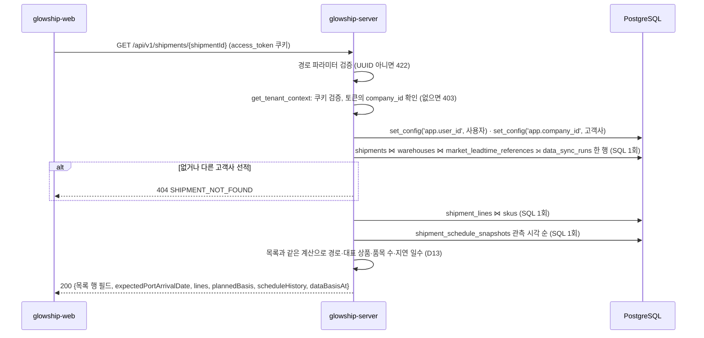

# 선적 상세 조회

고객사 사용자가 "연동 데이터 조회" 화면(SCR-005) 선적 탭에서 선적 하나를 고르면 보는 상세 API가 **현재 어떻게 동작하는지** 설명합니다.
응답 모양은 API 명세 v6.2 4.3 `GET /shipments/{shipmentId}`와 응답 본문 규칙(`api_response_body_rule_glowship.md`)을 따릅니다. 두 문서는 `glowship-plan` 저장소에 있습니다.
목록은 [선적 목록 조회](shipment-list.md)이고, 상세는 **목록 행 필드 전부 + 상세 필드**입니다(명세 4.3 "목록 필드 +"). FR-005 "선적 선택 시 상세 정보와 데이터 기준 시각이 표시된다"(GLOW-14)의 서버 쪽입니다(하위 작업 GLOW-156).

## 1. 전체 흐름



- 고객사 범위는 **토큰의 `company_id`** 입니다. OWNER·ADMIN은 소속 고객사가 없어 403입니다.
- 다른 고객사 선적은 존재 여부를 드러내지 않도록 없는 선적과 같은 404입니다(지연 상세 `DELAY_EVENT_NOT_FOUND`와 같은 방식, 명세 5절 `{리소스}_NOT_FOUND`).

## 2. 응답

```json
{
  "shipmentId": "…", "shipmentCode": "OCN-20260629", "transportMode": "OCEAN", "route": "KR → LOS ANGELES",
  "warehouse": {"warehouseId": "…", "warehouseCode": "WH-WEST", "regionCode": "WEST"},
  "representativeSku": {"skuId": "…", "skuCode": "SKU-001", "productName": "A Glow Hydra Toner Pad 60ea"},
  "skuCount": 21, "stage": "PRE_DEPARTURE",
  "plannedKrReleaseDate": "2026-07-15", "planned3plInboundDate": "2026-08-11",
  "expected3plInboundDate": "2026-08-07", "actual3plInboundDate": null,
  "isDelayed": false, "delayDays": 0,
  "expectedPortArrivalDate": "2026-08-01",
  "lines": [{"lineNo": 1, "sku": {"skuId": "…", "skuCode": "SKU-001", "productName": "A Glow Hydra Toner Pad 60ea"}, "shippedQuantity": 888}],
  "plannedBasis": {"month": "2025-07", "usPortName": "LOS ANGELES, CA", "totalLeadtimeP50": 23.16, "totalLeadtimeP90": 26.41, "confidenceLeadtime": "low"},
  "scheduleHistory": [{"observedAt": "2026-06-30T00:03:20Z", "stage": "PRE_DEPARTURE", "expectedPortArrivalDate": "2026-08-01", "expected3plInboundDate": "2026-08-07"}],
  "dataBasisAt": "2026-06-30T00:03:30Z"
}
```

(로컬 개발 DB 의 실제 선적 하나를 줄인 것. 줄·이력은 일부만.)

| 필드 | 뜻 |
| --- | --- |
| 목록 행 필드 | [선적 목록](shipment-list.md) 2절과 같은 이름·값. 목록 SQL 의 열·조인 조각과 목록 서비스의 계산(`_build_item`)을 그대로 써서 두 API 의 같은 칸이 어긋나지 않음 |
| `expectedPortArrivalDate` | 현재 예상 항구 도착일(`shipments.current_expected_port_arrival_date`). 3PL 입고일과 다른 날짜(BR-007). 값이 없으면 `null` |
| `lines[]` | 상세 줄 전부, 줄 번호 순. `sku` 는 공통 상품 요약 `{skuId, skuCode, productName}` |
| `plannedBasis` | 계획 3PL 입고일을 정한 시장 리드타임 기준(`market_leadtime_references`): 기준 달, 도착 항구 이름(표의 값 그대로, 예 `LOS ANGELES, CA`), 총 리드타임 p50·p90(일, JSON 숫자), 신뢰도(원천 값 그대로) |
| `scheduleHistory[]` | 일정 관측 전부(`shipment_schedule_snapshots`). **관측 시각 오래된 순**, 같으면 관측 ID 순. 관측이 없는 선적은 `[]`(로컬 개발 DB 선적 166건 중 104건) |
| `dataBasisAt` | 데이터 기준 시각 = 이 선적 행을 마지막으로 바꾼 수집(`shipments.data_sync_run_id`)의 **종료 시각**(`finished_at`) |

## 3. 명세에 없어 정한 것

| 정한 것 | 이유 |
| --- | --- |
| `dataBasisAt` = 수집 종료 시각(`finished_at`) | 명세는 "`data_sync_run_id`의 수집 시각"뿐. 분석 상세 `dataBasisAt`(사용한 수집 중 가장 오래된 `finished_at`)과 수집 현황·대시보드 `lastSyncedAt`(`finished_at`)이 모두 종료 시각이라 같은 이름은 같은 뜻으로. 이름은 응답 본문 규칙 "데이터 기준 시각 = `dataBasisAt`" |
| 이력은 오래된 순 | 명세는 "관측 시각별"뿐이고 화면 시안·화면 지도에 순서가 없음. 이력을 시간 흐름대로 읽게. 화면이 최신순을 원하면 뒤집기만 하면 됨 |
| 이력을 가상 시각으로 거르지 않음 | 목록도 거르지 않음. 시연 DB 는 가상 시각까지만 적재 |
| 404 코드 `SHIPMENT_NOT_FOUND` | 명세 5절 `{리소스}_NOT_FOUND` 규칙 |
| 경로 파라미터 이름 `shipment_id` | 지연 상세(`/delay-events/{delay_event_id}`)와 같은 서버 관례. URL 모양은 명세와 같음 |

## 4. SQL

`app/modules/shipment/infrastructure/repository/shipment_repository.py`

- 목록과 상세가 같은 열·조인 조각(`_SHIPMENT_COLUMNS`·`_SHIPMENT_JOINS`)을 씁니다. 목록 SQL 은 조각으로 나눈 뒤에도 공백을 빼면 전과 한 글자도 다르지 않음을 확인했습니다(11-15).
- 상세 한 행은 그 조각에 항구 도착일·기준 열과 `data_sync_runs`(복합 FK `(company_id, data_sync_run_id)`, `LEFT JOIN`)의 `finished_at`을 더하고 `company_id`·`shipment_id` 로 고릅니다.
- 상세 줄은 목록과 같은 `find_lines`, 이력은 `ORDER BY observed_at, shipment_schedule_snapshot_id`.
- 로컬 DB(선적 166건·관측 223건·상세 3,192줄, SQL 로그 켜짐) 실측: 관측이 가장 많은 선적(6건) 기준 중앙값 상세 한 행 1.8ms, 상세 줄 1.6ms, 이력 1.3ms. 색인 추가 없음.

## 5. 테스트

`tests/modules/shipment/`

| 파일 | 내용 |
| --- | --- |
| `test_shipment_detail_api.py`(DB 없음, 서비스 가짜) | 401, OWNER·ADMIN 403, UUID 아님 422, 404 `SHIPMENT_NOT_FOUND`, 토큰 고객사·경로 선적 전달과 RLS 먼저, camelCase 응답 모양(목록 필드·`3pl` 별칭·요약 객체·숫자로 나가는 p50·p90·이력·`dataBasisAt`) |
| `test_shipment_detail_sql.py`(실제 DB, 롤백) | 관측 둘 이상인 선적으로 — 목록 행과 같은 칸이 같음, 항구 도착일·계획 근거·`dataBasisAt`(= 그 수집 `finished_at`)이 원천 표 값과 같음, 상세 줄 전부(줄 번호·상품·수량이 원천과 같음, 줄 번호 순), 이력 전부(관측 시각·단계·두 날짜가 원천과 같음, 오래된 순), 관측이 없는 선적은 빈 이력, 다른 고객사·없는 선적 404 |

시험이 실패를 잡는지 변이 8종으로 확인(모두 잡힘): 상세 고객사 조건 뺌, 이력 순서 뒤집음, `dataBasisAt`을 `started_at`으로, 항구 도착일을 `NULL`로, 없는 선적에 404 안 냄, 목록 계산에 상세 줄 안 넘김, 기준 숫자를 문자열로, 이력 한 건만. "이력 SQL 의 고객사 조건 뺌"은 선적 ID 가 고객사를 넘어 고유해서 결과가 같아(동치 변이) 넣지 않았습니다.

push 전 점검에서 변이 12종을 더 넣었습니다: 이력·상세 SQL 의 선적 조건 뺌, 상세 줄 비움, 이력 `expected3plInboundDate` 별칭 뺌, p50 에 p90, `dataBasisAt`을 고객사 최신 수집으로, `dataBasisAt`을 `null`로, 이력 동점 정렬 기준 뺌, 이력 항구 도착일을 `null`로, 이력 단계 고정, 줄 수량 0, 이력 3PL 입고일에 항구 도착일. 처음에는 이력·상세 줄의 **값**을 바꾼 4종을 잡지 못했습니다(실제 DB 시험이 건수·순서만 봄). 값까지 원천과 비교하게 고친 뒤 11종을 잡습니다. 남은 1종(이력 동점 정렬 기준 뺌)은 로컬 DB 에 관측 시각이 같은 관측이 없어 시험으로 확인하지 못했습니다(유일 제약은 `(shipment_id, data_sync_run_id)`라 같은 시각이 생길 수는 있음).

## 6. 관련 파일

| 역할 | 파일 |
| --- | --- |
| 라우터 | `app/modules/shipment/presentation/shipment_api_router.py` (`get_shipment`) |
| 응답 스키마 | `app/modules/shipment/presentation/shipment_schemas.py` (`ShipmentDetailResponse`) |
| 서비스 | `app/modules/shipment/application/shipment_detail_service.py` |
| 오류 코드 | `app/modules/shipment/application/exception/shipment_exceptions.py` |
| 리포지토리 | `app/modules/shipment/infrastructure/repository/shipment_repository.py` (`find_detail`·`find_history`) |
| 의존성 | `app/modules/shipment/dependencies.py` |
