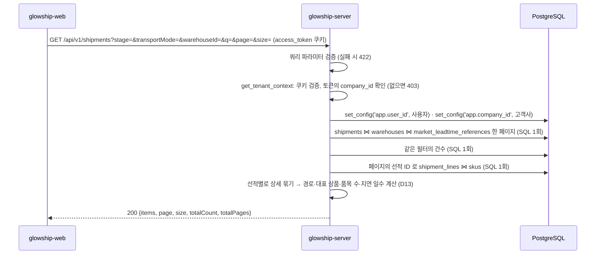

# 선적 목록 조회

고객사 사용자가 "연동 데이터 조회" 화면(SCR-005)의 **선적 탭**에서 보는 선적 목록 API가 **현재 어떻게 동작하는지** 설명합니다.
응답 모양은 API 명세 v6.2 4.3 `GET /shipments`와 응답 본문 규칙(`api_response_body_rule_glowship.md`) 5.2(요약 객체)·6절(목록)을 따릅니다. 두 문서는 `glowship-plan` 저장소에 있습니다.
상단 카드와 탭 배지(원천별 `openIssueCount`)는 [동기화 상태 API](../data-sync/latest-sync-status.md), 하단 오류 배너는 `GET /validation-issues`(미구현) 몫입니다.

> 명세 4.3 필드에 **`route`·`representativeSku`·`skuCount`·`delayDays`** 4개를 더했습니다(응답 규칙 7절: 필드 추가는 자유). 명세 4.5가 분석 상세의 선적 표시값을 "4.4 지연 목록과 같은 계산 함수(D13)로 만든다"고 하므로, 같은 선적을 보여 주는 이 목록도 지연 목록의 계산 함수(`app/modules/delay_analysis/application/delay_display.py`)를 그대로 씁니다. 명세에 없는 필터·링크 필드는 넣지 않았습니다(3절).

## 1. 전체 흐름



- 고객사 범위는 **토큰의 `company_id`** 입니다. OWNER·ADMIN은 소속 고객사가 없어 403입니다.
- `shipments`·`shipment_lines`·`warehouses`·`skus`는 고객사 범위 테이블이라 RLS 컨텍스트를 먼저 설정합니다. `market_leadtime_references`는 고객사 구분이 없는 공용 기준표(RLS 없음)입니다. 로컬 개발 DB는 슈퍼유저라 RLS를 우회하므로 SQL마다 `company_id` 조건을 직접 겁니다(ERD 설명 4.6).
- 한 페이지에 SQL은 3회(목록·건수·상세 줄)입니다. 상세 줄은 페이지의 선적 ID 배열로 한 번에 읽어 N+1이 없습니다.

## 2. 조회 API

`GET /api/v1/shipments` — `app/modules/shipment/presentation/shipment_api_router.py`

### 권한

`access_token` 쿠키가 유효하고 토큰에 `company_id`가 있어야 합니다(`CLIENT_MEMBER`·`CLIENT_LEAD`).

### 쿼리 파라미터

| 이름 | 타입 | 기본값 | 설명 |
| --- | --- | --- | --- |
| `stage` | `PRE_DEPARTURE`·`AT_SEA`·`IN_AIR`·`AT_PORT`·`RECEIVED` | 없음 | 현재 운송 단계(`shipments.current_stage`) |
| `transportMode` | `OCEAN`·`AIR` | 없음 | 운송 수단 |
| `warehouseId` | UUID | 없음 | 도착 창고(미국 3PL) |
| `q` | 문자열, 최대 100자 | 없음 | 선적 코드 부분 일치. 대소문자 무시. `%`·`_`는 글자 그대로 찾음. 양끝 공백은 지우고, 비면 없는 것으로 봄. **SKU 코드·상품명은 찾지 않음**(명세 4.3은 `q(선적 코드)`) |
| `page` | 정수 ≥ 1 | `1` | 페이지 번호 (`app/core/pagination.py` `PageParams`) |
| `size` | 정수 1~100 | `20` | 페이지 크기 |

- 정렬은 `planned3plInboundDate` 최신순, 같으면 `shipmentId`입니다(명세 4.3). 진행 중 선적이 위, 오래된 입고 완료가 아래에 옵니다. 페이지를 넘겨도 행이 중복·누락되지 않습니다.
- 합성 데이터는 입고 완료가 대부분입니다(고객사 A 85건 중 80건). 진행 중만 보려면 `stage`로 거릅니다.
- 상품으로 선적을 찾는 요구는 지연 목록 `GET /delay-events`의 `q`(선적 코드·SKU 코드·상품명)가 맡습니다.

### 성공 응답

```http
HTTP/1.1 200 OK
```

```json
{
  "items": [
    {
      "shipmentId": "f009db42-6256-5e11-9a15-1a28995bb5cf",
      "shipmentCode": "OCN-20260601",
      "transportMode": "OCEAN",
      "route": "KR → LOS ANGELES",
      "warehouse": {
        "warehouseId": "184d78f2-de76-531f-80d2-8eb5ad642178",
        "warehouseCode": "WH-WEST",
        "regionCode": "WEST"
      },
      "representativeSku": {
        "skuId": "f4a3001a-c9d6-5e07-b641-066f2a70f810",
        "skuCode": "SKU-001",
        "productName": "A Glow Hydra Toner Pad 60ea"
      },
      "skuCount": 20,
      "stage": "AT_SEA",
      "plannedKrReleaseDate": "2026-06-17",
      "planned3plInboundDate": "2026-07-12",
      "expected3plInboundDate": "2026-07-06",
      "actual3plInboundDate": null,
      "isDelayed": false,
      "delayDays": 0
    }
  ],
  "page": 1,
  "size": 20,
  "totalCount": 85,
  "totalPages": 5
}
```

입고 완료 뒤 늦게 들어온 선적의 예(로컬 DB `OCN-20251229`): `"stage": "RECEIVED"`, `"planned3plInboundDate": "2026-02-11"`, `"expected3plInboundDate": "2026-02-13"`, `"actual3plInboundDate": "2026-02-13"`, `"isDelayed": true`, `"delayDays": 2`.

| 필드 | 설명 |
| --- | --- |
| `shipmentId`·`shipmentCode` | 선적 ID와 화면의 선적 코드. 상세 API(`GET /shipments/{shipmentId}`, 미구현)의 경로 값 |
| `transportMode` | `OCEAN`(해상)·`AIR`(항공). 명세 2절에 표시명이 없어 해상·항공을 권함 |
| `route` | **추가 필드.** "KR → LOS ANGELES" 형식(명세 D13). 출발은 고객사의 한국 출고 창고(`KR_ORIGIN`) 지역, 도착은 선적이 가리키는 시장 리드타임 기준의 항구 이름(`us_port_name`, 주 약칭 제외). 지연 목록의 `route`와 같은 함수 |
| `warehouse` | 도착 창고 요약 객체. `regionCode` 표시명은 명세 2절(`WEST` 서부(LA)·`EAST` 동부(NJ)·`KR` 한국) |
| `representativeSku` | **추가 필드.** 선적에서 수량이 가장 많은 SKU, 같으면 상세 줄 번호가 작은 SKU(지연 목록과 같은 규칙). 상세 줄이 없으면 `null` |
| `skuCount` | **추가 필드.** 선적에 실린 서로 다른 SKU 수. 상세 줄이 없으면 0. 화면은 "SKU-001 외 19종"처럼 표시 |
| `stage` | 현재 운송 단계. 표시명은 명세 2절(출항 전·해상 운송·항공 운송·항구 도착·통관 중·입고 완료) |
| `plannedKrReleaseDate` | 한국 창고 계획 출고일 |
| `planned3plInboundDate` | 계획 3PL 입고일. 계획 출고일 + 올림(시장 리드타임 p90)으로 새 선적 적재 때 한 번 정한 값([수집 적재](../data-sync/ingest.md) 3절). 목록 정렬 기준 |
| `expected3plInboundDate` | 현재 예상 3PL 입고일(`shipments.current_expected_3pl_inbound_date`). 입고 완료 뒤에는 실제 입고일과 같은 값 |
| `actual3plInboundDate` | 실제 3PL 입고일. 입고 전이면 `null`. `stage = RECEIVED`면 항상 값이 있음(ERD `shipments_ck3`) |
| `isDelayed` | 지연 여부 = `delayDays > 0`. **대시보드 지연 선적(명세 4.4 C22, 열린 에피소드만)과 다른 기준**(아래) |
| `delayDays` | **추가 필드.** `max(0, 기준값 − planned3plInboundDate)` 일수. 기준값은 **입고 전이면 예상 입고일, 입고 완료면 실제 입고일**(아래) |

### 지연 판정 기준

서비스 플로우 1절은 입고 전의 "지연 위험 감지"(예상 입고일 > 계획 입고일)와 입고 후의 "사후 성과 평가"(실제 입고일 > 계획 입고일)를 구분합니다. 대시보드 정시 입고율(명세 4.4)도 입고 완료 선적을 `actual ≤ planned`로 셉니다. 이 목록은 두 경우를 한 필드로 보여 주기 위해 `coalesce(actual3plInboundDate, expected3plInboundDate)`를 기준값으로 씁니다. `RECEIVED ⇔ actual 있음`(ERD `ck3`)이라 입고 전에는 예상일, 입고 후에는 실제일이 자동으로 선택됩니다. 회복되어 기준값이 계획일 이내면 `delayDays`는 0이고 `isDelayed`는 `false`입니다. 명세 4.3에는 `isDelayed`의 정의가 없어 이렇게 정했습니다.

**대시보드의 "지연 선적"과 다릅니다.** 명세 4.4 `GET /dashboard/summary`의 `delayedShipmentCount`는 C22(2026-11-04)로 **열린 에피소드**(`delay_events.closed_at` 없음)만 세고, 입고·회복으로 닫힌 에피소드는 지연 선적이 아닙니다. 이 목록의 `isDelayed`는 선적 자체의 일정 비교라서 **입고 완료 선적의 지연 입고도 `true`**이고, 에피소드가 열렸는지는 보지 않습니다. 그래서 두 숫자는 같지 않습니다.

| 로컬 DB 고객사 A(2026-11-04) | 건수 |
| --- | --- |
| 이 목록 `isDelayed: true` | 12건(모두 입고 완료, 입고 전 0건) |
| 열린 에피소드가 있는 선적(대시보드 지연 선적) | 0건 |

열린 에피소드 기준으로 바꾸지 않은 이유: 선적 탭은 입고 전의 지연 위험과 입고 후의 사후 평가를 한 열로 보여 주는 곳이고, 열린 에피소드만 세면 입고 완료 선적의 늦은 입고가 모두 "정상"으로 보입니다. 열린 에피소드 수는 대시보드 KPI와 지연 대응 센터(`GET /delay-events`)의 몫입니다. 프론트가 두 화면의 숫자를 이어서 보여 주려면 아래 "프론트의 해석"처럼 문구를 나눕니다.

### 프론트의 해석

- 목록 열은 선적 코드·운송·경로·도착 창고·대표 상품(외 N종)·단계·계획 출고·계획 입고·예상 입고·실제 입고·지연을 권합니다.
- 지연 열은 `isDelayed`가 참이면 "지연 N일"(`delayDays`), 거짓이면 "정상"으로 표시합니다. 대시보드 지연 선적 수와 함께 보여 주는 화면이라면 **입고 전(`actual3plInboundDate` null)은 "지연 위험", 입고 완료는 "지연 입고"**로 문구를 나눠, 입고 완료 선적의 `true`가 대시보드의 지연 선적(열린 에피소드)으로 읽히지 않게 합니다.
- 지연 대응 센터로 넘어가려면 `GET /delay-events?q={shipmentCode}`로 같은 선적의 지연을 찾습니다. 이 목록에는 지연 이벤트 링크 필드가 없습니다(3절).
- 상품 탭과 달리 행별 검증 상태 열이 없습니다. 검증 오류로 거부된 선적은 적재되지 않아 목록에 없습니다.

### 실패 응답

| 상태 | `code` | 상황 |
| --- | --- | --- |
| `401` | `UNAUTHENTICATED` | 쿠키 없음·만료 |
| `403` | `FORBIDDEN` | 토큰에 `company_id` 없음(OWNER·ADMIN) |
| `422` | `VALIDATION_ERROR` | `stage`·`transportMode`가 허용값 밖, UUID 형식 오류, `page < 1`, `size` 범위 밖, `q` 길이 초과 |

응답 규칙 6.1은 범위 오류를 400으로 적지만 "현재 구현은 422"라 다른 목록 API와 같이 422입니다.

## 3. 명세와 다른 점·넣지 않은 것

| 항목 | 결정 | 근거 |
| --- | --- | --- |
| `route`·`representativeSku`·`skuCount`·`delayDays` | 추가 | 응답 규칙 7절(필드 추가 자유), 명세 4.5(선적 표시값은 D13 함수 공유). 설계 담당에게 명세 4.3 반영을 요청합니다 |
| 열린 지연 이벤트 링크 필드(`openDelayEvent` 등) | 넣지 않음 | 응답 규칙 5.2 요약 객체 표에 없는 새 모양이라 설계 담당이 표를 먼저 고쳐야 합니다. 현재 합성 데이터는 열린 에피소드가 0건입니다 |
| `isDelayed`를 열린 에피소드 기준으로 | 바꾸지 않음 | 대시보드 지연 선적(C22)은 열린 에피소드만 세지만, 선적 탭은 입고 완료 선적의 지연 입고도 보여 줘야 합니다(2절 "지연 판정 기준"). 차이는 문서에 적고 설계 담당에게 명세 4.3 반영을 요청합니다 |
| `isDelayed=true` 필터 | 넣지 않음 | 명세 4.3의 필터는 `stage`·`transportMode`·`warehouseId`·`q`뿐입니다. 지연 선적을 모아 보는 곳은 지연 대응 센터입니다 |
| `q`의 SKU 검색 | 넣지 않음 | 명세 4.3이 `q(선적 코드)`입니다. 주문 탭의 SKU 검색은 명세 자체가 `q(주문 번호·SKU)`였기 때문입니다 |
| `expectedPortArrivalDate`·`lines[]`·`plannedBasis`·`scheduleHistory[]`·데이터 기준 시각 | 상세 API 몫 | 명세 4.3 `GET /shipments/{shipmentId}`(미구현, 별도 티켓) |

## 4. SQL

`app/modules/shipment/infrastructure/repository/shipment_repository.py`

- 목록·건수가 같은 `filtered` CTE를 씁니다. 필터는 값이 `NULL`이면 통과합니다(`CAST(:x AS …) IS NULL OR …`).
- `shipments ⋈ warehouses`(도착 창고) `⋈ market_leadtime_references`(항구 이름)이고, 경로 출발지는 지연 목록 SQL과 같은 서브쿼리(`warehouse_type = 'KR_ORIGIN'` 창고의 `region_code`, 없으면 서비스가 `KR`)입니다.
- `q`는 `shipment_code ILIKE`이고 패턴의 `\`·`%`·`_`는 이스케이프합니다.
- 상세 줄은 `shipment_lines ⋈ skus`를 페이지의 선적 ID 배열(`= ANY(:shipment_ids)`)로 한 번에 읽습니다(선적당 1~30줄).

로컬 DB(고객사 A, 선적 85건·상세 1,825줄) 실측: 목록 1페이지 0.5ms, 한 페이지(20건)의 상세 줄 3ms. 기존 색인으로 충분해 색인 추가는 없습니다.

## 5. 테스트

`tests/modules/shipment/`

| 파일 | 내용 |
| --- | --- |
| `test_shipment_api.py` | 401·403, 형식 오류 8종 422, camelCase 응답 모양(요약 객체·`3pl` 별칭), 상세 없는 선적의 `null`·0, 기본값·파라미터 전달, RLS 컨텍스트 |
| `test_shipment_list_service.py` | 필터·페이지 전달, 검색어 공백, 행 변환, 경로 출발지 기본값, 대표 상품 규칙(최다 수량·동률은 줄 번호·상세 없음), 선적별 상세 분배, 지연 판정 경계 7종(입고 전 예상일·입고 후 실제일·회복 0) |
| `test_shipment_repository.py` | 가짜 세션으로 목록·건수·상세 SQL과 파라미터, 행 변환, 건수 `None → 0`, 빈 ID 배열이면 조회 없음, LIKE 이스케이프 |
| `test_shipment_repository_sql_smoke.py` | 실제 DB(읽기 전용): 정렬 규칙, 범위 밖 페이지, `RECEIVED ⇔ actual 있음`, 필터 건수 일관성, 상세 줄 수 = `shipment_lines` 건수·줄 번호 순 |

## 6. 아직 없는 것

- `GET /shipments/{shipmentId}`(상세: 상세 줄·계획 근거·일정 변경 이력·데이터 기준 시각)
- `GET /validation-issues`(하단 오류 배너)
- 명세 4.3 `GET /shipments`에 추가 필드 4개와 `isDelayed` 정의(대시보드 지연 선적 C22와 다른 기준임을 포함) 반영(설계 담당 확인 뒤)

## 7. 관련 파일

| 역할 | 파일 |
| --- | --- |
| 라우터 | `app/modules/shipment/presentation/shipment_api_router.py` |
| 응답 스키마 | `app/modules/shipment/presentation/shipment_schemas.py` |
| 서비스 | `app/modules/shipment/application/shipment_list_service.py` |
| 리포지토리 | `app/modules/shipment/infrastructure/repository/shipment_repository.py` |
| 코드값 | `app/modules/shipment/infrastructure/shipment_enums.py` |
| 의존성 | `app/modules/shipment/dependencies.py` |
| ORM | `app/modules/shipment/infrastructure/shipment.py`, `shipment_line.py` |
| 표시값 계산(공유) | `app/modules/delay_analysis/application/delay_display.py` |
| 공통 | `app/core/pagination.py`, `app/core/summary_schemas.py`, `app/core/security/tenant.py` |
